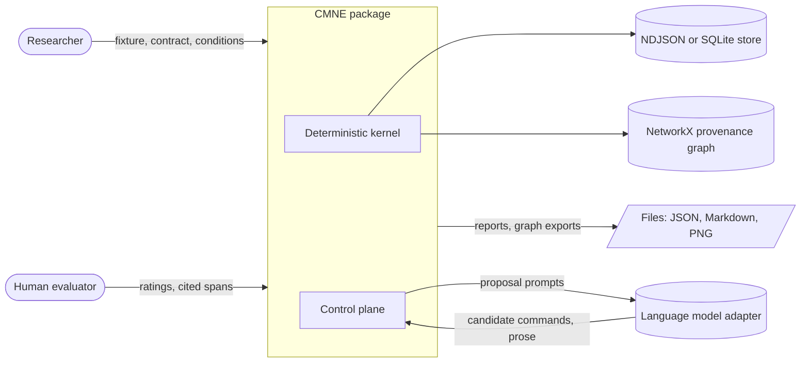
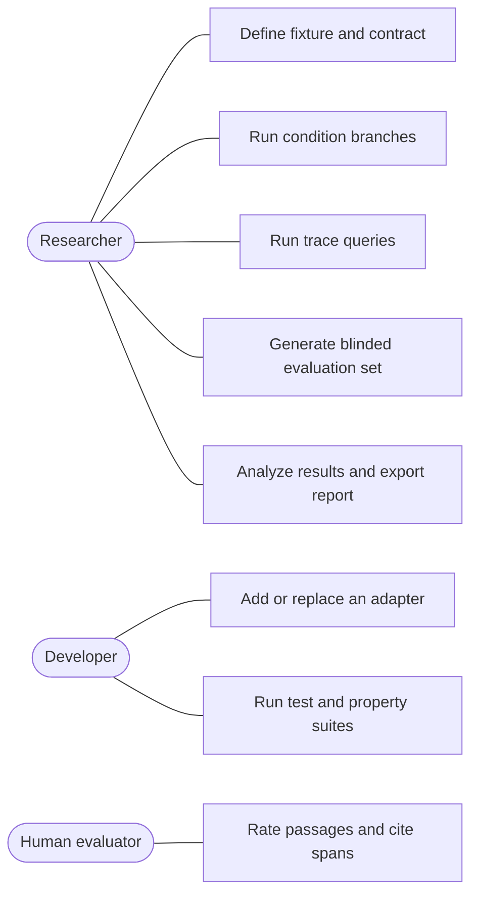
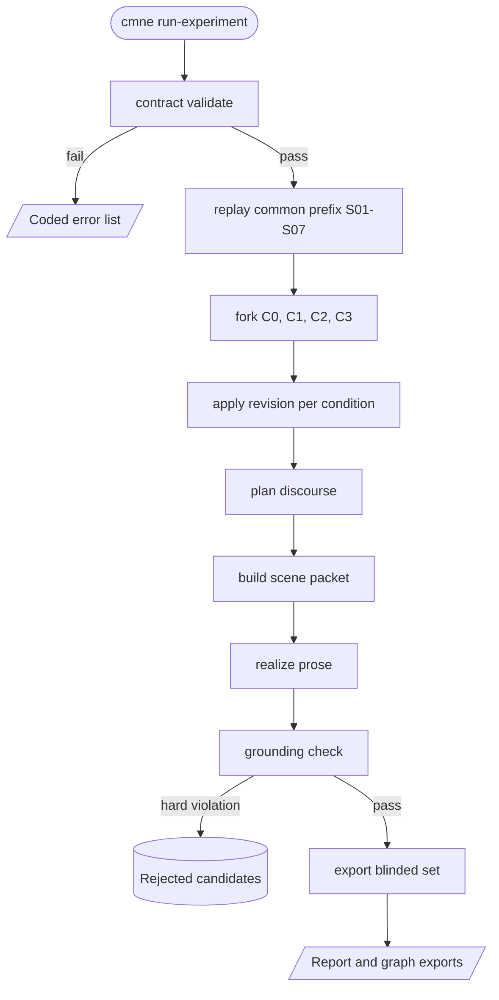
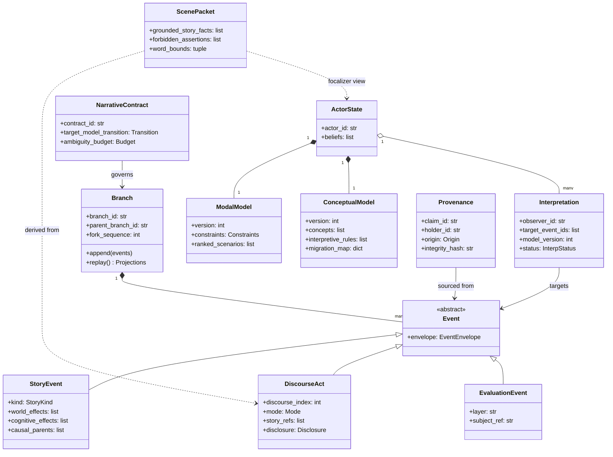
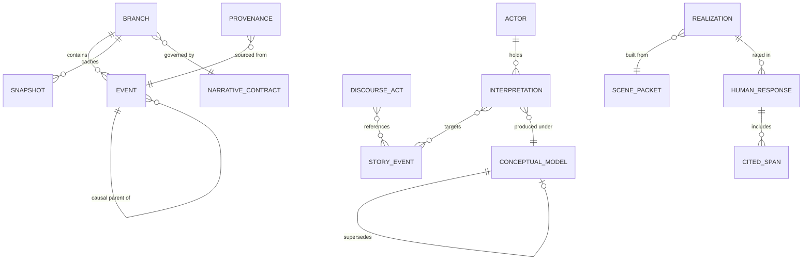
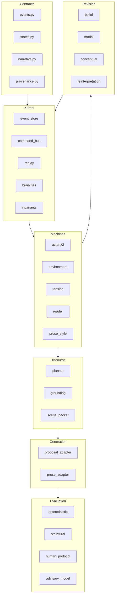
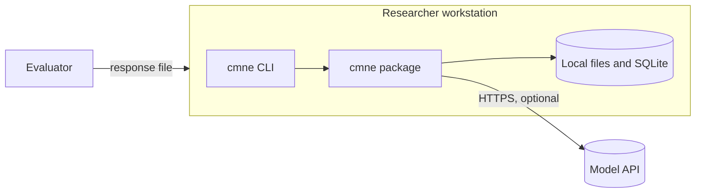
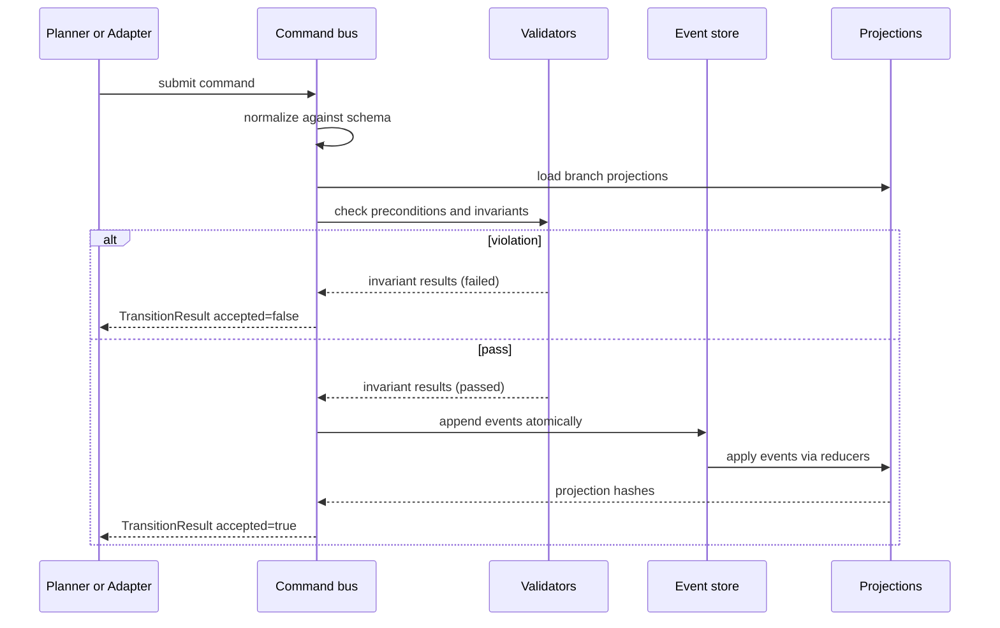
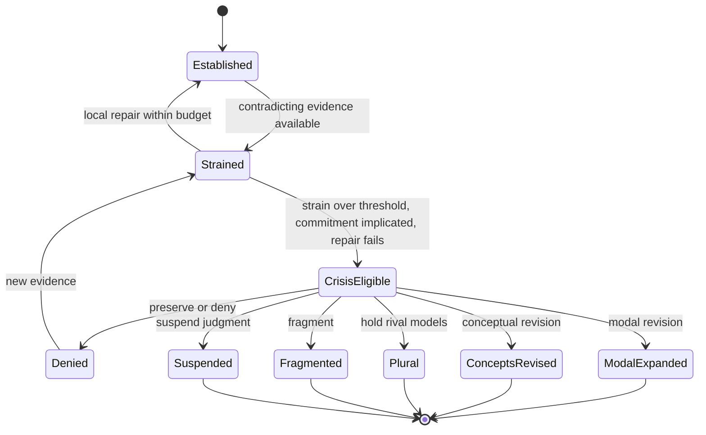
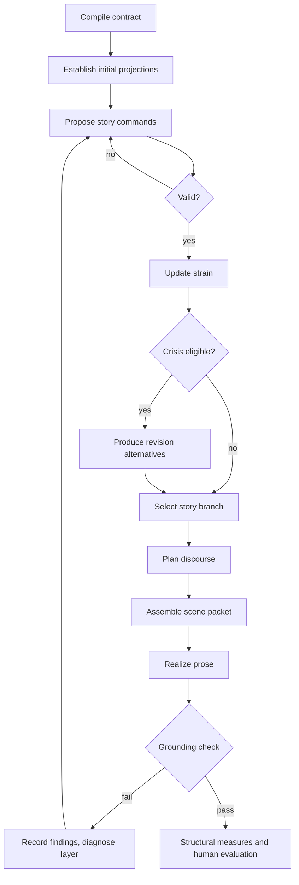

# Software Requirements Specification: Coupled Modal Narrative Engine (CMNE)

| Field | Value |
|---|---|
| Document ID | SRS-033 |
| Title | Coupled Modal Narrative Engine (Modal Generator) |
| Version | 0.2 requirements baseline; implementation note 0.3 |
| Date | 2026-10-19 |
| Author | Matt Briggs, Final State Press |
| Status | Requirements target with a dated implementation checkpoint |
| Standard | IEEE 830-style structure |
| Source material | *Conceptual Architecture and Minimal Implementation Foundation* v0.1; *Coupled Modal Narrative Engine: Feedback* (review of precedents and design notes); *2026.10.18-[F] - Modal Work* (OneNote export, 12 pages); *SRS-033-A System Assessment and Scenarios*; *SRS-033-V GUI Visual Language* |

### Revision history

| Version | Date | Change |
|---|---|---|
| 0.1 | 2026-10-19 | First draft from the Architecture, Feedback, and OneNote export. |
| 0.2 | 2026-10-19 | Added users and scenarios (SRS-033-A). Added a desktop workbench with a visual-language graph editor (GUI-001 to GUI-040; SRS-033-V). Closed review findings F-01 to F-26: formula language, deterministic hashing and IDs, project lock, record/replay, budgets, untrusted-input rules, error catalog, voice profile, motif ledger, analysis plan, and protocol versioning (REQ-147 to REQ-166). Added Appendix A (theory traceability) and Appendix B (plain-language glossary). |
| 0.3 note | 2026-10-19 | Recorded the working Tauri/React/Python foundation and its unimplemented SRS targets. Requirement and acceptance-criterion text remains the v0.2 baseline. |

### Implementation checkpoint (2026-10-19)

The repository now contains a runnable local workbench, Python sidecar, and Mara/Len sample. See [SRS-033 Implementation Status](SRS-033-Implementation-Status.md) for the current architecture, feature coverage, source paths, and verification evidence. The requirements below remain the **intended release behavior**; they are not a claim that each feature or AC-01–AC-42 has passed.

The delivered foundation covers local JSON projects, hashed NDJSON story/discourse streams, deterministic replay into six basic projections, a bounded formula AST, drafts and branch forks, seven graph lenses, offline template realization, basic checks, and Markdown report export. C0–C3 run as separate branches after a shared S01–S07 prefix. The current run is synchronous, and the Pipeline lens displays the result after completion. The sample's word bounds are **0–1100**, so the 700–1100-word study requirement is still open.

The full revision operators, provenance graph, model adapter/record-replay pipeline, comprehensive grounding and voice checks, blinded evaluation, and most release gates remain to implement. The diagrams and schema examples in §§6–8 show the target architecture where they differ from the code. A basic automated suite, frontend build, Rust check, unsigned macOS bundle, and bundled-sidecar smoke have passed; the complete acceptance suite, packaged GUI, accessibility, cross-platform, and study checks have not been verified.

---

## 1. Introduction

### 1.1 Purpose

This document specifies the requirements for the Coupled Modal Narrative Engine (CMNE), a Python system that simulates a short fictional scene as coupled state machines, plans how the scene is disclosed to a reader, and constrains a language model to realize that plan as prose.

The document serves three audiences:

- The developer who implements the engine.
- The researcher who runs the bounded epiphany experiment and writes the white paper.
- The reviewer who needs to confirm that every requirement can be tested.

### 1.2 Scope

CMNE is a research instrument. It tests one hypothesis: a literary epiphany is often a crisis in an interpretive model, not only the receipt of a new fact. The first release supports one bounded experiment (two actors, one kitchen, 8–10 story events, 700–1,100 words of prose) and four experimental conditions (C0–C3).

CMNE does the following:

- Stores story, discourse, and evaluation events in append-only logs.
- Replays those logs deterministically into six state-machine projections.
- Validates proposed commands against hard invariants.
- Represents belief, modal, and conceptual revision, and retrospective reinterpretation.
- Plans discourse and assembles a read-only scene packet.
- Calls a replaceable language-model adapter to realize prose, then checks the prose against the packet.
- Computes structural measures and records human evaluation data.

CMNE does not do the following (see also section 2.7):

- Generate novels or long-form plots.
- Simulate general human cognition or emotion.
- Certify that a passage is artistically successful.
- Let a language model commit canonical story facts.

### 1.3 Definitions, acronyms, and abbreviations

| Term | Definition |
|---|---|
| Actor A, Actor B | The two character machines. In the first experiment, Mara (A) and Len (B). |
| Ambiguity budget | The contract's list of claims that must be clear and questions that must remain open. |
| Branch | A named, isolated continuation of an event log that shares a prefix with other branches. |
| Command | A requested state transition. Commands are validated; only accepted commands become events. |
| Conceptual model | A versioned set of concepts and interpretive rules an observer uses to make events intelligible. |
| Control plane | Planning, candidate generation, validation, selection, realization, and evaluation. |
| Data plane | Immutable event logs and deterministic projections. |
| Discourse act | A record of how story material is presented: order, mode, focalizer, disclosure, and salience. |
| Epiphany candidate | A structural state that meets the criteria in REQ-052. It is not a certified literary epiphany. |
| Event | An immutable, validated record in the story, discourse, or evaluation stream. |
| Focalizer | The actor through whom the prose perceives the scene. |
| Interpretation | An observer-relative record that assigns meaning to one or more events under a model version. |
| Model crisis | A state in which an observer's strain exceeds the contract threshold and ordinary repair fails. |
| Modal model | An observer's constraints (necessary, impossible, contingent) and ranked scenarios. |
| Projection | State derived by folding events through a versioned reducer. |
| Provenance record | A traceable answer to who holds a claim, what it is about, what supports it, which model produced it, and when it became available. |
| Scene packet | The frozen, read-only input to the prose realizer. |
| Strain | A heuristic score of how poorly a model accommodates accumulated evidence. |
| Story timeline | Chronology and causality of fictional events. |
| Discourse timeline | Order, duration, viewpoint, and information policy of presentation. |
| SRS | Software Requirements Specification. |

### 1.4 References

1. *Coupled Modal Narrative Engine: Conceptual Architecture and Minimal Implementation Foundation*, working architecture v0.1 (hereafter the *Architecture*).
2. *Coupled Modal Narrative Engine: Feedback* (hereafter the *Feedback*), which reviews Ryan, Doležel, Bremond, Herman, Phelan, Mateas and Stern, and Riedl and Young, and develops the modal-logic extension.
3. *2026.10.18-[F] - Modal Work* (hereafter the *OneNote export*), which records the implementation stack decision (Python, NetworkX, a frontier model) and white-paper plans.
4. IEEE Std 830-1998, *Recommended Practice for Software Requirements Specifications*.
5. *SRS-033-A: CMNE System Assessment, Scenarios, and UML* (users, empathy maps, scenarios, UML, findings F-01 to F-26, guide diagrams).
6. *SRS-033-V: CMNE GUI Visual Language and Graph Workbench* (node and edge grammar, lenses, overlays, React design).
7. *SRS-033 Implementation Plan* v0.2.
8. *SRS-033-R: Package Review and Scorecard* (rubric and scores).

### 1.5 Document conventions

- **shall** marks a mandatory requirement. **should** marks a recommended requirement. **may** marks an option.
- Requirement IDs use the form `REQ-nnn` and never change once assigned. A retired ID is not reused.
- Priority uses MoSCoW: **M** (must), **S** (should), **C** (could). Priority applies to the first milestone set (section 3.13).
- Invariants keep the `INV-nn` IDs from the Architecture. Acceptance criteria use `AC-nn`.
- Narrative terms (for example, *care* and *avoidance*) are fixture content, not system vocabulary.
- Example data uses the Mara and Len fixture. The Architecture's Eleanor example is retired.
- Fractional quantities (confidence, plausibility, desirability, reliability, and weights) are stored as integer basis points (REQ-149). Prose in this document may write them as decimals.

### 1.6 Document overview

Section 2 describes the product context. Section 3 lists features and requirements. Section 4 defines interfaces. Section 5 gives nonfunctional requirements. Sections 6–8 give the domain model, design constraints, and data contracts. Section 9 gives acceptance criteria. Section 10 lists assumptions and open questions.

---

## 2. Overall Description

### 2.1 Product perspective

CMNE is a standalone, local-first Python package with a command-line interface. It has no web service. It calls a language model only through replaceable adapters.

The Feedback groups the six machines into three coupled systems. CMNE adopts this grouping as a design view, not as a change to the six-machine core.

| System | Machines and services | Role |
|---|---|---|
| Fictional world | Actor A, Actor B, Environment | Holds what happens and what each actor believes. |
| Dramatic organization | Tension, Narrative Controller | Decides which events and relations gain significance. |
| Narrative communication | Reader, Prose Style, Discourse Planner, Prose Realizer | Decides what the reader is told, in what order, and in what language. |



*Diagram 1 shows the system context.* It identifies the two human roles, the single external dependency (the language model), the persistence stores, and the outputs. It shows that the kernel never depends on the language model.

### 2.2 Product functions

1. Load and validate a narrative fixture and narrative contract.
2. Append validated events to separate story, discourse, and evaluation streams.
3. Replay events into six projections and verify projection hashes.
4. Apply belief, modal, and conceptual revision operators.
5. Record interpretations and provenance, and answer trace queries.
6. Fork branches and compare them.
7. Plan discourse acts and assemble scene packets.
8. Call a prose realizer and check its output against the packet.
9. Compute structural measures and ablation variants.
10. Collect and analyze blinded human evaluation data.

### 2.3 User classes and use cases

Five kinds of people use the system. SRS-033-A gives each one's goals, fears, and scenarios.

| ID | User | Description | Primary needs |
|---|---|---|---|
| P1 | Author-Researcher | Designs fixtures, contracts, and experiments; edits the graph; reads reports. | Reproducible runs, traceable failures, safe experimentation, authorial control. |
| P2 | Evaluator-Reader | Reads blinded passages and answers questions. | Neutral presentation, span citation, "no discernible difference" option, short sessions. |
| P3 | Maintainer-Developer | Extends machines, operators, and adapters. | Stable contracts, layer lint, offline tests. |
| P4 | Replicator-Reviewer | Reruns a published result. | Run record, recorded model calls, analysis plan hash. |
| P5 | Newcomer | Wants to see the idea working. | A sample that runs first, plain-language help. |



*Diagram 2 shows the original use cases.* SRS-033-A section 3.1 gives the full use case diagram for P1–P5. Evaluators interact only through exported files.

### 2.4 Operating environment

- Python 3.11 or later on macOS, Linux, or Windows.
- NetworkX for graph structures and provenance traversal.
- A runtime-validation library for contracts (Pydantic is the default; see section 7.4).
- NDJSON files or SQLite for persistence.
- A frontier language model (the OneNote export names Claude Sonnet) reached through an adapter.
- A desktop shell: Tauri 2 (Rust), a TypeScript and React frontend, and the Python package running as a sidecar process (section 3.17).

### 2.5 Design and implementation constraints

- The event log is the canonical source of truth (EA-1).
- Generative components can propose but cannot commit (EA-7, INV-06).
- Story chronology is immutable within a branch (section 5.4 of the Architecture).
- The first experiment is bounded as in section 3.12.

### 2.6 Assumptions and dependencies

| ID | Assumption or dependency |
|---|---|
| A-01 | The engineering assumptions EA-1 through EA-8 in the Architecture hold for milestones 1–5. |
| A-02 | Typed predicates with polarity and confidence suffice to represent the Mara and Len fixture. |
| A-03 | Bounded ranked scenarios suffice for modal state; no possible-world theorem prover is needed. |
| A-04 | The language model is available through an API or local runtime. The kernel works without it. |
| A-05 | Strain weights are heuristics for comparison, not psychological measurements. |
| A-06 | Prior-art statements in the Feedback and OneNote export are leads for reading, not verified claims. Section 10.2 lists items to check before the white paper cites them. |

### 2.7 Out of scope for the first release

- General human cognition and full emotion simulation.
- A universal narratology or complete formalization of literary meaning.
- Long-form plot generation and more than two actors.
- Treating a model-based evaluator as ground truth.
- Graph-database persistence and a theorem prover.
- Forcing resolution, a moral, or a single correct interpretation.

### 2.8 Purpose traceability

Every feature group serves a stated hypothesis (Architecture §2.1), an engineering assumption, or a user need. A feature with none of these is out of scope.

| Feature group | Serves | Why it exists |
|---|---|---|
| Event store, replay, provenance (3.2, 3.6) | TH-3, EA-1, EA-2 | Retrospective force is only testable if the past is fixed and each interpretation is attributable. |
| Six machines (3.4) | TH-1, TH-4 | Character and reader transformations must vary independently. |
| Revision operators and crisis (3.5) | TH-2, TH-5 | The hypothesis that epiphany is a model crisis needs three distinct operations and several endings. |
| Discourse, packet, prose style (3.8–3.10) | TH-6 | Style must register model change without exposition. |
| Grounding checker, generation boundary (3.10, 3.11) | EA-7 | A language model must not change canon. |
| Evaluation, ablations, analysis plan (3.12, 3.15) | TH-7, H1–H5 | Literary effect is an empirical question. |
| Voice profile, motif ledger (3.15) | TH-6, TH-7 | Style state alone cannot carry an author's voice or an object's recurring weight. |
| Integrity additions (3.14, 3.16) | EA-2, replicability | Reproducible hashes and recorded model calls let others check the result. |
| Workbench (3.17) | User needs P1, P5 | Makes the structure visible and editable without hiding the rules. |

---

## 3. System Features

Each feature lists a description, priority, stimulus and response, and requirements. Section 3.13 gives the milestone mapping.

### 3.1 Fixture and narrative contract management

**Description.** The researcher supplies a versioned initial fixture and a narrative contract. The engine validates both before any event is appended.

**Priority.** M.

**Stimulus and response.** The researcher runs `cmne contract validate`. The engine returns a pass result or a list of coded violations.

| ID | Requirement | Priority |
|---|---|---|
| REQ-001 | The system shall load a narrative fixture that defines entities, initial predicates, and initial model state for both actors, Environment, Tension, Reader, and Prose Style. | M |
| REQ-002 | The system shall assign each fixture a version identifier and content hash. | M |
| REQ-003 | The system shall load a narrative contract that conforms to the `NarrativeContract` schema (section 8.1). | M |
| REQ-004 | The system shall reject a contract whose `required_story_conditions` and `forbidden_story_conditions` overlap. | M |
| REQ-005 | The system shall reject a contract whose `prose_bounds.min_words` exceeds `prose_bounds.max_words`. | M |
| REQ-006 | The system shall reject a contract that lists a claim in both `facts_that_must_be_clear` and `questions_that_must_remain_open`. | M |
| REQ-007 | The system shall reject a fixture in which the pre-crisis operative model of the target-transition subject lacks at least one concrete behavior or expectation that evidences it. | S |
| REQ-008 | The system shall report every contract or fixture violation with a stable error code and the path of the offending field. | M |

### 3.2 Event store, replay, and snapshots

**Description.** The event store holds three append-only streams (`story`, `discourse`, `evaluation`) per branch. Replay folds events into projections.

**Priority.** M.

**Stimulus and response.** The kernel receives an append request with an expected sequence number. It appends atomically or returns a rejection.

| ID | Requirement | Priority |
|---|---|---|
| REQ-009 | The system shall store `story`, `discourse`, and `evaluation` events in separate append-only streams. | M |
| REQ-010 | The system shall assign each event a unique `event_id` and a branch-local, strictly increasing `sequence` (INV-01). | M |
| REQ-011 | The system shall reject an append when the supplied `expected_sequence` differs from the branch head. | M |
| REQ-012 | The system shall append all events emitted by one accepted command in a single atomic operation. | M |
| REQ-013 | The system shall provide no operation that updates or deletes a stored event. | M |
| REQ-014 | The system shall replay a branch from a versioned fixture, reducer version, and event sequence to produce each projection and its hash (INV-07). | M |
| REQ-015 | Replay of identical fixture, reducer version, schema version, and events shall produce identical projection hashes. | M |
| REQ-016 | The system shall write snapshots that record projection state, last applied event ID and sequence, reducer and schema versions, and a content hash. | S |
| REQ-017 | The system shall verify a snapshot by replaying from the previous trusted checkpoint and comparing hashes. | S |
| REQ-018 | The system shall treat a snapshot as a cache and shall rebuild from events when the snapshot hash does not match. | M |
| REQ-019 | The system shall keep evaluation events out of story and discourse projections (INV-12). | M |

### 3.3 Command validation and transitions

**Description.** All changes enter as commands. Validators check identity, authority, preconditions, and invariants. Accepted commands emit events.

**Priority.** M.

**Stimulus and response.** A planner, an author, or an adapter submits a command. The engine returns a `TransitionResult` (section 8.1).

| ID | Requirement | Priority |
|---|---|---|
| REQ-020 | The system shall normalize every command against its schema before validation. | M |
| REQ-021 | The system shall evaluate each command's preconditions against the projection immediately before the proposed event (INV-02). | M |
| REQ-022 | The system shall return a `TransitionResult` for every command, including `accepted`, `emitted_events`, `rejected_reason`, `invariant_results`, and projection hashes before and after. | M |
| REQ-023 | The system shall reject a command that would violate any hard invariant (INV-01 through INV-18) and shall name the violated invariants in the result. | M |
| REQ-024 | The system shall treat commands from generative components as proposals subject to the same validation as authored commands. | M |
| REQ-025 | The system shall reject an observation event that lacks a declared perceptual or testimonial path (INV-03). | M |
| REQ-026 | The system shall leave all projections unchanged when it rejects a command. | M |
| REQ-027 | The system shall record, for each event created from a generated proposal, the proposal ID, the validator results, and the accepting validator version. | S |

### 3.4 The six machines

**Description.** Six machines maintain projections. Machines communicate only through events and declared projections.

**Priority.** M.

| ID | Requirement | Priority |
|---|---|---|
| REQ-028 | The system shall maintain exactly six machine projections: Actor A, Actor B, Environment, Tension, Reader, and Prose Style. | M |
| REQ-029 | The Actor machine shall be one implementation instantiated twice, with an independent event horizon per instance. | M |
| REQ-030 | The Actor machine shall maintain physical state, goals, observations, beliefs with confidence and status, a modal model, a conceptual model, and interpretations. | M |
| REQ-031 | The Actor machine shall reject any knowledge update whose source event the actor could not perceive or be told about (INV-03). | M |
| REQ-032 | The Environment machine shall record observable, non-interpretive facts only. | M |
| REQ-033 | The Environment machine shall record that an act occurred without recording what the act meant, unless the contract designates a narrator-level fact. | M |
| REQ-034 | The Tension machine shall compute its dimensions as a derived projection from other projections and contract weights. | M |
| REQ-035 | The Tension machine shall permit non-monotonic trajectories, including relief and displacement states. | S |
| REQ-036 | The Tension machine shall expose two views of one projection: world instability (conflict within the fictional world) and telling tension (gaps between the telling and the reader), as the Feedback recommends after Phelan. | M |
| REQ-037 | The Reader machine shall update only from discourse events (INV-04). | M |
| REQ-038 | The Reader machine shall represent the intended reader model and shall label it as simulated, not measured. | M |
| REQ-039 | The Prose Style machine shall maintain focalization, distance, attention allocation, information density, rhythm, degree of explanation, permitted figurative patterns, lexical registers, and motif recurrence. | M |
| REQ-040 | The Prose Style machine shall change state only through state-linked transitions that cite a triggering dramatic condition. | S |
| REQ-041 | The system shall define the coupling signals between machines as in the coupling matrix (Architecture section 4.7) and shall not let one machine mutate another's state. | M |

### 3.5 Belief, modal, and conceptual revision

**Description.** The engine distinguishes first-order state change from second-order model change. Revision operators propose changes; the kernel validates and records them.

**Priority.** M.

**Stimulus and response.** New evidence reaches an observer. The engine updates strain. When strain is eligible, the engine produces a revision proposal set and does not select enlightenment automatically.

| ID | Requirement | Priority |
|---|---|---|
| REQ-042 | The system shall implement a belief-revision operator that changes proposition confidence or status without changing vocabulary or interpretive rules. | M |
| REQ-043 | The system shall implement a modal-revision operator that can admit an excluded scenario, remove a necessity constraint, change accessibility, reorder plausibility, or preserve incompatible alternatives. | M |
| REQ-044 | The system shall implement a conceptual-revision operator that creates a new conceptual-model version, records a migration map, lists unmapped or ambiguous terms, and schedules reinterpretation tasks. | M |
| REQ-045 | The conceptual-revision operator shall not modify the superseded model version (INV-09). | M |
| REQ-046 | The system shall compute strain for an observer as a weighted sum of contradiction cost, unexplained salient evidence, failed-prediction cost, repair complexity, and identity or goal cost, using weights from the contract. | M |
| REQ-047 | The system shall make a `model_crisis` eligible only when strain crosses the contract threshold, at least one high-commitment assumption is implicated, ordinary belief revision cannot restore coherence within the repair budget, and the trigger evidence is available to the subject (INV-10). | M |
| REQ-048 | When a crisis is eligible, the system shall produce a transition set that includes preserve or deny, local repair, modal expansion, conceptual revision, hold rival models, fragment, and suspend judgment. | M |
| REQ-049 | The system shall record suspension of a proposition as distinct from assertion of its negation (INV-16). | M |
| REQ-050 | The system shall reject a model in which `necessary(p)` and `impossible(p)` are both active (INV-13). | M |
| REQ-051 | The system shall require a contradiction or revision event whenever a scenario that violates an active necessity constraint is ranked possible (INV-14). | M |
| REQ-052 | The system shall mark an epiphany candidate only when all of these hold: an operative model existed before the trigger; evidence creates material strain; the subject registers inadequacy in the prior model; at least one earlier event receives a materially different interpretation or becomes uninterpretable; the change affects a goal, identity commitment, relationship, or action possibility; the result appears in the actor or reader projection; and the prose does not require an abstract lesson. | M |
| REQ-053 | The system shall not label any output a certified epiphany; only human evaluation shall support such a claim. | M |
| REQ-054 | The system shall require every confidence change to cite evidence or an explicit endogenous operation such as denial (INV-15). | M |

### 3.6 Interpretation, reinterpretation, and provenance

**Description.** Interpretations are observer-relative records. Retrospective reinterpretation adds records; it never edits events.

**Priority.** M.

| ID | Requirement | Priority |
|---|---|---|
| REQ-055 | The system shall store each interpretation with observer, target events, proposition, confidence, status, producing rules, evidence, model ID and version, creating event, and superseded interpretations. | M |
| REQ-056 | The system shall preserve both the original and the revised interpretation when a later model reinterprets an earlier event (INV-08, INV-18). | M |
| REQ-057 | The system shall allow rival interpretations of one event to coexist. | M |
| REQ-058 | The system shall not promote an actor's interpretation to world fact by propagation (INV-17). | M |
| REQ-059 | The system shall create a `Provenance` record for every claim held by an observer, with holder, origin type, source events, transformation chain, availability indices, confidence, and integrity hash. | M |
| REQ-060 | The system shall never accept generated text as evidence for a canonical fact. | M |
| REQ-061 | The system shall link memory evidence to both the recollection event and the remembered event when one exists. | S |
| REQ-062 | The system shall answer these trace queries: why an actor holds a proposition; which disclosures licensed a reader inference; which interpretations changed after a given model version; whether prose exposed information outside the focalizer's access; and which proposal introduced an event and which validator accepted it. | M |
| REQ-063 | The system shall build the provenance graph as a directed graph (NetworkX) and shall export it to a portable format. | S |

### 3.7 Branching and experimental conditions

**Description.** Alternative plans become named branches that share a common prefix. The engine compares branches and never merges them silently.

**Priority.** M.

| ID | Requirement | Priority |
|---|---|---|
| REQ-064 | The system shall create a branch from any committed sequence of an existing branch. | M |
| REQ-065 | Branches shall not share mutable projection state (INV-11). | M |
| REQ-066 | The system shall compare two branches and report the first diverging event, differing projections, and differing interpretations. | M |
| REQ-067 | The system shall not merge branches automatically. | M |
| REQ-068 | The system shall implement conditions C0 (fact revelation), C1 (belief revision), C2 (modal revision), and C3 (conceptual revision, unresolved) as branches from a common prefix through S07. | M |
| REQ-069 | The system shall report, for any two conditions, whether they are distinguishable at the state-transition level. | M |

### 3.8 Discourse planning

**Description.** The planner maps story events to discourse acts. The story log is not reordered.

**Priority.** M for authored plans, S for constrained candidate planning.

| ID | Requirement | Priority |
|---|---|---|
| REQ-070 | The system shall accept an authored discourse plan as an ordered list of discourse acts. | M |
| REQ-071 | The system shall keep story chronology fixed when the discourse order changes. | M |
| REQ-072 | The system shall allow a discourse act to reference zero, one, or several story events, and one story event to be referenced by several acts. | M |
| REQ-073 | The system shall reject a discourse act that reveals a claim absent from the relevant story projection unless the act marks the claim hypothetical or unreliable (INV-05). | M |
| REQ-074 | The system shall record, for each act, its mode (scene, summary, ellipsis, pause, memory, repetition), focalizer, narrative time, disclosure lists (reveal, cue, withhold), duration weight, salience, and style transition. | M |
| REQ-075 | The system shall record a flashback disclosure as a change to reader state at the discourse time of the act, not at the story time of the remembered event. | M |
| REQ-076 | The system shall support planning the same story branch as suspense, surprise, or dramatic-irony variants without altering canon. | S |
| REQ-077 | The system should propose candidate discourse plans within contract constraints and rank them by contract satisfaction. | C |

### 3.9 Scene packet assembly

**Description.** The packet freezes everything the realizer may use.

**Priority.** M.

| ID | Requirement | Priority |
|---|---|---|
| REQ-078 | The system shall assemble a scene packet that contains grounded story facts, discourse acts, focalizer state view, intended reader state before and after, style state, forbidden assertions, unresolved questions, and word bounds. | M |
| REQ-079 | The system shall assemble the packet deterministically from projections and the discourse plan. | M |
| REQ-080 | The system shall give the realizer a read-only copy of the packet and shall store a hash of the packet with each realization. | M |
| REQ-081 | The system shall exclude from the packet any claim the focalizer cannot access, except claims the contract marks as narrator-level. | M |

### 3.10 Prose realization and grounding checks

**Description.** The realizer produces text. The checker annotates and tests sentences against the packet.

**Priority.** M for the checker, S for the generative realizer.

| ID | Requirement | Priority |
|---|---|---|
| REQ-082 | The system shall define a `ProseRealizer` interface that accepts a scene packet and returns a realization candidate. | M |
| REQ-083 | The system shall prevent a realizer from appending, deleting, or mutating canonical events (INV-06). | M |
| REQ-084 | The system shall annotate each sentence of a candidate with its claims, focal access, discourse act, and claim type (assertion, perception, metaphor, hypothesis, free indirect thought). | S |
| REQ-085 | The checker shall flag new ungrounded entities. | M |
| REQ-086 | The checker shall flag causal assertions that have no basis in the story log. | M |
| REQ-087 | The checker shall flag access to another actor's private cognition. | M |
| REQ-088 | The checker shall flag disclosure of a withheld claim before its planned discourse act. | M |
| REQ-089 | The checker shall flag explicit resolution of a question the contract requires to remain open. | M |
| REQ-090 | The checker shall flag style features outside the allowed style state. | S |
| REQ-091 | The checker shall not treat metaphor, hypothesis, or free indirect thought as a canonical fact claim. | M |
| REQ-092 | The system shall reject a candidate with any hard violation, record the violations as evaluation events, and keep the candidate for analysis. | M |
| REQ-093 | The system shall check that a candidate's word count falls within `prose_bounds`. | M |
| REQ-094 | The system shall flag explanatory sentences that exceed the contract's `explanation_ceiling`. | S |
| REQ-095 | The system shall provide a deterministic template realizer for testing the pipeline without a language model. | M |

### 3.11 Generation boundary

**Description.** The language model proposes commands and realizes prose. It never commits.

**Priority.** S.

| ID | Requirement | Priority |
|---|---|---|
| REQ-096 | The system shall define a `ProposalAdapter` that receives current projections, allowed command types, the contract, unresolved goals and contradictions, and a limited catalog of entities and predicates. | S |
| REQ-097 | The proposal adapter shall return candidate commands with rationales and expected effects; the system shall store rationales as diagnostic metadata and not as story truth. | S |
| REQ-098 | The system shall store with each generation run the model name and version, prompt version, seed, and decoding parameters. | M |
| REQ-099 | The system shall run the full deterministic pipeline when the adapter is unavailable and shall report the adapter failure without altering stored events. | M |

### 3.12 Evaluation and the bounded epiphany experiment

**Description.** Evaluation has five layers: deterministic correctness, structural measures, counterfactual ablations, blinded human evaluation, and advisory model evaluation.

**Priority.** M for layers A–C, S for D, C for E.

| ID | Requirement | Priority |
|---|---|---|
| REQ-100 | The system shall run Layer A checks (schema, preconditions, invariants, replay hashes, referential integrity, temporal and causal consistency, knowledge boundaries, grounding, provenance completeness) as blocking checks. | M |
| REQ-101 | The system shall compute Layer B structural measures: pre-crisis model coverage, contradiction count and independence, evidence availability, strain trajectory, number and depth of reinterpreted events, reader and character alignment over discourse time, resolution state, explanatory density, and motif recurrence. | M |
| REQ-102 | The system shall label structural measures as descriptive and not as aesthetic scores. | M |
| REQ-103 | The system shall generate Layer C ablation variants: remove the trigger; remove one establishment event; reveal the secret earlier; replace conceptual revision with a fact update; state the insight explicitly; omit retrospective recurrence; and switch reader alignment between surprise and dramatic irony. | S |
| REQ-104 | The system shall load the bounded experiment fixture with Mara (A) and Len (B), one kitchen, a blue bowl, a note, a repaired chair, and a travel bag. | M |
| REQ-105 | The fixture shall define events S01–S10 and discourse acts D01–D07 as in the Architecture (sections 14.4 and 14.6). | M |
| REQ-106 | The experiment shall stop and report a repair-first status when any stop condition in Architecture section 14.10 occurs. | M |
| REQ-107 | The system shall produce at least three realizations per branch, using fixed generation settings or matched composition constraints. | S |
| REQ-108 | The system shall not filter realizations on aesthetic grounds before condition assignment. | M |
| REQ-109 | The system shall export a blinded evaluation set with randomized order and condition labels held in a separate key file. | S |
| REQ-110 | The system shall record each human response with evaluator ID, text version, branch, paired ranking, free response, cited spans, confidence, and a "no discernible difference" option. | S |
| REQ-111 | The system shall compute the primary measures: proportion of readers citing at least one earlier event whose meaning changed; count of distinct earlier details cited; preparedness-versus-arbitrariness rating; and unresolved-but-meaningful versus merely-confusing classification. | S |
| REQ-112 | The system shall compute the secondary measures listed in Architecture section 14.9. | C |
| REQ-113 | The system shall store advisory model evaluations with prompt, model, version, response, and the text version evaluated, and shall exclude them from ground truth. | C |
| REQ-114 | The system shall fix the evaluation method before outcome analysis and shall record any later change as an amendment. | S |

### 3.13 Milestone mapping

| Milestone | Scope | Requirement groups |
|---|---|---|
| M1 Deterministic kernel | Schemas, store, replay, branches, six projections, provenance, hard invariants, fixture | 3.1, 3.2, 3.3, 3.4, 3.6 (core), 3.7 (core), REQ-104 |
| M2 Revision operators | Belief, modal, conceptual revision; reinterpretation; C0–C3 histories | 3.5, 3.7 (REQ-068, REQ-069) |
| M3 Discourse planner | Authored plans, reader checkpoints, grounding | 3.8, 3.9 |
| M4 Prose realization | Realizer adapter, sentence annotation, checker | 3.10, 3.11 |
| M5 Bounded evaluation | Matched sets, ablations, blinded study, analysis | 3.12 |
| M6 Generalization decision | Decision record only; no committed scope | None |
| M7 Workbench | Sidecar, Tauri shell, visual-language graph editor, progress graph | 3.17 (GUI-001 to GUI-040), REQ-115–122 |

Milestone assignment of v0.2 additions: REQ-147–152, 155, 156, 163, 165, 166 join M1. REQ-153 and REQ-154 join M4. REQ-157 and REQ-158 join M3. REQ-159–162 join M5. REQ-164 and all GUI requirements join M7.

### 3.14 Semantics, determinism, and integrity (added in v0.2)

**Description.** These requirements close review findings F-01 to F-05, F-09 to F-11, and F-20 (SRS-033-A section 4). They make hashes, identifiers, formulas, and inputs well defined.

**Priority.** M unless stated.

| ID | Requirement | Priority |
|---|---|---|
| REQ-147 | The system shall define a formula language as a closed set of typed nodes (`atom`, `not`, `and`, `or`, `implies`, `necessarily`, `possibly`, `believes`, `suspends`, `in_scenario`) that serialize to canonical JSON (section 8.1.1). All fields of type `Formula` and `Condition` shall use it. | M |
| REQ-148 | The system shall evaluate a formula by a total, terminating procedure against a named projection and scenario set. It shall reject a formula deeper than 16 levels or larger than 256 nodes (limits configurable) with E-FORMULA-001, and shall never execute user-supplied code. | M |
| REQ-149 | The system shall store confidence, plausibility, desirability, reliability, conservatism, thresholds, and strain weights as integers in basis points (0 to 10000) and shall hash only the integer form. | M |
| REQ-150 | The system shall derive each event ID from the branch ID, the sequence number, and the SHA-256 hash of the event's canonical content. It shall not use wall-clock time or random values in an ID. | M |
| REQ-151 | The system shall read events written under earlier schema versions through registered up-cast functions in memory and shall never rewrite stored lines. A missing up-cast shall produce E-UPCAST-001. | M |
| REQ-152 | The system shall allow one writer per project through a lock file that records process, host, and start time. A second writer shall receive E-LOCK-001. Readers shall remain allowed. The system shall report a stale lock and let the user clear it. | M |
| REQ-153 | The system shall record each model request and response in a cassette keyed by the SHA-256 hash of the canonical request. A run in replay mode shall read responses from the cassette and shall make no network call. A missing entry shall produce E-CASSETTE-001. | M |
| REQ-154 | The system shall enforce a per-run budget (maximum model calls, maximum tokens, and an optional cost estimate). When any limit is reached, the system shall make no further model call, stop the run with E-BUDGET-001, and report the spend so far. | S |
| REQ-155 | The system shall treat project files, imports, and response files as untrusted input. It shall parse YAML with a safe loader that rejects arbitrary object tags; reject files larger than 5 MB unless the researcher raises the limit; resolve every path inside the project root and reject traversal and symlinks that leave it; and not extract archives in release 1. A violation shall produce E-INPUT-001. | M |
| REQ-156 | Every error code shall have a plain-language message, a probable cause, and a next action. The CLI and the GUI shall show all three. Codes remain the machine key. | M |

### 3.15 Literary-purpose and evaluation additions (added in v0.2)

**Description.** These requirements close findings F-13 to F-17. They carry an author's voice and an object's recurring weight into the machinery, and they fix the study design before data arrive.

| ID | Requirement | Priority |
|---|---|---|
| REQ-157 | The contract shall accept an optional voice profile: researcher-supplied exemplar passages, register tags, a sentence-length range, and forbidden phrases. The scene packet shall carry the profile. The checker shall flag forbidden phrases and sentences outside the range without a model call. The system shall not ship exemplar text. | S |
| REQ-158 | The system shall maintain a motif ledger as a derived projection. For each designated entity, the ledger shall record every discourse act in which it appears, its salience in that act, and the interpretations attached to it. The motif-recurrence measure (REQ-101) shall read the ledger. | S |
| REQ-159 | The documentation shall keep a theory traceability table (Appendix A) that maps each machine and operator to its source theory and records a verification status. A documentation check shall fail when a machine or operator has no row. | S |
| REQ-160 | The evaluation set shall include a one-page protocol that states the task, the expected time, that no answer is preferred, and the "no discernible difference" option. Passages shall be available as plain text and as an accessible format (tagged PDF or HTML). The session length limit recorded in the analysis plan shall apply. | S |
| REQ-161 | Before exporting an evaluation set, the system shall require an analysis plan that records hypotheses, primary and secondary measures, target sample size with rationale, the inter-rater agreement metric, exclusion rules, and the session length limit. The system shall store the plan's hash and creation time and shall record any later change as an amendment that cites the prior hash. An absent plan shall produce E-PLAN-001. | M |
| REQ-162 | The analysis report shall include inter-rater agreement; effect sizes with confidence intervals for each primary measure; counts of generated and rejected candidates per condition; a section on results that disagree with the hypotheses; and, for a null result, the alternatives listed in Architecture §14.11. | S |

### 3.16 Process, protocol, and quality additions (added in v0.2)

| ID | Requirement | Priority |
|---|---|---|
| REQ-163 | The test suite shall include mutation testing of `kernel/invariants.py` and the `machines` and `revision` packages, with a kill rate of at least 80%. | S |
| REQ-164 | The sidecar shall report ready within 3 seconds of launch on the reference machine, and the application shall show launch progress until then. | S |
| REQ-165 | On start, the sidecar shall answer `app.hello` with its protocol version, package version, and supported schema versions. The shell shall refuse a sidecar whose protocol major version differs and shall report E-PROTO-001. | M |
| REQ-166 | The sidecar shall serialize write operations per project and shall serve read operations on committed events while a write or a run is in progress. Each RPC method shall declare itself read-only or writing. | M |

### 3.17 Workbench (GUI) requirements (added in v0.2)

**Description.** The desktop workbench lets the user import and export files, configure the scene as a graph in a visual language, run the pipeline, and watch progress. The node and edge kinds, lenses, and overlays are defined in SRS-033-V. The workbench contains no domain logic; the sidecar decides validity.

| ID | Requirement | Priority |
|---|---|---|
| GUI-001 | The application shall let the user create, open, and close a project folder. | M |
| GUI-002 | The application shall import fixtures, contracts, discourse plans, and human-response files by file dialog and by drag-and-drop. | M |
| GUI-003 | The application shall show a rejected import's error codes, plain-language causes, and next actions, and shall leave the project unchanged. | M |
| GUI-004 | The application shall export reports, blinded evaluation sets with key files, GraphML graphs, chart images, and run records. | M |
| GUI-005 | The application shall save drafts after 5 seconds of idle time and on focus loss, and shall offer recovery after an abnormal exit. | M |
| GUI-006 | The canvas shall implement the node and edge kinds of SRS-033-V and shall reject unknown kinds. | M |
| GUI-007 | The user shall create nodes from a palette, by drag-and-drop, or from a keyboard command palette. | M |
| GUI-008 | The user shall edit node fields in an inspector and shall change structure by connecting and disconnecting edges. | M |
| GUI-009 | The application shall ask the sidecar to validate every connection before accepting it and shall show the reason for a refusal. | M |
| GUI-010 | The application shall distinguish Draft, Sealed, Proposed, and Rejected nodes by shape, border, and glyph, not by color alone. | M |
| GUI-011 | Sealed nodes shall be read-only. The command "Fork from here" shall create a branch and a draft copy of the later events. | M |
| GUI-012 | The Seal command shall submit the draft's commands in causal order as one transaction. A failure shall leave the draft intact and list the violated invariants. | M |
| GUI-013 | The application shall support undo and redo of draft edits for at least 50 steps. | M |
| GUI-014 | The application shall provide seven lenses (Fixture, Story, Discourse, Mind, Provenance, Motif, Pipeline). Switching lenses shall keep the selection. | M |
| GUI-015 | The application shall provide a time scrubber that replays projections, read-only, at any story sequence and discourse index. | S |
| GUI-016 | The application shall provide overlays for strain heat, knowledge-access halo, focalizer view, and reader-versus-actor divergence. | S |
| GUI-017 | The application shall draw retrospection arcs from each revision event to the earlier events it reinterprets. | M |
| GUI-018 | The application shall provide a branch diff mode that marks added, removed, and changed nodes by border and glyph. | S |
| GUI-019 | The application shall lay out story nodes left to right in time order with the discourse lane below, and shall store manual positions as layout data, never as domain data. | M |
| GUI-020 | The application shall provide semantic zoom (summary, standard, detail), a minimap, and grouping, and shall keep at least 300 nodes interactive at 30 frames per second on the reference machine. | S |
| GUI-021 | The run panel shall let the user choose conditions, realizer, seed, budget, and replay mode. | M |
| GUI-022 | The application shall show a live pipeline graph with one node per stage and condition, its status, and its elapsed time. | M |
| GUI-023 | The application may animate tokens along edges during a run and shall honor the reduced-motion setting. | C |
| GUI-024 | The application shall show a strain and tension chart per condition with the threshold line. | M |
| GUI-025 | The user shall be able to cancel a run, and the run shall stop at the next safe point within 5 seconds. | M |
| GUI-026 | A repair-first status shall name the responsible layer and select the offending node. | M |
| GUI-027 | The application shall attach checker findings to sentences and to graph nodes. | S |
| GUI-028 | The scene packet view shall mark forbidden assertions and unresolved questions. | S |
| GUI-029 | The realization view shall highlight findings at sentence level. | S |
| GUI-030 | The trace query panel shall highlight result paths on the provenance graph. | S |
| GUI-031 | The application shall label simulated reader data as simulated and structural measures as descriptive. | M |
| GUI-032 | The user shall be able to operate the whole canvas by keyboard: move focus along relations, create, connect, and seal. | M |
| GUI-033 | Every graph shall have an equivalent table or outline view that offers the same operations, and every node shall have a text alternative. | M |
| GUI-034 | The application shall honor reduced-motion and high-contrast settings and shall never convey status by color alone. | M |
| GUI-035 | The application shall show sidecar status and recover from one sidecar crash without losing sealed events. | M |
| GUI-036 | The application shall keep secrets out of logs, events, and exports. | M |
| GUI-037 | The application shall respond to user actions within 200 ms while a run executes. | M |
| GUI-038 | On first launch, the application shall offer the Mara and Len sample as a read-only copy with a guided run. | S |
| GUI-039 | The application shall show plain-language glossary tooltips for specialist terms (Appendix B). | S |
| GUI-040 | The settings panel shall cover the model adapter, budget, theme, and reduced motion. | S |


---

## 4. External Interface Requirements

### 4.1 User interfaces

CMNE has two interfaces. The researcher uses a command-line interface or the desktop workbench (section 3.17). Evaluators never run the software; they receive a static, blinded evaluation set and return a structured response file.

| ID | Requirement | Priority |
|---|---|---|
| REQ-115 | The system shall provide a CLI with commands to validate a contract, replay a branch, fork a branch, apply a revision condition, plan discourse, build a scene packet, realize and check prose, run trace queries, export an evaluation set, and generate a report. | M |
| REQ-116 | Each CLI command shall exit with code 0 on success and a non-zero code on failure, and shall print machine-readable results when `--json` is set. | M |
| REQ-117 | The CLI shall print error messages that state the failed rule, the object involved, and one corrective action. | S |
| REQ-118 | The evaluation set shall present each passage with its label hidden and shall include the structured questions in Architecture section 13.4. | S |



*Diagram 3 sketches the command-line flow.* It shows the researcher's main path and the two outputs (coded errors and the final report). SRS-033-V gives the workbench flows and wireframes.

### 4.2 Software interfaces

| ID | Requirement | Priority |
|---|---|---|
| REQ-119 | The system shall define `EventStore`, `Projector`, `Validator`, `RevisionOperator`, `ProseRealizer`, and `ProposalAdapter` as protocols (section 7.3). | M |
| REQ-120 | The system shall provide an NDJSON event store and may provide a SQLite event store behind the same `EventStore` protocol. | M |
| REQ-121 | The system shall read model credentials from environment variables or a configuration file excluded from version control, and shall not write them to logs or events. | M |
| REQ-122 | The system shall isolate each model vendor behind an adapter so that replacing the vendor changes no kernel code. | M |

### 4.3 File and data interfaces

| Interface | Format | Direction |
|---|---|---|
| Fixture, contract | YAML or JSON | In |
| Event streams | NDJSON (one event per line) | In and out |
| Snapshots | JSON with hash | Out |
| Provenance graph | GraphML or JSON node-link | Out |
| Evaluation set | Markdown or JSON, plus separate key file | Out |
| Human responses | JSON or CSV | In |
| Reports | Markdown and JSON; PNG for charts | Out |

### 4.4 Hardware and communications interfaces

- No special hardware is required.
- Network access is required only for a remote model adapter, over HTTPS.

---

## 5. Nonfunctional Requirements

| ID | Category | Requirement | Priority |
|---|---|---|---|
| REQ-123 | Determinism | The kernel shall use no wall-clock time, random values, or unordered iteration in reducers, validators, or packet assembly. The `recorded_at` field shall not enter a projection hash. | M |
| REQ-124 | Reproducibility | The system shall persist, with each run, the event schema, reducer code, fixture, prompt and model, evaluator rubric, conceptual vocabulary, random seed, and decoding parameters. | M |
| REQ-125 | Performance | The system shall replay a 100-event branch and compute all six projection hashes in under 1 second on a developer laptop. | S |
| REQ-126 | Performance | The system shall assemble a scene packet in under 2 seconds for the bounded experiment. | S |
| REQ-127 | Reliability | The system shall leave the event store consistent after process termination during an append; a partial write shall not be readable. | M |
| REQ-128 | Reliability | The system shall detect a corrupted event line, name the line, and refuse to replay past it. | M |
| REQ-129 | Maintainability | The package shall follow the layer order in section 7.1, and a static check shall fail the build on a reverse dependency. | M |
| REQ-130 | Testability | The system shall achieve at least 90% line coverage on the `contracts`, `kernel`, `machines`, and `revision` packages. | S |
| REQ-131 | Testability | The test suite shall include property tests for replay determinism, append-only history, branch isolation, provenance paths, concept-version increments, and snapshot equivalence. | M |
| REQ-132 | Testability | The test suite shall include hand-inspected golden fixtures for direct observation, deceptive testimony, mistaken memory, simple belief correction, modal expansion, conceptual split, unresolved crisis, reader-only epiphany, and character-only epiphany. | M |
| REQ-133 | Observability | The system shall log each command decision with command ID, result, and invariants checked, in structured form. | S |
| REQ-134 | Security | The system shall not send fixture or evaluator personal data to a model adapter unless the researcher enables it per run. | S |
| REQ-135 | Privacy | The system shall identify human evaluators by pseudonymous ID in stored responses. | S |
| REQ-136 | Portability | The system shall run without modification on macOS, Linux, and Windows. | S |
| REQ-137 | Usability | The CLI help text shall describe every command and option in active voice and with one example per command. | C |
| REQ-138 | Documentation | Every public schema shall carry a docstring that states its invariants. | S |
| REQ-167 | Accessibility | The workbench shall meet WCAG 2.2 level AA for text contrast, focus visibility, and keyboard operation, within the limits of GUI-032 to GUI-034. | S |

---

## 6. Domain Model

### 6.1 Classification of domain elements

| Kind | Elements |
|---|---|
| Entities (identity persists) | `Branch`, `Event`, `Actor`, `WorldEntity`, `Interpretation`, `ConceptualModel`, `ModalModel`, `NarrativeContract`, `Realization`, `HumanResponse` |
| Value objects (immutable, compared by value) | `Predicate`, `EvidenceRef`, `EventEnvelope`, `StoryTime`, `Confidence`, `ScenePacket`, `StyleDelta`, `ProjectionHash` |
| Aggregates | `Branch` (owns its three streams and projections) |
| Commands | `AppendStoryCommand`, `ProposeDisclosureCommand`, `ReviseBeliefCommand`, `ReviseModalCommand`, `ReviseConceptsCommand`, `ForkBranchCommand` |
| Domain events | `ObservationRecorded`, `UtteranceMade`, `RecollectionOccurred`, `BeliefRevised`, `ModalRevised`, `ConceptualRevised`, `ModelCrisisOpened`, `DisclosureMade`, `ValidationFailed` |
| Domain services | `Reducer` (per machine), `StrainCalculator`, `RevisionPlanner`, `DiscoursePlanner`, `ScenePacketAssembler`, `GroundingChecker`, `BranchComparer`, `TraceQueryService` |
| Repositories | `EventStore`, `SnapshotStore`, `FixtureRepository`, `EvaluationRepository` |
| Interfaces (ports) | `Projector`, `Validator`, `RevisionOperator`, `ProseRealizer`, `ProposalAdapter` |

### 6.2 Class diagram



*Diagram 4 shows the core domain classes.* It covers the event hierarchy, the actor's two model objects, interpretation and provenance records, and the contract and scene packet that govern realization. The `Branch` aggregate owns its events.

### 6.3 Entity-relationship diagram



*Diagram 5 shows persistent relationships.* It covers the many-to-many link between discourse acts and story events, the model supersession chain, and the path from a realization to human responses.

### 6.4 Domain rules

| ID | Rule |
|---|---|
| DR-01 | A world-scoped predicate is canonical only when an accepted story event emits it. |
| DR-02 | An observer-scoped predicate is a belief, supposition, desire, or interpretation. |
| DR-03 | "Impossible" means excluded by an observer's current model, not metaphysically impossible. |
| DR-04 | `ref` between discourse acts and story events is many-to-many. |
| DR-05 | A memory is a present story event whose content refers to an earlier event; recollection does not guarantee accuracy. |
| DR-06 | An evaluator judgment never changes story or discourse truth. |

---

## 7. Architecture and Design Constraints

### 7.1 Layering and dependency direction

Dependencies shall flow in one direction:

```text
contracts -> events -> projections -> discourse plan -> realization -> evaluation
```

| ID | Requirement | Priority |
|---|---|---|
| REQ-139 | A lower layer shall not import from a higher layer. | M |
| REQ-140 | Evaluation shall not rewrite prior canonical events; a revision shall create a new branch or append compensating events. | M |
| REQ-141 | The control plane shall not hold canonical truth; only the data plane shall. | M |

### 7.2 Component diagram



*Diagram 6 shows the package structure from the Architecture.* The `Revision → Kernel` edge represents revision operators submitting commands through the command bus, not importing kernel internals.

### 7.3 Interfaces

```python
class EventStore(Protocol):
    def append(self, branch_id, expected_sequence, events): ...
    def read(self, branch_id, after_sequence=0): ...

class Projector(Protocol):
    def initial(self, fixture): ...
    def apply(self, state, event): ...

class Validator(Protocol):
    def check(self, command, projections) -> list[InvariantResult]: ...

class RevisionOperator(Protocol):
    def propose(self, observer_state, evidence, policy) -> RevisionProposal: ...

class ProseRealizer(Protocol):
    def realize(self, scene_packet) -> RealizationCandidate: ...
```

### 7.4 Design decisions and likely patterns

| Decision | Pattern or technique | Reason |
|---|---|---|
| Append-only logs and replay | Event sourcing | Enables replay, provenance, and branch comparison. |
| Commands separate from events | Command bus with validators | Keeps generated proposals outside canon. |
| Replaceable realizer and proposer | Ports and adapters | Isolates model vendors. |
| Revision operators | Strategy | Lets belief, modal, and conceptual operators share one interface. |
| Concept-version migration | Versioned schema with migration map | Prevents conceptual change from posing as a belief update. |
| Branch isolation | Copy-on-fork aggregate | Prevents shared mutable projection state. |

Pydantic or an equivalent runtime-validation library shall implement the contracts. The choice does not change any requirement.

### 7.5 Deployment diagram



*Diagram 7 shows deployment.* Everything runs locally except the optional model call.

### 7.6 Transaction sequence



*Diagram 8 shows the transaction loop.* It covers the accept and reject paths and shows that projections change only after an atomic append.

### 7.7 Contract boundaries

| Boundary | Producer | Consumer | Contract | Failure behavior |
|---|---|---|---|---|
| Authoring to kernel | Researcher | Fixture and contract loader | `Fixture`, `NarrativeContract` | Reject with coded errors; no state change. |
| Planner to kernel | Planner, adapter | Command bus | `Command` | Return `TransitionResult` with `accepted=false`. |
| Kernel to machines | Event store | Reducers | `Event` | Halt replay on unknown schema version. |
| Machines to planner | Projections | Discourse planner | Projection views | Read-only; no mutation path. |
| Planner to realizer | Scene packet assembler | `ProseRealizer` | `ScenePacket` | Realizer receives a copy; hash stored. |
| Realizer to checker | Realizer | `GroundingChecker` | `RealizationCandidate` with annotations | Reject on hard violation; keep candidate. |
| Checker to evaluation | Checker | Evaluation repository | `EvaluationEvent` | Append-only; never touches story. |

### 7.8 Concurrency, protocol, and trust rules (added in v0.2)

| Rule | Design constraint | Requirement |
|---|---|---|
| One writer | A project lock file guards all writes. The CLI and the sidecar acquire it before any append. | REQ-152 |
| Reads during runs | Read methods use committed events only and need no lock. | REQ-166 |
| Handshake | The shell and sidecar exchange `app.hello` before any other call. | REQ-165 |
| Schema evolution | Stored events are immutable. Readers up-cast in memory. | REQ-151 |
| Determinism | Hashes use integer quantities. IDs derive from content. Reducers use no clock or random source. | REQ-123, 149, 150 |
| Trust boundary | The webview is untrusted by the sidecar. The shell allow-lists methods. Files are untrusted input. | REQ-155, 121 |
| Model calls | Every call passes through the recording adapter and the budget guard. | REQ-153, 154 |

---

## 8. Data and Validation Contracts

### 8.1 Reference schemas

The schemas below are language-neutral. The implementation shall express each as a typed model with runtime validation.

```yaml
EventEnvelope:
  event_id: string            # derived, REQ-150
  stream: story | discourse | evaluation
  event_type: string
  schema_version: integer
  branch_id: string
  sequence: integer           # branch-local, strictly increasing
  story_time: {earliest: integer, latest: integer}
  recorded_at: datetime       # excluded from projection hashes
  actor_ids: [string]
  entity_ids: [string]
  causation_id: string?
  correlation_id: string?
  preconditions: [Condition]
  payload: object
  provenance: object

Predicate:
  id: string
  name: string
  arguments: [EntityRef]
  polarity: positive | negative
  scope: world | observer

EvidenceRef:
  evidence_id: string
  source_event_id: string
  observer_id: string
  acquisition_event_id: string
  reliability_bp: integer     # 0 to 10000, REQ-149
  interpretation_id: string?

ModalModel:
  model_id: string
  version: integer
  vocabulary_version: string
  constraints: {necessary: [Formula], impossible: [Formula], contingent: [Formula]}
  ranked_scenarios: [Scenario]
  revision_policy: {contradiction_threshold: number, conservatism: number, allows_suspension: boolean}

ConceptualModel:
  model_id: string
  version: integer
  concepts: [Concept]
  interpretive_rules: [InterpretiveRule]
  supersedes: string?
  migration_map: {old_to_new: object}
  unresolved_terms: [string]

TransitionResult:
  accepted: boolean
  emitted_events: [Event]
  rejected_reason: string?
  invariant_results: [InvariantResult]
  projection_hash_before: string
  projection_hash_after: string?
```

The `ActorState`, `Interpretation`, `StoryEvent`, `DiscourseAct`, `NarrativeContract`, `Provenance`, and `scene_packet` schemas shall match sections 7.2, 7.5–7.8, 9.1, and 11.5 of the Architecture.

| ID | Requirement | Priority |
|---|---|---|
| REQ-142 | The system shall validate every object against its schema at each contract boundary in section 7.7. | M |
| REQ-143 | Confidence, plausibility, desirability, and reliability values shall be integers in basis points from 0 to 10000 inclusive (REQ-149). User interfaces may show them as decimals from 0.0 to 1.0. | M |
| REQ-144 | The system shall reject an event with an unknown `schema_version` and shall name the version. | M |
| REQ-145 | The system shall store `integrity_hash` values computed over a canonical serialization with sorted keys. | M |

#### 8.1.1 Formula language

Formulas appear in constraints, concept criteria, interpretive-rule conditions, and event preconditions. The language is a closed abstract syntax tree. It has no loops, no functions, and no code.

```yaml
Formula:
  op: atom | not | and | or | implies | necessarily | possibly | believes | suspends | in_scenario
  # atom         -> predicate: Predicate
  # not          -> operands: [Formula]            (exactly 1)
  # and, or      -> operands: [Formula]            (2 to 16)
  # implies      -> operands: [Formula]            (exactly 2: antecedent, consequent)
  # necessarily  -> operands: [Formula]            (exactly 1)
  # possibly     -> operands: [Formula]            (exactly 1)
  # believes     -> observer_id: string, operands: [Formula]   (exactly 1)
  # suspends     -> observer_id: string, operands: [Formula]   (exactly 1)
  # in_scenario  -> scenario_id: string, operands: [Formula]   (exactly 1)
```

Evaluation rules:

| Operator | Meaning in the evaluation context |
|---|---|
| `atom` | True when the predicate holds in the named projection (world scope) or in the observer's belief set (observer scope) at the given polarity. |
| `not`, `and`, `or`, `implies` | Classical, evaluated left to right with no side effects. |
| `necessarily φ` | True when φ holds in every ranked scenario the observer's model admits. |
| `possibly φ` | True when φ holds in at least one ranked scenario the observer's model admits. |
| `believes(o, φ)` | True when o's belief set contains φ with status `accepted`. |
| `suspends(o, φ)` | True when o's belief set contains φ with status `suspended`. Suspension is not the negation of belief (INV-16). |
| `in_scenario(s, φ)` | True when φ holds in scenario s. |

The evaluator returns true, false, or `undetermined` when a predicate has no value; `undetermined` never counts as true. Depth and size limits follow REQ-148. The bounded scenarios of EA-5 keep `necessarily` and `possibly` finite.

### 8.2 Invariants

Hard invariants reject a command or realization. Soft diagnostics produce evaluation findings.

| ID | Hard invariant | Enforced at |
|---|---|---|
| INV-01 | Event IDs, entity IDs, and branch-local sequence numbers are unique. | Event store |
| INV-02 | Event preconditions hold in the projection immediately before the event. | Command bus |
| INV-03 | No actor observes an event without a declared perceptual or testimonial path. | Actor reducer |
| INV-04 | Reader state changes only through discourse acts. | Reader reducer |
| INV-05 | Discourse cannot reveal a claim absent from the story projection unless marked hypothetical or unreliable. | Discourse validator |
| INV-06 | The realizer cannot append, delete, or mutate canonical events. | Adapter boundary |
| INV-07 | Replay with identical versions and inputs yields the same projection hash. | Replay |
| INV-08 | Interpretations identify observer and model version and never overwrite source events. | Interpretation store |
| INV-09 | Conceptual revision creates a new vocabulary version and an explicit migration record. | Revision operator |
| INV-10 | A crisis cannot be triggered by evidence unavailable to its subject. | Strain calculator |
| INV-11 | Branches never share mutable projection state. | Branch manager |
| INV-12 | Evaluation claims stay isolated from story and discourse truth. | Event store |
| INV-13 | `necessary(p)` and `impossible(p)` cannot both be active in one model version. | Modal validator |
| INV-14 | A scenario violating an active necessity constraint is ranked possible only with a contradiction or revision event. | Modal validator |
| INV-15 | Confidence changes cite evidence or an explicit endogenous operation. | Belief reducer |
| INV-16 | Suspending a proposition differs from asserting its negation. | Belief reducer |
| INV-17 | A mistaken interpretation never becomes world fact by propagation. | Environment reducer |
| INV-18 | Retrospective reinterpretation preserves both original and revised records. | Interpretation store |

Soft literary diagnostics (Architecture section 10.3) shall be reported as findings, not as rejections.

### 8.3 Error states

Each code has a plain-language message and a next action (REQ-156). The GUI and CLI show all three columns.

| Code | Condition | System response | Message to the user | Next action |
|---|---|---|---|---|
| E-CONTRACT-001 | Contract field overlap or bound inversion | Reject contract; list field paths. | "Two settings in the contract contradict each other." | Open the named field and change one of the two. |
| E-FIXTURE-001 | Fixture lacks evidence of the operative pre-crisis model | Reject fixture (REQ-007). | "The scene never shows the belief the character is about to lose." | Add an event or behavior that shows the belief before the trigger. |
| E-APPEND-001 | `expected_sequence` mismatch | Reject append; return head sequence. | "Someone else added events since you started." | Reload the branch and redo the change. |
| E-APPEND-002 | Event line corrupted in store | Halt replay; name the line. | "A stored event is damaged." | Restore the project from backup; the message names the file and line. |
| E-CMD-001 | Precondition failed | Reject command; return failed condition. | "This step needs something that is not true yet." | Add the missing earlier event, or reorder. |
| E-CMD-002 | Hard invariant violated | Reject command; return invariant IDs. | "This step breaks a rule the engine always enforces." | Read the named rule and adjust the step. |
| E-EPI-001 | Observation without access path | Reject (INV-03). | "A character learns something they could not have seen or been told." | Add how they perceive it, or remove the knowledge. |
| E-MODEL-001 | Necessity and impossibility both active | Reject (INV-13). | "The model says the same thing must happen and cannot happen." | Remove one of the two constraints. |
| E-MODEL-002 | Conceptual revision without migration record | Reject (INV-09). | "A change of concepts needs a map from old to new." | Add the migration map, or list the terms as unresolved. |
| E-DISC-001 | Disclosure of a claim without story basis | Reject (INV-05). | "The telling states something the story never established." | Add the story event, or mark the claim as a guess. |
| E-PROSE-001 | Hard grounding violation in a realization | Reject candidate; keep for analysis. | "The passage breaks a rule about what the story allows it to say." | Open the highlighted sentence and the named layer. |
| E-PROSE-002 | Word count outside bounds | Reject candidate. | "The passage is too short or too long." | Adjust the bounds or realize again. |
| E-ADAPT-001 | Model adapter unavailable | Report; continue deterministic path. | "The model service did not answer." | Retry, switch to the template realizer, or replay a recorded run. |
| E-REPLAY-001 | Projection hash mismatch | Stop run; report both hashes. | "Replaying the events gave a different result." | Open the first diverging event named in the report. |
| E-FORMULA-001 | Formula unknown, too deep, or too large | Reject formula; name the operator or the limit. | "This condition uses something the formula language does not allow." | Use only the listed operators and shorten the formula. |
| E-UPCAST-001 | No up-cast for an older schema | Halt read; name the version. | "This project was saved by an older version that this one cannot read." | Install the migration or open with the older version. |
| E-LOCK-001 | Another writer holds the project | Reject write; show holder. | "This project is open for editing somewhere else." | Close the other window, or clear a stale lock. |
| E-CASSETTE-001 | Replay mode lacks a recorded response | Stop run; name the request hash. | "This run needs a model answer that was never recorded." | Record the run online once, or switch off replay mode. |
| E-BUDGET-001 | Run budget reached | Stop run; report spend. | "The run reached its call or cost limit." | Raise the limit in the run panel, or continue with the template realizer. |
| E-INPUT-001 | Unsafe or oversized input file | Reject file; name the rule. | "This file cannot be opened safely." | Fix the named problem or raise the size limit deliberately. |
| E-PROTO-001 | Sidecar protocol version differs | Refuse sidecar; show both versions. | "The app and its engine are out of step." | Reinstall or update the application. |
| E-PLAN-001 | No analysis plan before export | Refuse export. | "Record how you will analyze the results before you collect them." | Complete the analysis plan. |
| E-VOICE-001 | Voice-profile finding (forbidden phrase or out-of-range sentence) | Record finding; reject candidate if configured as hard. | "A sentence falls outside the voice you set." | Edit the profile or realize again. |

### 8.4 State diagram for a model crisis



*Diagram 9 shows the observer model lifecycle.* It covers the transition set in REQ-048. The `Denied` state can return to `Strained`, which allows resistance to precede a later crisis. The contract's `target_model_transition.resolution` selects the intended terminal state.

### 8.5 Pipeline activity



*Diagram 10 shows the ten-stage workflow of the Architecture.* The loop from a failed check returns to the layer that caused the failure, not to sentence polishing.

| ID | Requirement | Priority |
|---|---|---|
| REQ-146 | When a check fails, the system shall report the responsible layer using the symptom-to-layer table in Architecture section 12 (Stage 10). | S |

---

## 9. Acceptance Criteria

Each criterion is written to become an automated or protocol test.

| ID | Criterion | Verifies |
|---|---|---|
| AC-01 | **Given** the Mara and Len fixture and events S01–S10, **when** the branch is replayed twice, **then** all six projection hashes are identical. | REQ-014, REQ-015, REQ-123 |
| AC-02 | **Given** an event store, **when** a caller attempts to update or delete a stored event, **then** no such operation exists and the stored line is unchanged. | REQ-013 |
| AC-03 | **Given** a branch at sequence 7, **when** an append supplies `expected_sequence` 5, **then** the store returns E-APPEND-001 and appends nothing. | REQ-011 |
| AC-04 | **Given** a command that emits two events, **when** the second event fails validation, **then** neither event is appended. | REQ-012, REQ-026 |
| AC-05 | **Given** Mara in the kitchen and a note in a place she cannot see, **when** an observation of the note is proposed without a perceptual path, **then** the command is rejected with INV-03. | REQ-025, REQ-031 |
| AC-06 | **Given** a discourse act that reveals a claim with no story basis, **when** it is submitted, **then** the system rejects it with INV-05. | REQ-073 |
| AC-07 | **Given** only story events before the first discourse act, **when** the Reader projection is read, **then** it equals its initial state. | REQ-037 |
| AC-08 | **Given** a model with `necessary(p)`, **when** an operation also activates `impossible(p)`, **then** the system rejects it with INV-13. | REQ-050 |
| AC-09 | **Given** Mara's `care` model v1, **when** conceptual revision runs, **then** a v2 model exists, v1 is unchanged, and a migration map lists mapped and unresolved terms. | REQ-044, REQ-045 |
| AC-10 | **Given** S01 and S02 interpreted under v1, **when** Mara's model moves to v2, **then** both v1 and v2 interpretations of S01 and S02 exist and the events are unchanged. | REQ-056 |
| AC-11 | **Given** evidence Mara cannot access, **when** strain would cross the threshold, **then** no crisis becomes eligible. | REQ-047 |
| AC-12 | **Given** a crisis-eligible state, **when** the system proposes revisions, **then** the transition set contains all seven options in REQ-048. | REQ-048 |
| AC-13 | **Given** the common prefix through S07, **when** C0–C3 are forked, **then** the branch comparer shows a distinct state-transition history for each condition. | REQ-068, REQ-069 |
| AC-14 | **Given** two forked branches, **when** one appends an event, **then** the other's projections and hashes are unchanged. | REQ-065 |
| AC-15 | **Given** the C3 discourse plan, **when** the packet is built twice, **then** both packets have the same hash. | REQ-079, REQ-080 |
| AC-16 | **Given** a candidate that states Len's private motive in Mara's close third, **when** the checker runs, **then** it flags access to another actor's private cognition and rejects the candidate. | REQ-087, REQ-092 |
| AC-17 | **Given** a candidate that declares whether Len's acts were care or avoidance, **when** the contract lists that question as open, **then** the checker flags explicit resolution. | REQ-089 |
| AC-18 | **Given** a candidate with a metaphor about the bowl, **when** the checker runs, **then** it does not report the metaphor as an ungrounded fact. | REQ-091 |
| AC-19 | **Given** an unavailable model adapter, **when** the pipeline runs, **then** the deterministic kernel completes, the template realizer produces text, and no event is altered. | REQ-095, REQ-099 |
| AC-20 | **Given** an event created from a generated proposal, **when** `trace proposal` runs, **then** it returns the proposal ID and the accepting validator. | REQ-027, REQ-062 |
| AC-21 | **Given** the C3 branch, **when** the epiphany-candidate test runs, **then** all seven conditions in REQ-052 are met and the result is labeled a candidate. | REQ-052, REQ-053 |
| AC-22 | **Given** the first-milestone success criteria, **when** the experiment completes, **then** (a) all branches replay deterministically, (b) no hard invariant fails, (c) C3 yields more cited retrospective reinterpretation than C1, (d) the unresolved variant is not consistently read as simple incompleteness, (e) evaluators cite concrete spans, and (f) each failure traces to one layer. | REQ-106, REQ-111, REQ-146 |
| AC-23 | **Given** a snapshot, **when** its hash does not match a replay from the trusted checkpoint, **then** the system discards the snapshot and rebuilds from events. | REQ-017, REQ-018 |
| AC-24 | **Given** a corrupted NDJSON line, **when** replay starts, **then** the system halts at that line and names it. | REQ-128 |
| AC-25 | **Given** the blinded export, **when** the key file is removed, **then** no passage reveals its condition. | REQ-109 |
| AC-26 | **Given** a formula with an unknown operator, a depth of 17, or 257 nodes, **when** it is loaded, **then** it is rejected with E-FORMULA-001, and a formula at the limits evaluates and terminates. | REQ-147, REQ-148 |
| AC-27 | **Given** golden fixtures, **when** hashes are computed on macOS, Linux, and Windows, **then** all are identical, and a confidence of one third is stored as 3333 basis points. | REQ-149, REQ-123 |
| AC-28 | **Given** a list of commands, **when** it is applied to two empty branches, **then** both branches have identical event IDs and projection hashes. | REQ-150 |
| AC-29 | **Given** one process holds the project lock, **when** a second process tries to write, **then** it receives E-LOCK-001 and a reader still opens the project; a lock whose process is gone is reported as stale. | REQ-152 |
| AC-30 | **Given** a recorded run and sockets blocked, **when** the run repeats in replay mode, **then** no network call is made and the realization is byte-identical. | REQ-153 |
| AC-31 | **Given** a budget of five model calls, **when** a run needs six, **then** the sixth call is not made and the run stops with E-BUDGET-001 and the spend. | REQ-154 |
| AC-32 | **Given** a YAML file with an object tag, a path containing `..`, a 6 MB file, and a symlink leaving the project, **when** each is imported, **then** each is rejected with E-INPUT-001. | REQ-155 |
| AC-33 | **Given** a voice profile with a forbidden phrase and a sentence-length range, **when** a candidate contains the phrase and an over-long sentence, **then** the checker flags both with no model call. | REQ-157 |
| AC-34 | **Given** no analysis plan, **when** the user exports an evaluation set, **then** E-PLAN-001 is returned; **given** a plan, **then** its hash and time are stored and an amendment cites the prior hash. | REQ-114, REQ-161 |
| AC-35 | **Given** a schema-version-1 event file and a version-2 reducer, **when** the branch is read, **then** events up-cast in memory and the file's bytes are unchanged. | REQ-151 |
| AC-36 | **Given** the error-code registry, **when** the catalog test runs, **then** every code has a message, a cause, and a next action. | REQ-156 |
| AC-37 | **Given** the reference machine, **when** timing tests run, **then** replay of 100 events takes at most 1 second, packet assembly at most 2 seconds, and sidecar readiness at most 3 seconds. | REQ-125, REQ-126, REQ-164 |
| AC-38 | **Given** a process killed during an append, **when** the project reopens, **then** no partial event is readable and the last draft is offered for recovery. | REQ-127, GUI-005 |
| AC-39 | **Given** the C3 branch, **when** the motif ledger is read, **then** it lists the chair and bowl in D01, D04, and D05 with their interpretation links. | REQ-158 |
| AC-40 | **Given** collected responses, **when** the report is generated, **then** it contains agreement, effect sizes with intervals, rejected-candidate counts, and a section on results that disagree with the hypotheses. | REQ-162 |
| AC-41 | **Given** a sidecar whose protocol major version differs, **when** the shell starts it, **then** the shell refuses it with E-PROTO-001. | REQ-165 |
| AC-42 | **Given** the mutation run, **when** it finishes, **then** the kill rate for invariants, machines, and revision is at least 80%. | REQ-163 |

### 9.1 Traceability summary

Verification methods: **T** automated test, **P** property test, **G** golden fixture, **D** demonstration, **H** human protocol, **I** inspection. A script fails the build when any requirement lacks a test marker or any acceptance criterion lacks a mapped test (Implementation Plan §7.2).

| Feature group | Requirements | Acceptance criteria | Method |
|---|---|---|---|
| Contract and fixture | REQ-001 to REQ-008 | AC-01 | T |
| Store and replay | REQ-009 to REQ-019 | AC-01 to AC-04, AC-23, AC-24, AC-38 | T, P |
| Commands | REQ-020 to REQ-027 | AC-04, AC-05, AC-20 | T |
| Machines | REQ-028 to REQ-041 | AC-05, AC-07 | T, G |
| Revision | REQ-042 to REQ-054 | AC-08, AC-09, AC-11, AC-12, AC-21 | T, G |
| Interpretation and provenance | REQ-055 to REQ-063 | AC-10, AC-20 | T, P |
| Branches and conditions | REQ-064 to REQ-069 | AC-13, AC-14 | T, P |
| Discourse | REQ-070 to REQ-077 | AC-06, AC-15 | T |
| Scene packet | REQ-078 to REQ-081 | AC-15 | T |
| Realization and checks | REQ-082 to REQ-095 | AC-16 to AC-19 | T |
| Generation boundary | REQ-096 to REQ-099 | AC-19, AC-20 | T |
| Evaluation | REQ-100 to REQ-114 | AC-21, AC-22, AC-25, AC-34 | T, H |
| Interfaces | REQ-115 to REQ-122 | AC-19 | T |
| Nonfunctional | REQ-123 to REQ-138, REQ-167 | AC-01, AC-24, AC-37 | T, I |
| Design and data | REQ-139 to REQ-146 | AC-03, AC-09 | T, I |
| Semantics, determinism, integrity | REQ-147 to REQ-156 | AC-26 to AC-32, AC-35, AC-36 | T, P, G |
| Literary purpose and evaluation | REQ-157 to REQ-162 | AC-33, AC-34, AC-39, AC-40 | T, H, I |
| Process, protocol, quality | REQ-163 to REQ-166 | AC-37, AC-41, AC-42 | T |
| Workbench | GUI-001 to GUI-040 | GAC-01 to GAC-22 (Implementation Plan §7.3; SRS-033-V §9) | T, D, I |

---

## 10. Open Questions and Assumptions

### 10.1 Open questions

| ID | Question | Affects | Source |
|---|---|---|---|
| OQ-01 | When is conceptual revision genuinely different from a sufficiently large modal revision? Until resolved, the system distinguishes them by the presence of a new vocabulary version. | REQ-043, REQ-044 | Architecture §18 |
| OQ-02 | How should embodied affect influence strain without simulating full emotion? | REQ-046 | Architecture §18 |
| OQ-03 | Can an interpretive rule be inferred from repeated behavior, or must the author write it? The first release assumes the author writes it. | REQ-001, REQ-044 | Architecture §18 |
| OQ-04 | What minimum discourse evidence lets a reader experience revision without explanatory naming? | REQ-089, REQ-094 | Architecture §18 |
| OQ-05 | How should the engine represent an epiphany the character resists behaviorally but registers perceptually? | REQ-048 | Architecture §18 |
| OQ-06 | When do multiple active models count as productive plurality rather than inconsistent state? | REQ-048, REQ-057 | Architecture §18 |
| OQ-07 | Can style-state change be evaluated without reducing form to countable features? | REQ-040, REQ-090 | Architecture §18 |
| OQ-08 | Should unreliable narration be modeled as false disclosure, attributed discourse, or a separate narrator model? | REQ-073 | Architecture §18 |
| OQ-09 | What makes a reinterpretation consequential rather than clever? | REQ-052 | Architecture §18 |
| OQ-10 | Which architecture components remain useful if the epiphany hypothesis fails? | Milestone 6 | Architecture §18 |
| OQ-11 | **Resolved in v0.2.** One Tension machine with two views (REQ-036). | REQ-034, REQ-036 | Feedback §5 |
| OQ-12 | **Resolved in v0.2.** The controller stays outside the six machines (Architecture §19; Implementation Plan ADR-005). | REQ-028 | Architecture §19 |
| OQ-13 | Which strain weights and thresholds does the first experiment use, and who sets them? | REQ-046, REQ-047 | Architecture §8.2 |
| OQ-14 | How many human evaluators, and what recruitment and consent process, does the blinded study need? | REQ-109, REQ-110, REQ-135 | Architecture §13.4 |
| OQ-15 | What persistence format (NDJSON or SQLite) is the default? | REQ-120 | Architecture §11.6 |
| OQ-16 | Which model and version serve as the proposal and realization adapters, and what is the cost limit per run? The OneNote export says "Claude Sonnet maybe." | REQ-096, REQ-098, REQ-154 | OneNote export |
| OQ-17 | Should evaluators rate passages inside the application, or only by file? Release 1 assumes files. | REQ-109, REQ-110, REQ-160 | Plan OQ-C |
| OQ-18 | Are Windows and Linux builds required at release 1, or macOS only? | REQ-136 | Plan OQ-F |
| OQ-19 | Should API keys live in the OS keychain or in environment variables only? Release 1 assumes environment variables. | REQ-121, GUI-036 | Plan OQ-E |
| OQ-20 | Which exemplar passages seed the voice profile, and who holds the rights to them? | REQ-157 | Review F-13 |
| OQ-21 | What graph size must the workbench support beyond 300 nodes? | GUI-020 | Review F-21 |
| OQ-22 | Does "progress graph" also mean project-milestone progress (M1 to M7)? Release 1 assumes run progress only. | GUI-022, GUI-024 | Plan OQ-B |

### 10.2 Verification status of claims from the notes

The Feedback and OneNote export came from model-assisted conversations. This SRS treats them as design input. Status after a web check on 2026-10-19:

| Claim | Status |
|---|---|
| The Szilas IDtension system separates a world simulator from narrative recounting. | The system exists: [IDtension – Highly Interactive Drama](https://ojs.aaai.org/index.php/AIIDE/article/view/18704) (AAAI AIIDE). The specific story/discourse claim is not re-verified; read the paper before citing it that way. |
| Dannenberg's book charts counterfactual and coincidental plotting. | The book exists: *Coincidence and Counterfactuality: Plotting Time and Space in Narrative Fiction* (University of Nebraska Press, "Frontiers of Narrative"; see the [fabula.org notice](https://www.fabula.org/actualites/h-p-dannenberg-coincidence-and-counterfactuality-plotting-time-and-space-in-narrative-fiction_24674.php)). The OneNote export lists it twice under different headings; keep one entry. |
| "Nicholas Ryan Jennings" publishes belief-revision work at ICIDS. | No supporting source found. Removed from the SRS references. Do not cite unless confirmed. |
| The conceptual-revision mechanism is "highly original" and "novel." | Not supported. The Feedback says only that no established theory formalizes the six-machine integration. Make no novelty claim until a literature search supports one. |
| The Koon Woon article establishes his own formalization of modal logic. | No. The Feedback notes the article is interpretive. Keep that caveat. |
| Eleanor and letter example data. | Retired in v0.2; examples use Mara and Len. |

### 10.3 Assumptions carried into design

- The author writes interpretive rules by hand in the first release (OQ-03).
- Strain weights are tuned per fixture and recorded, not treated as general constants (A-05).
- The first white paper reports results as qualified findings under bounded conditions, as Architecture section 14.11 requires.

---

## Appendix A. Theory traceability (REQ-159)

Status key: **Notes** = cited in the Feedback or OneNote export, not independently re-read. **Checked** = existence confirmed on 2026-10-19. **Proposed** = suggested by the reviewer; read the source before citing.

| CMNE element | Source theory | Status |
|---|---|---|
| Story/discourse split; discourse acts (order, duration, repetition) | Genette's order, duration, and frequency; fabula and syuzhet | Proposed |
| Story/discourse split in a working system | Szilas, IDtension | Checked (system exists) |
| Tension as world instability plus telling tension | Phelan, *Narrative as Rhetoric* (1996) | Notes |
| Actor models as possible worlds; competing models of reality | Ryan, *Possible Worlds, Artificial Intelligence, and Narrative Theory* (1991); Doležel, *Heterocosmica* (1998) | Notes |
| Branching, conditional transitions | Bremond, "The Logic of Narrative Possibilities" (1966) | Notes |
| Reader machine as evolving storyworld model | Herman, *Story Logic* (2002) | Notes |
| Controller over autonomous characters | Mateas and Stern, Façade architecture (2005) | Notes |
| Causal and intentional story planning | Riedl and Young, "Narrative Planning: Balancing Plot and Character" (2010) | Notes |
| Belief, modal, and conceptual revision | Dynamic epistemic logic; AGM belief revision (Stanford Encyclopedia entries cited in the Feedback) | Notes |
| Retrospective counterfactual reading | Dannenberg, *Coincidence and Counterfactuality* (2008) | Checked (book exists) |
| Focalization; focalizer in the scene packet | Genette; Bal | Proposed |
| Free indirect thought as a checker claim type | Cohn, *Transparent Minds* | Proposed |
| Ambiguity budget; withheld claims | Hemingway's "iceberg"; Iser's gaps and blanks | Proposed |
| Reader expectations and open questions | Jauss's horizon of expectations; Barthes's hermeneutic code in *S/Z* | Proposed |
| Reinterpretation as retrospective patterning | Kermode, *The Sense of an Ending* | Proposed |
| Epiphany candidate | Joyce's epiphany. Classical epiphany stresses perceptual radiance; the engine models the interpretive aftermath and the shift in attention that carries it. | Proposed |

## Appendix B. Plain-language glossary (GUI-039)

| Term | In plain words |
|---|---|
| Story | What happens, in the order it happens. |
| Discourse | How the story is told: what comes first, what is held back. |
| Event | One fixed thing that happens. Once sealed, it never changes. |
| Seal | Make a draft permanent. |
| Draft | Work you can still change. |
| Fork | Start a new branch from a moment to try something different. The original stays. |
| Branch | One version of the story's events. |
| Belief | What a character holds to be true. |
| Possibility model | What a character thinks could or could not happen. |
| Concept model | The categories a character uses to make sense of things, such as *care*. |
| Interpretation | What an event means to one person at one time. |
| Reinterpretation | A later meaning given to an earlier event. The event itself does not change. |
| Strain | How badly a character's picture fits what they now know. |
| Model crisis | A point where the old picture can no longer be kept as it was. |
| Epiphany candidate | A moment in the engine that has the structure of an epiphany. Only readers can say whether it works as one. |
| Scene packet | Everything the writing step is allowed to use. |
| Focalizer | The character whose eyes and mind the passage stays inside. |
| Grounding | Checking that every statement in the prose rests on the story. |
| Provenance | The trail that shows why someone holds a belief. |
| Cassette | A saved copy of model requests and answers, so a run can be repeated exactly. |
