# CMNE Visual Language and Graph Workbench

| Field | Value |
|---|---|
| Document ID | SRS-033-V |
| Version | 0.1 visual design; implementation note 0.2 |
| Date | 2026-10-19 |
| Implements | SRS-033 v0.2 §3.17 (GUI-001 to GUI-040), REQ-167 |
| Target stack | Tauri 2 (Rust shell), TypeScript, React, proposed React Flow (`@xyflow/react`), ELK layout, Apache ECharts, Python sidecar |
| Companion documents | SRS-033-A (users, scenarios, UML), Implementation Plan v0.2 |

---

## Implementation note (2026-10-19)

The seven lenses and graph workbench are present in `app/src/App.tsx` and `app/src/GraphCanvas.tsx`. The current renderer uses React, HTML, and custom SVG edges/nodes with deterministic layout; the strain chart is also custom SVG. React Flow, ELK, ECharts, Zustand, and the other libraries in §8.1 are **proposed**, not installed. The wireframes, graph grammar, scale goals, and GAC-01–GAC-22 in this document remain design targets; see [SRS-033 Implementation Status](SRS-033-Implementation-Status.md) for source and verification.

| Interaction | Available now | Design still open |
|---|---|---|
| Seven lenses | Fixture, Story, Discourse, Mind, Provenance, Motif, and Pipeline graphs; node selection; basic edges and kind/state styling. | Complete node/edge grammar, all editing operations in every lens, semantic zoom, minimap, saved layout, and full overlay set. |
| Authoring | Story/discourse draft creation, inspector edits, sidecar connection validation, preview/seal, persisted draft recovery, 50-step in-memory undo/redo, and fork of a sealed story event with editable suffix. | Drag/drop palette, full fixture/mind/motif editing, transaction-level undo, and comprehensive outline/keyboard parity. |
| Reading | Outline table, story/discourse time scrubbers, strain chart, basic trace details, basic branch comparison. | Model-access halos, full motif/provenance views, visual diff overlay, and all prescribed navigation and accessibility checks. |
| Running | One branch or C0–C3 run synchronously; Pipeline lens shows the saved seven-stage result and passage. | Live stage notifications, cancellation, highlighted checker spans, repair navigation, and a measured performance gate. |

The current keyboard shortcuts are `Alt+1`–`Alt+7` for lenses, `Alt+O` for outline, `Ctrl/Cmd+K` to add, `C` to start a connection, `Ctrl/Cmd+Z`/`Ctrl/Cmd+Shift+Z` for draft undo/redo, and `Ctrl/Cmd+Enter` to seal. This differs from portions of the planned key map in §6.2. The outline can select nodes, but full canvas/outline action equivalence has not been demonstrated. The sample opens automatically on first launch in `~/Documents/CMNE/Mara and Len`; there is no guided welcome or glossary flow yet.

---

## 1. Purpose and principles

The workbench lets a person **create, modify, run, and see** a narrative simulation on one canvas. The canvas is a graph drawn in a fixed visual language. A reader who knows the language can look at a graph and say what is canon, what is draft, who knows what, and where a run stands.

| # | Principle | Consequence |
|---|---|---|
| VL-1 | **Shape says what a thing is. Border says what state it is in. Position says when.** Color only reinforces. | Every node kind has its own silhouette. Every state has its own border and glyph. The grayscale test (GAC-21) must pass. |
| VL-2 | **Canon looks different from work in progress.** | Sealed nodes have a thick solid border and a lock glyph. Drafts have a dashed border and a pencil glyph. |
| VL-3 | **One canvas for four verbs.** | Create, modify, run, and visualize use the same nodes. A run decorates the graph; it does not replace it. |
| VL-4 | **The canvas shows; the sidecar decides.** | The frontend never judges whether an edge or a seal is valid. It asks. |
| VL-5 | **One question per lens.** | Seven lenses, each answering one question (section 2). Switching keeps the selection. |
| VL-6 | **Every graph has a table twin.** | Anything done on the canvas can be done in the outline view and with the keyboard (GUI-032, GUI-033). |
| VL-7 | **Time runs left to right.** | Story nodes sit in story-time order; discourse nodes in telling order; reinterpretation reaches backward as arcs under the line. |
| VL-8 | **Say it in words too.** | Every glyph has a text label available on focus, hover, and in the outline. |

---

## 2. Lenses

A lens projects the domain data into a graph that answers one question. Lenses are views; they hold no domain data.

| Lens | Question it answers | Shows | Edits allowed | Typical overlays |
|---|---|---|---|---|
| **Fixture** | Who and what is in this scene? | Actors, places, objects, facts, goals | Create and connect entities and initial facts | None |
| **Story** | What happens, in what order, and why? | Story events, causal edges, observation edges | Draft events and causal links; seal; fork | Knowledge-access halo, strain heat, retrospection arcs |
| **Discourse** | What does the reader see, in what order? | Discourse acts, reference edges to story events, withheld claims | Draft and reorder acts | Reader-versus-actor divergence, focalizer view |
| **Mind** | What does one character believe, think possible, and mean by their words? | Beliefs, scenarios, concepts, rules, interpretations, model versions, crisis marker | Draft model changes in a fork; accept proposals | Strain heat, retrospection arcs |
| **Provenance** | Why does anyone hold this claim? | Claims, evidence, origins, proposals, validators | None (read-only) | Trace-query highlight |
| **Motif** | Where do the recurring things appear and how heavily? | One track per designated entity; appearances sized by salience | Designate entities | Interpretation links |
| **Pipeline** | Where is the run and what failed? | Stages by condition, findings | Run configuration; cancel | Live status, elapsed time, token animation |

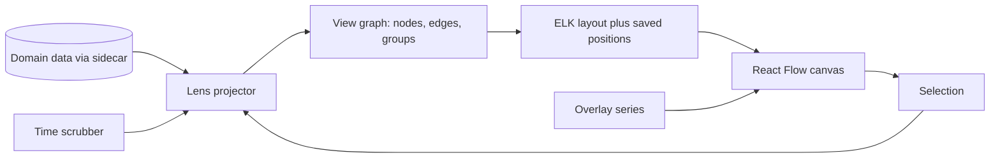

*From data to canvas.* The projector turns domain data into a view graph for the chosen lens. Overlays and the scrubber change what is drawn; the selection survives a lens change.

---

## 3. Node grammar

### 3.1 Families and color roles

Color marks a family and never carries meaning alone. Fills are light tints so text keeps full contrast; the family hue appears in the border accent and the glyph. Three hues from the validated categorical order, plus neutral:

| Family | Hue (light / dark) | Members |
|---|---|---|
| World | blue `#2a78d6` / `#3987e5` | Actor, Place, Object, Fact, Story event |
| Minds | aqua `#1baf7a` / `#199e70` | Belief, Concept, Rule, Scenario, Interpretation, Model version, Crisis |
| Telling | orange `#eb6834` / `#d95926` | Discourse act, Withheld claim, Style marker |
| Run and evidence | neutral gray `#898781` | Claim, Evidence, Stage, Finding, Branch, Annotation |

The aqua hue falls below 3:1 contrast on the light surface, so aqua appears only as a border accent beside an ink-colored text label and a glyph. The palette passes the all-pairs color-vision check for these three hues.

### 3.2 Node kinds

| Kind | Silhouette | Glyph (icon name) | Lenses | Domain object | Key fields | Out ports | In ports |
|---|---|---|---|---|---|---|---|
| Actor | Circle | `user` | Fixture, Mind | Actor | name, initial goals | holds, observes | — |
| Place | Rounded rectangle, pin tab | `map-pin` | Fixture | Entity | name | contains | contains |
| Object | Rounded square | `box` | Fixture, Motif | Entity | name, designated motif | — | contains, acts-on |
| Fact | Pill | `check-square` | Fixture, Story | Predicate (world scope) | predicate, polarity | — | effect-of |
| Story event | Rectangle with a time tab | by kind: `footprints` action, `eye` observation, `message-square` utterance, `rotate-ccw` recollection, `target` decision, `sparkles` revision, `alert-octagon` crisis | Story | StoryEvent | kind, actors, preconditions, effects | causes, observed-by | causes, observes |
| Discourse act | Parallelogram | by mode: `clapperboard` scene, `list` summary, `ellipsis` ellipsis, `pause` pause, `history` memory, `repeat` repetition | Discourse | DiscourseAct | mode, focalizer, reveal, cue, withhold | refs | — |
| Withheld claim | Parallelogram, hatched | `eye-off` | Discourse | ClaimRef (withhold list) | claim | — | withholds |
| Belief | Rounded rectangle, wavy top | `message-circle` | Mind | Belief | proposition, confidence, status | supports | holds |
| Scenario | Dashed ellipse | `cloud` | Mind | Scenario | assertions, plausibility, desirability | accessible-from | accessible-from |
| Concept | Diamond | `diamond` | Mind | Concept | label, criteria, version | migrates-to | migrates-to, produced-by |
| Rule | Hexagon | `scale` | Mind | InterpretiveRule | when, supports, weight | produced-by | — |
| Interpretation | Hexagon with double border | `lightbulb` | Mind | Interpretation | observer, target events, status | interprets, supersedes | supports, produced-by |
| Model version | Group frame with tab | `layers` | Mind | Model version | version, supersedes | — | — |
| Crisis | Double-ringed circle | `alert-octagon` | Mind, Story | model_crisis event | subject, level, resolution | triggers | strain-from |
| Claim | Small rounded rectangle | `quote` | Provenance | Provenance claim | holder, confidence | derives | derives |
| Evidence | Page with folded corner | `file-text` | Provenance | EvidenceRef | source event, reliability | supports | — |
| Proposal | Dotted-border rectangle with spark | `wand-sparkles` | Story, Mind | Generated proposal | rationale, validator results | — | — |
| Appearance | Dot sized by salience | `circle-dot` | Motif | Motif ledger entry | act, salience | links | — |
| Stage | Chevron | `chevron-right` | Pipeline | Pipeline stage | name, status, elapsed | flows | flows |
| Finding | Badge | `triangle-alert` | Pipeline, Story, Discourse | Finding | code, layer, span | blocks | — |
| Branch | Tag | `git-branch` | Story, Pipeline | Branch | id, parent, fork sequence | — | — |
| Annotation | Folded note | `sticky-note` | any | None (view only) | text | — | — |

Annotations and layout positions are view data. They never enter the event log.

### 3.3 Node anatomy

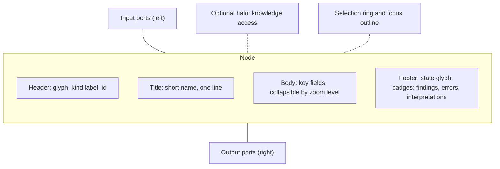

*Four bands and two port sides.* The header always carries the kind glyph and a text label. The footer carries the state glyph so a node's state is readable without color.

### 3.4 State encoding

| State | Border | State glyph | Meaning | Editable |
|---|---|---|---|---|
| **Draft** | Dashed | `pencil` | Work in progress; not canon. | Yes |
| **Sealed** | Thick, solid | `lock` | Committed to the event log; canon. | No (fork instead) |
| **Proposed** | Dotted, with spark corner | `wand-sparkles` | Offered by a model adapter; not canon. | Accept or reject only |
| **Rejected** | Thin, struck through | `x` | A refused proposal or draft; kept for analysis. | No |
| **Invalid** | Double | `triangle-alert` plus error count | The draft fails validation. | Yes |
| **Suspended** | Half-filled body | `circle-half` | A proposition held in suspension, not negated. | Per kind |
| **Selected** | Outer ring | — | In the inspector. | — |
| **Focal** | Corner marker | `crosshair` | The current focalizer. | — |

Run status (Pipeline lens stages and findings) uses its own marks, always with a text label:

| Status | Shape mark | Label |
|---|---|---|
| Pending | Outlined, empty | Pending |
| Running | Ring with moving dash (static dash under reduced motion) | Running |
| Passed | Filled with check | Passed |
| Failed | Filled with cross | Failed |
| Cancelled | Filled with dash | Cancelled |
| Skipped | Outlined with slash | Skipped |

---

## 4. Edge grammar

### 4.1 Edge kinds

| Kind | Line | Arrowhead | From → to | Meaning | Domain mapping |
|---|---|---|---|---|---|
| causes | Solid, medium | Filled | Story event → Story event | The target has the source as a causal parent. | `causal_parents` |
| observes | Dotted | Open | Actor → Story event | The actor can perceive or be told of the event. | Observation effect |
| holds | Thin solid | Dot | Actor → Belief | The actor holds the belief. | `ActorState.beliefs` |
| refs | Thin solid | Circle at source | Discourse act → Story event | The act presents the event. | `story_refs` |
| withholds | Dashed | Bar | Discourse act → Withheld claim | The act holds the claim back. | `disclosure.withhold` |
| supports | Solid, thin | Open | Evidence or Belief → Interpretation | The source is evidence for the interpretation. | `evidence` |
| produced-by | Dash-dot | Open | Interpretation → Rule | The rule produced the interpretation. | `produced_by_rule_ids` |
| interprets | Dashed, curved below the story line | Open | Interpretation → Story event | The interpretation is about the event. | `target_event_ids` |
| supersedes | Thick dashed arc, drawn backward in time | Filled | Interpretation → Interpretation | The newer interpretation supersedes the older; both remain. | `supersedes` |
| migrates-to | Double line | Filled | Concept → Concept | The concept maps into the newer vocabulary. | `migration_map` |
| accessible-from | Dotted | Open | Scenario → Scenario | The second scenario is accessible from the first. | `accessible_from` |
| triggers | Solid, bold | Filled | Crisis → Interpretation or Concept | The crisis opens the revision. | Revision event |
| strain-from | Dotted, bold | Open | Story event → Crisis | The event contributes strain. | Strain input |
| derives | Thin gray | Open | Claim → Claim or Evidence | A step in the transformation chain. | `transformation_chain` |
| flows | Solid, bold gray | Filled | Stage → Stage | Pipeline order. | Run plan |
| blocks | Zigzag | Bar | Finding → any node | The finding concerns the node. | `Finding.node_refs` |
| contains | (nesting, not drawn) | — | Place → Actor or Object | Initial location. | Initial predicate |

### 4.2 Connection rules

The sidecar owns these rules (`graph.validate_connection`). The frontend caches them to show hints while dragging but accepts an edge only after the sidecar agrees.

| Rule | Check |
|---|---|
| Source and target kinds must match the table in section 4.1. | Kind pairs |
| `causes` shall not create a cycle. | Cycle check on the draft and sealed graph |
| A sealed node accepts incoming edges only where the edge is part of a draft that depends on it. | State check |
| A draft cannot add an edge to a sealed node's *own* causal parents. | Immutability |
| `observes` requires a perceptual or testimonial path (INV-03). | Actor access |
| `refs` shall point to a story event that exists at the selected branch head. | Reference |
| `supersedes` shall point from a newer model version to an older one by the same observer. | INV-08, INV-18 |
| `migrates-to` requires the target concept to belong to the next model version (INV-09). | Version rule |
| `withholds` requires a claim not already revealed earlier in the discourse (INV-05). | Order rule |

A refused connection shows the reason in words beside the cursor and in the inspector. No edge is added.

---

## 5. Worked example: Mara and Len in the visual language

Diagrams use Mermaid shapes as stand-ins for the silhouettes. Thick border means Sealed; dashed means Draft; dotted means Proposed.

### 5.1 Story and Discourse lenses

```mermaid
flowchart LR
    subgraph STORY["Story lane: story-time order, all Sealed"]
        direction LR
        S01["S01 action<br/>Len repairs chair 🔒"]:::sealed
        S02["S02 action<br/>Len replaces bowl 🔒"]:::sealed
        S03["S03 action<br/>Len writes note 🔒"]:::sealed
        S04["S04 utterance<br/>Len gives routine reason 🔒"]:::sealed
        S05["S05 action<br/>Len leaves; chair rocks 🔒"]:::sealed
        S06["S06 observation<br/>Mara finds note 🔒"]:::sealed
        S07["S07 observation<br/>Note shows deferred departures 🔒"]:::sealed
        S08["S08 recollection<br/>Mara recalls S01, S02 🔒"]:::sealed
        S09["S09 crisis<br/>Mara cannot choose 🔒"]:::crisis
        S10["S10 action<br/>Mara moves bowl 🔒"]:::sealed
        S11["S11 proposal<br/>generated candidate ✦"]:::proposed
    end
    subgraph DISC["Discourse lane: telling order, plan C3"]
        direction LR
        D01[/"D01 scene<br/>rocking chair"/]:::act
        D02[/"D02 scene<br/>routine reason"/]:::act
        D03[/"D03 scene<br/>partial note"/]:::act
        D04[/"D04 memory<br/>repair"/]:::act
        D05[/"D05 memory<br/>replacement"/]:::act
        D06[/"D06 pause<br/>care and avoidance held together"/]:::act
        D07[/"D07 scene<br/>bowl placed elsewhere"/]:::act
    end
    S01 ~~~ S02 ~~~ S03 ~~~ S04 ~~~ S05 ~~~ S06 ~~~ S07 ~~~ S08 ~~~ S09 ~~~ S10 ~~~ S11
    S03 ==> S06
    S06 ==> S07
    S07 ==> S08
    S08 ==> S09
    S09 ==> S10
    D01 ~~~ D02 ~~~ D03 ~~~ D04 ~~~ D05 ~~~ D06 ~~~ D07
    D01 -.-> S05
    D02 -.-> S04
    D03 -.-> S06
    D04 -.-> S01
    D05 -.-> S02
    D06 -.-> S08
    D07 -.-> S10
    classDef sealed stroke:#2a78d6,stroke-width:4px,fill:#e8f1fc,color:#0b0b0b
    classDef crisis stroke:#1baf7a,stroke-width:4px,fill:#e4f6ef,color:#0b0b0b
    classDef proposed stroke:#2a78d6,stroke-width:2px,stroke-dasharray:2 4,fill:#ffffff,color:#0b0b0b
    classDef act stroke:#eb6834,stroke-width:3px,fill:#fdeee8,color:#0b0b0b
```

*Story and Discourse lenses together.* Bold arrows are `causes`; dotted arrows are `refs` from telling to story. The order of the telling differs from the order of events: the reader meets the rocking chair (S05) first, then recalls S01 and S02 after the note. Event S11 is a model-generated proposal that is not canon until accepted and sealed. The order and the shapes, not the colors, carry the meaning.

### 5.2 Mind lens for Mara

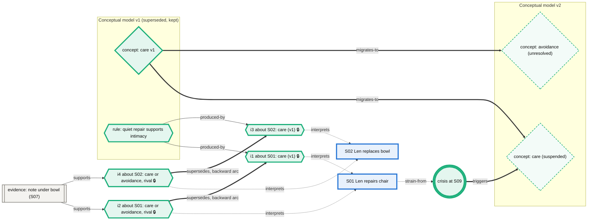

*Mara's mind after the C3 revision.* The retrospection arcs (`supersedes`) reach back from the new interpretations to the old ones about S01 and S02. Both stay. The concept `care` migrates to two unresolved terms; the old rule still produced i1 and i3 under model v1.

### 5.3 Pipeline lens during a run

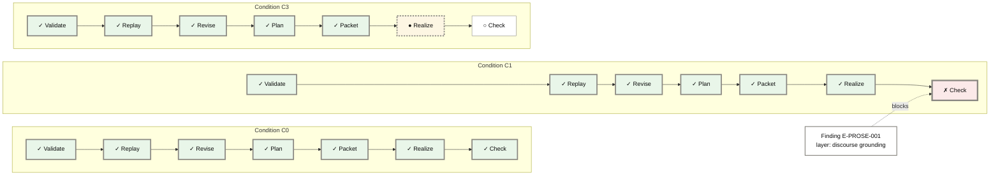

*A run in progress.* C0 has finished; C1 failed at Check; C3 is realizing. The finding is attached to the failed stage and names the responsible layer. Status shows as a mark (check, cross, dot, ring) and a word, never color alone.

---

## 6. Interaction model

### 6.1 Verbs on the canvas

| Verb | How | Result |
|---|---|---|
| **Create** | Drag from the palette; double-click empty canvas for quick-create; `Ctrl/Cmd+K` command palette ("Add story event"); drop a fixture file on the canvas | A Draft node appears at the pointer or at the next free grid position. |
| **Modify** | Select and edit in the inspector; double-click a title to rename; drag from an output port to an input port to connect; `Delete` removes a draft | Each change is a draft operation; the sidecar validates it. |
| **Seal** | `Seal` button or `Ctrl/Cmd+Enter` on a selection or the whole draft | The sidecar compiles the draft to commands in causal order and appends them atomically. |
| **Fork** | Context menu on a sealed node: "Fork from here" | New branch, with a draft copy of later events. |
| **Run** | Toolbar Run; run panel selects conditions, realizer, seed, budget, replay mode | Pipeline lens opens; stages update live. |
| **Visualize** | Lens switcher; overlay toggles; time scrubber; branch compare | The canvas redraws. No domain change. |
| **Explain** | Select a node and choose "Why?" | Trace query result highlights on the Provenance lens. |

### 6.2 Keyboard map

| Action | Keys |
|---|---|
| Command palette | `Ctrl/Cmd+K` |
| Move focus to a related node | Arrow keys follow edges: right = out, left = in, up/down = siblings |
| Open inspector for focused node | `Enter` |
| Start a connection from the focused node | `C`, then arrows to a target, `Enter` to attempt |
| Seal | `Ctrl/Cmd+Enter` |
| Undo / redo | `Ctrl/Cmd+Z` / `Ctrl/Cmd+Shift+Z` |
| Switch lens | `Alt+1` to `Alt+7` |
| Toggle outline (table twin) | `Alt+O` |
| Step the time scrubber | `[` and `]` |
| Cancel run | `Esc` while the run panel has focus |

### 6.3 Draft lifecycle

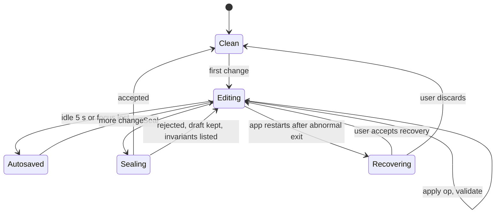

*Draft lifecycle.* A rejected seal never discards the draft. After a crash, the app offers the last autosave.

### 6.4 Overlays and scrubber

| Overlay | What it shows | Encoding |
|---|---|---|
| Strain heat | Each actor's strain at the selected time | Border thickness steps and a number badge; legend with four levels |
| Knowledge-access halo | Which events the chosen actor can access | Halo ring around accessible events; inaccessible events hatched |
| Focalizer view | What the prose may say from the focalizer's position | Everything outside the focalizer's access dims and hatches |
| Reader versus actor | Gap between what the reader has been told and what the actor believes | A ribbon between paired nodes whose length shows the gap; numeric badge |
| Retrospection arcs | Interpretations reaching back to earlier events | Thick dashed arcs below the story line |
| Findings | Checker findings on the nodes they concern | Triangle badge with count; click to open sentence |
| Diff | Added, removed, and changed nodes between two branches | Added: plus glyph and double border. Removed: minus glyph and faded dashed border. Changed: delta glyph and dotted inner border |

The **time scrubber** has two handles: a story sequence and a discourse index. Moving them replays the projections read-only and redraws state-dependent decoration (halos, beliefs, strain). It never writes.

---

## 7. From canvas to domain

### 7.1 Draft model and seal compiler

The frontend edits a **draft document**: a set of draft nodes and edges plus references to sealed nodes. The draft is saved as JSON in `drafts/`. Sealing sends the draft to the sidecar's **draft compiler**, which

1. checks every node against its schema and every edge against the connection rules;
2. orders nodes by causal parents (topological order);
3. turns each node into a command (`AppendStoryCommand`, `ProposeDisclosureCommand`, `ReviseConceptsCommand`, and so on);
4. runs the command bus on all commands as one transaction;
5. on success, maps draft node IDs to the deterministic event IDs (REQ-150) and returns them; on failure, returns the `TransitionResult` with the violated invariants and the draft node each one concerns.

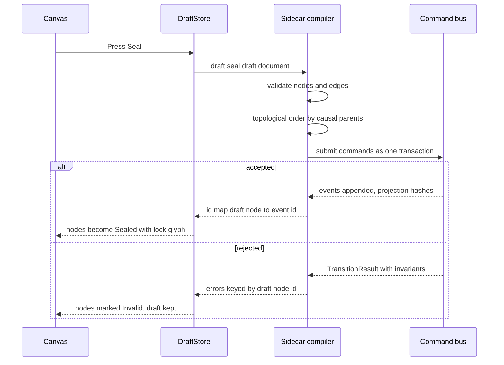

*Seal flow.* Failure keeps the draft and points at the nodes that caused it.

### 7.2 Operations to RPC

| Canvas operation | Draft operation | RPC | Writes? |
|---|---|---|---|
| Open lens | none | `graph.get(lens, branch, range)` | Read |
| Create node | `addNode` | `draft.patch` | Draft |
| Edit field | `setField` | `draft.patch` (and `*.validate`) | Draft |
| Connect | `addEdge` | `graph.validate_connection`, then `draft.patch` | Draft |
| Delete draft node | `removeNode` | `draft.patch` | Draft |
| Undo / redo | local inverse op | `draft.patch` | Draft |
| Seal | none | `draft.seal` | Event log |
| Dry-run seal | none | `draft.compile_preview` | Read |
| Fork from here | none | `branch.fork` | Event log |
| Accept proposal | `acceptProposal` | `draft.patch` then seal | Draft |
| Move node | layout op | `layout.set` | Layout |
| Scrub time | none | `scrub.projection(branch, sequence, discourse_index)` | Read |
| Overlay | none | `overlay.series(kind, branch)` | Read |
| Run | none | `run.start(config)` | Event log, runs |
| Cancel | none | `run.cancel` | Run |
| Why? | none | `trace.query` | Read |

All methods that read declare themselves read-only (REQ-166) and so work during a run.

### 7.3 DTO contracts

The view graph the sidecar returns uses generated types (JSON Schema → TypeScript). Shape:

```typescript
type NodeState = "draft" | "sealed" | "proposed" | "rejected" | "invalid";

interface ViewNode {
  id: string;                 // draft id or event/object id
  kind: NodeKind;             // section 3.2
  state: NodeState;
  title: string;
  fields: Record<string, unknown>;
  lens: LensId;
  refs: { eventId?: string; branchId: string; sequence?: number };
  badges: Array<{ code: string; count: number }>;   // findings, errors
  textAlt: string;            // full sentence for assistive technology
}

interface ViewEdge {
  id: string;
  kind: EdgeKind;             // section 4.1
  source: string;
  target: string;
  state: NodeState;
}

interface ViewGraph {
  lens: LensId;
  branchId: string;
  nodes: ViewNode[];
  edges: ViewEdge[];
  groups: Array<{ id: string; label: string; members: string[] }>;
  protocolVersion: string;
}
```

---

## 8. React implementation design

**Target architecture.** This section records proposed dependencies and module boundaries. The working app currently uses `app/src/App.tsx`, `app/src/GraphCanvas.tsx`, `app/src/api.ts`, and `app/src/styles.css` with React state and custom SVG/HTML; see the implementation note above.

### 8.1 Libraries

| Need | Library | Reason |
|---|---|---|
| Node-and-edge canvas, custom nodes and edges, ports, minimap | `@xyflow/react` (React Flow) | Custom node components, handles, selection, and viewport control suit a typed visual language. |
| Layered layout with ports | `elkjs` in a web worker | Layered layout for time-ordered graphs; keeps the main thread free. |
| State | `zustand` | Small stores for draft, view, and run state. |
| Forms in the inspector | `react-hook-form` with `ajv` against generated JSON Schema | Field-level errors from the schema and from the sidecar. |
| Command palette | `cmdk` | Accessible keyboard palette. |
| Menus, dialogs, tooltips | Radix UI primitives | Accessible focus management. |
| Icons | `lucide-react` | Icon names in section 3.2 map to this set. |
| Charts | Apache ECharts | Strain and tension lines with a threshold; heat strips. |
| Tests | Vitest, Testing Library, Playwright, `axe-core`, Storybook | Unit, end to end, accessibility, and a node-and-edge catalog. |

### 8.2 Module layout

```text
app/src/features/graph/
  GraphCanvas.tsx            # React Flow host, viewport, selection, keyboard
  registry.ts                # NodeRegistry: kind -> component, ports, defaults, glyph
  nodes/                     # one component per node kind (section 3.2)
  edges/                     # one component per edge kind (section 4.1)
  lenses/                    # projectors: DTO -> view graph, one per lens
  overlays/                  # strain, halo, focalizer, divergence, diff, arcs
  draft/DraftStore.ts        # ops, undo/redo, autosave, recovery
  draft/ops.ts               # addNode, setField, addEdge, removeNode, acceptProposal
  rules/connectionHints.ts   # cached hints only; sidecar decides
  layout/elk.worker.ts       # layout in a worker; saved positions override
  scrubber/TimeScrubber.tsx
  inspector/                 # forms generated from schemas
  palette/                   # drag palette and command palette
  outline/OutlineView.tsx    # table twin with the same operations
  a11y/keyboard.ts           # roving focus along edges, key map
  a11y/announce.ts           # live-region announcements
  run/PipelineLens.tsx       # stage-by-condition graph
  run/StrainChart.tsx        # ECharts
  catalog/*.stories.tsx      # every node, edge, and state
```

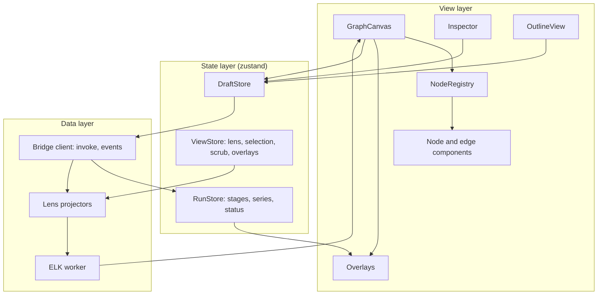

*Layers of the graph feature.* The canvas and the outline read the same stores, so they cannot disagree.

### 8.3 Performance and scale

| Technique | Goal |
|---|---|
| `onlyRenderVisibleElements`, memoized node components, stable callbacks | Keep 300 nodes at 30 frames per second (GUI-020). |
| Level of detail by zoom: summary shows glyph and title; standard adds key fields; detail adds all fields | Readability at every zoom. |
| Group collapse for model versions and conditions | Reduce node count. |
| ELK layout in a worker; layout cache keyed by view-graph hash | No main-thread stalls. |
| Progress events coalesced to 10 updates per second before they touch the store | UI stays under 200 ms during a run (GUI-037). |
| Positions saved only for nodes the user moved | Auto layout adapts to new nodes. |

### 8.4 Accessibility design

- The canvas has `role="application"` with an accessible name. Nodes use roving `tabindex`; arrow keys move focus along edges (section 6.2).
- Each node's `aria-label` is its `textAlt` sentence, for example "Sealed story event S05. Len leaves; the chair rocks. Causes S06."
- A live region announces run stage changes, validation results, and seal outcomes.
- The outline view lists nodes and edges as a table with the same operations and the same keyboard map.
- The reduced-motion setting disables token animation, pan easing, and the running-ring animation (a static dashed ring remains).
- Under `forced-colors`, borders, glyphs, and shapes carry all meaning; no state depends on fill.
- The check against WCAG 2.2 AA covers text contrast, focus visibility, target size, and keyboard operation (REQ-167).

---

## 9. Wireframes

### 9.1 Workbench layout

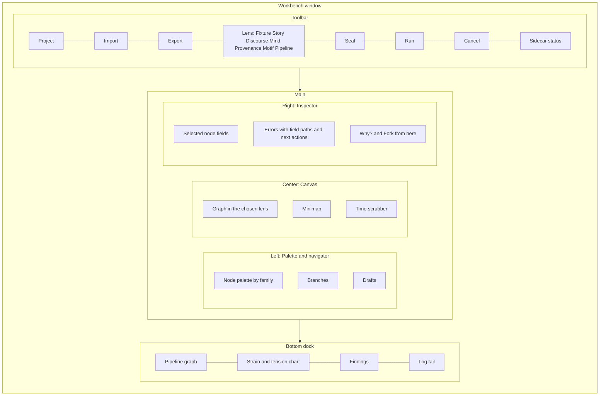

*Layout of the main window.* The palette and branch list are on the left, the canvas and scrubber in the center, the inspector on the right, and the run dock below. The outline view replaces the canvas at the press of `Alt+O`.

### 9.2 Story lens canvas

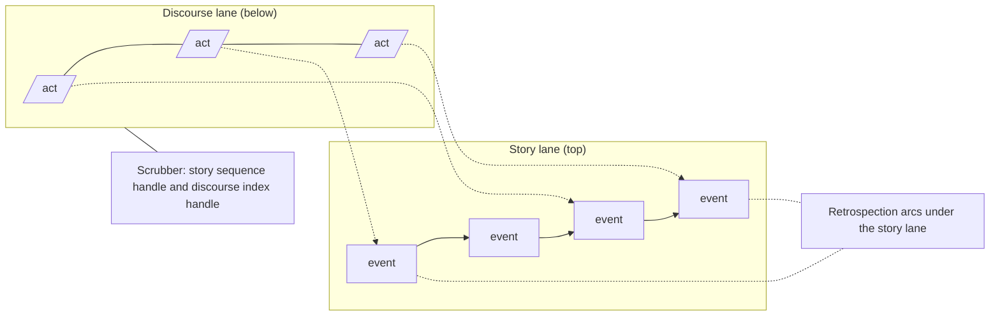

*Story lens layout.* Time runs left to right; arcs for reinterpretation run backward beneath the story lane; the scrubber sits under both lanes.

### 9.3 Pipeline lens

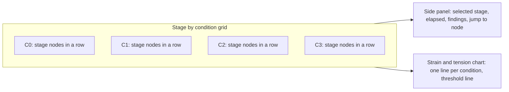

*Pipeline lens.* One row per condition, ten stage nodes per row. Selecting a stage opens its findings and offers a jump to the offending node in the Story, Discourse, or Mind lens.

### 9.4 Outline view (table twin)

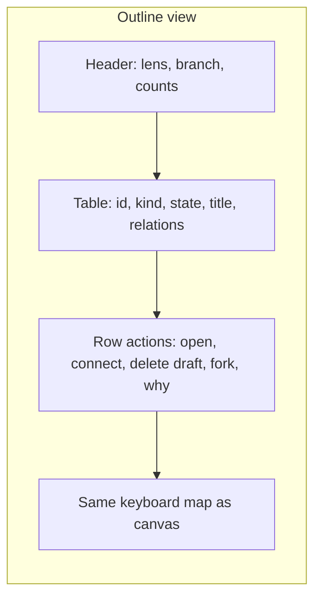

*Outline view.* Every canvas operation has a row-level equivalent, which serves keyboard and screen-reader use.

### 9.5 Branch compare

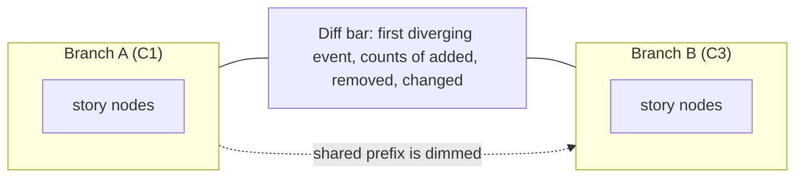

*Compare mode.* The shared prefix is dimmed; differing nodes are marked by border and glyph.

---

## 10. Scenarios on the canvas

| Scenario | Canvas path |
|---|---|
| S-01 Newcomer opens the sample | Welcome → sample opens in Story lens (Sealed nodes) → Run → Pipeline lens fills left to right → strain chart rises → glossary tooltips on hover |
| S-02 Compose from scratch | Fixture lens: drag Actor, Place, Object → connect `contains` → Mind lens: add Concept and Rule → Story lens: draft events → inspector errors guide fixes → Seal |
| S-03 Tune Mara's rule | Select S07 → Fork from here → Mind lens: edit rule weight in the draft → Run C3 → Story lens with retrospection arcs → scrub to compare i1 and i2 |
| S-04 Repair after a leak | Pipeline lens: red cross with word "Failed" on Check → click finding → Discourse lens selects the offending act → edit `withhold` → re-run |
| S-05 What if the chair did not rock | Story lens: right-click S05 → Fork from here → delete the draft copy of the anomaly → Seal → Compare |

---

## 11. Acceptance criteria for the workbench

| ID | Criterion | Verifies |
|---|---|---|
| GAC-11 | **Given** a Sealed node, **when** the user tries to edit a field, **then** the field is read-only and the inspector offers "Fork from here." | GUI-011 |
| GAC-12 | **Given** a Sealed node S05, **when** the user chooses Fork from here, **then** a new branch exists with a draft copy of S05 onward and the original branch is unchanged. | GUI-011, REQ-064 |
| GAC-13 | **Given** an edge that would create a cycle among `causes` edges, **when** the user drops it, **then** it is refused with a reason within 300 ms and no edge is added. | GUI-009 |
| GAC-14 | **Given** an unsaved edit, **when** the application is killed and relaunched, **then** it offers recovery and the recovered draft equals the last autosave. | GUI-005, AC-38 |
| GAC-15 | **Given** keyboard only, **when** the user creates two events, connects them, and seals, **then** the events are Sealed and no pointer was used. | GUI-032 |
| GAC-16 | **Given** any lens, **when** the outline view opens, **then** every node and edge is listed with a text alternative and every canvas operation is available; `axe-core` reports no serious or critical violations. | GUI-033, REQ-167 |
| GAC-17 | **Given** a 300-node graph, **when** the user pans and zooms during a run, **then** the canvas holds at least 30 frames per second and user actions respond within 200 ms. | GUI-020, GUI-037 |
| GAC-18 | **Given** a selected node, **when** the user changes lens, **then** the selection is preserved where the node exists in the new lens. | GUI-014 |
| GAC-19 | **Given** branch C3, **when** the scrubber moves to story sequence 7 and then 9, **then** Mara's interpretation of S01 shows only i1 at 7 and both i1 and i2 at 9. | GUI-015 |
| GAC-20 | **Given** branches C0 and C3, **when** retrospection arcs are enabled, **then** C3 shows arcs from the revision to S01 and S02 and C0 shows none. | GUI-017 |
| GAC-21 | **Given** branches C1 and C3 in diff mode and a grayscale rendering, **when** the user inspects the nodes, **then** added, removed, and changed nodes are still distinguishable by border and glyph. | GUI-018, GUI-010, GUI-034 |
| GAC-22 | **Given** reduced-motion and forced-colors settings, **when** a run executes, **then** no token animation plays and every node state and run status remains distinguishable. | GUI-023, GUI-034 |
| GAC-23 | **Given** the node and edge tables in sections 3.2 and 4.1, **when** the catalog check runs, **then** every kind and every state has a Storybook story and a table row, and none is missing. | GUI-006 |

The earlier GAC-01 to GAC-10 appear in Implementation Plan §7.3.
