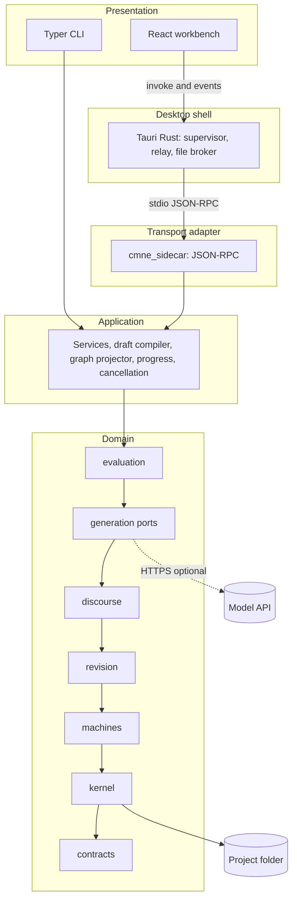
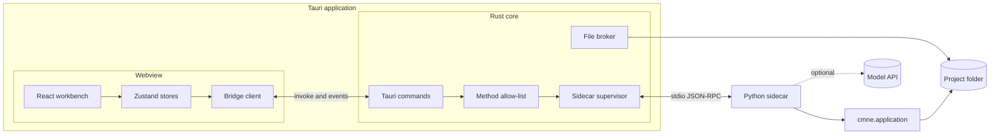
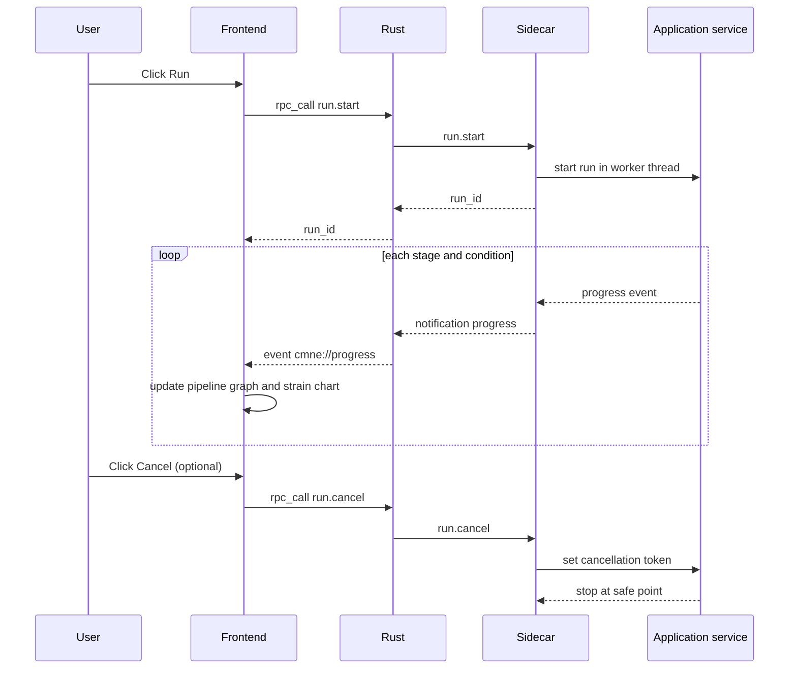
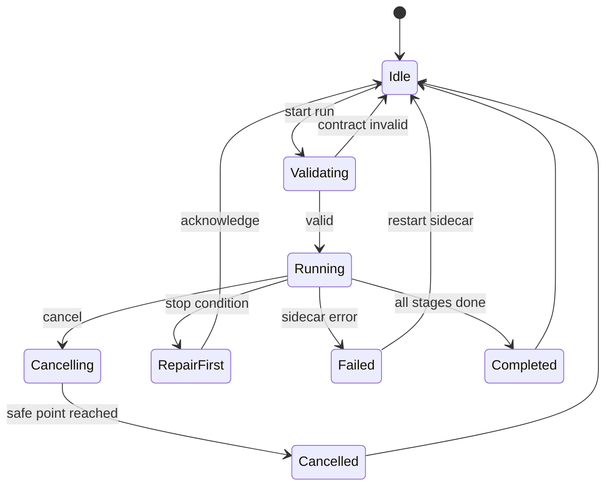

# Implementation Plan: Coupled Modal Narrative Engine (CMNE) Workbench

| Field | Value |
|---|---|
| Plan ID | IMPL-033 |
| Version | 0.2 roadmap; implementation checkpoint 0.3 |
| Date | 2026-10-19 |
| Implements | SRS-033 v0.2: REQ-001 to REQ-167, GUI-001 to GUI-040, AC-01 to AC-42 |
| Companion documents | SRS-033-A (users, scenarios, UML), SRS-033-V (visual language and graph workbench), SRS-033-R (review and scorecard) |
| Target stack | Python 3.11+ library and sidecar; Tauri 2 (Rust) shell; TypeScript, React, Vite; proposed React Flow, ELK, ECharts |

### Revision history

| Version | Change |
|---|---|
| 0.1 | First plan: 33 tasks, 19 phases, GUI as a list of views. |
| 0.2 | Reworked after the system assessment. Added tasks for the formula language, deterministic hashing and IDs, project lock, schema up-casting, record/replay adapter and budget guard, voice profile, motif ledger, analysis plan, draft compiler and graph services, the visual-language kit, the graph canvas, accessibility, and mutation testing. Moved the loader out of the application layer (finding F-04). Added the protocol handshake and read/write rules. Added ADR index and risk register. Replaced the GUI requirement list with a pointer to SRS §3.17 and SRS-033-V. |
| 0.3 checkpoint | Recorded what the first runnable app actually implements and which planned tasks and gates remain open. The task table and diagrams remain the target roadmap. |

### Current implementation checkpoint (2026-10-21)

Use [SRS-033 Implementation Status](SRS-033-Implementation-Status.md) as the dated record of delivered code and verification. This plan's proposed structure, diagrams, task exit criteria, and completion template describe the **target release**. They are not evidence that a task is complete.

| Planned area | Current state | Remaining work |
|---|---|---|
| Desktop shell and bridge | Tauri 2 Rust relay, JSON-RPC 2.0 handshake, allowlist, stateless-only retry after sidecar failure, bundled Python executable, unsigned macOS `.app`, background condition progress and cancellation. | Packaged GUI crash/reopen journey, stage-level progress, and Windows/Linux package gates. |
| Python/domain | `src/cmne/` provides typed boundary shapes and generated JSON Schema/TypeScript, closed formula AST, atomic hashed streams, six projections, weighted strain/crisis rules, versioned revisions, five traces, in-memory v1-to-v2 up-cast, per-act filtered packets, selected prose checks, and vendor-neutral proposal/prose ports with cassette replay and budgets. | Complete invariant-by-invariant and cross-OS evidence, full formal semantics, a release vendor choice, and a broader adversarial grounding corpus. |
| Frontend | Seven lenses, custom SVG graph, fixture/contract JSON editing, story/discourse drafts, outline, scrubbers, four-condition strain chart, pipeline/passage/trace, study panel and report export. | React Flow/ELK/ECharts remain proposed; complete graph interactions, diff/overlays, keyboard/table parity, accessibility and performance checks. |
| Research and release | Mara/Len C0–C3 offline passages meet the new sample's 700–1100-word bound; fixed study plans, 12 distinct blind-export variants, response import/report, seven realized controlled ablations, and a hashed decision packet. 103 Python tests, seeded properties, Mypy, Ruff, TypeScript, Rust Clippy/test, local macOS bundle and sidecar smoke pass. | Real human study is Milestone 9; cross-OS CI, complete property/invariant and mutation evidence, full AC/GAC, and independent software review remain open. |

The actual source layout is `src/cmne/`, `src/cmne_sidecar/`, `app/src/`, `app/src-tauri/`, `scripts/`, and `tests/`. Project data use JSON and NDJSON, not the proposed YAML layout. The CLI uses `argparse`, not Typer. Runs can be synchronous or background jobs with cancellation between conditions; stage-level streaming in §5 remains a target. The `T-` rows in §8 still need task-by-task evidence before they can be marked done. The [roadmap](SRS-033-Project-Roadmap.md) and [software codebase review](SRS-033-Codebase-Review-2026-10-21.md) carry current gates and scores.

---

## 0. Assumptions and open questions

### 0.1 Assumptions

| ID | Assumption |
|---|---|
| AS-01 | "Tauri/Rust.JS" means a Tauri 2 shell in Rust with a JavaScript frontend. The frontend uses TypeScript, React, and Vite. |
| AS-02 | The GUI is in scope through SRS v0.2 §3.17. |
| AS-03 | The workbench is a graph editor in a fixed visual language (SRS-033-V) with seven lenses. |
| AS-04 | "Progress graph" means the live pipeline graph and the strain chart. |
| AS-05 | The Python library `cmne` owns all domain logic. Rust and JavaScript hold none. |
| AS-06 | The CLI stays (REQ-115). The CLI and the sidecar call the same application services. |
| AS-07 | The sidecar speaks JSON-RPC 2.0 over standard input and output, one JSON object per line. Standard output carries only RPC; logs go to standard error. |
| AS-08 | Release targets are macOS (Apple Silicon first), then Windows and Linux (REQ-136). |
| AS-09 | Sealed events are never edited. "Modify" on a sealed event means fork and edit a draft copy. |

### 0.2 Open questions

| ID | Question | Default if unanswered |
|---|---|---|
| OQ-A | Is React acceptable, or do you prefer Svelte or Vue? | React |
| OQ-B | Does "progress graph" include project-milestone progress (M1–M7)? | Run progress and strain chart only |
| OQ-C | Should evaluators rate passages in the app, or only by file? | File only |
| OQ-D | Do you need signed and notarized macOS builds at release 1? | Unsigned developer builds |
| OQ-E | Do API keys live in the OS keychain or in environment variables? | Environment variables |
| OQ-F | Are Windows and Linux builds required at release 1? | macOS only; CI builds all three |
| OQ-G | Which model and version serve the adapters? | Template realizer and recorded cassettes only until decided |
| OQ-H | Which exemplar passages seed the voice profile, and who holds their rights? | No exemplars shipped; the researcher supplies them |

---

## 1. Implementation Strategy

1. **Kernel first, GUI last.** Build and test the deterministic library (SRS milestones M1–M5) with the CLI before any GUI work.
2. **Determinism before features.** Hashing, identifiers, the formula language, and locking come before machines. Every later test depends on them.
3. **One source of truth for contracts.** Pydantic models define every schema. A build step exports JSON Schema and generates TypeScript types. Rust passes payloads through as opaque JSON.
4. **Thin shell, thin sidecar.** Rust supervises the sidecar and brokers files. The sidecar maps RPC methods to application services and adds no domain rules.
5. **Server-owned state.** The sidecar and the project folder hold domain state. The frontend holds view state and drafts. Drafts become canon only through the sidecar's seal.
6. **The visual language is a product, not styling.** Node, edge, and state components are built once as a kit with a catalog (Storybook) before any lens uses them.
7. **Test at every boundary.** Python unit, property, golden, contract, and mutation tests; sidecar tests; Rust tests with a real sidecar; frontend unit, accessibility, and end-to-end tests against a mock bridge; one packaged-app smoke test.
8. **Enforce layers by tool.** `import-linter` fails the build on a reverse dependency (REQ-129, REQ-139).


*Phase flow.* P1–P10 deliver the SRS as a library and CLI. P11–P16 add the desktop workbench. P17–P18 package and close.

---

## 2. Proposed Project Structure

**Target layout.** The implemented source tree is summarized in the checkpoint above and in [SRS-033 Implementation Status](SRS-033-Implementation-Status.md). Paths in this section are proposed, not an inventory of current files.

```text
cmne/
  pyproject.toml  README.md  mkdocs.yml  import-linter.ini
  .github/workflows/ci.yml
  src/
    cmne/
      contracts/                       # leaf layer: Pydantic models only
        events.py states.py narrative.py provenance.py results.py errors.py
        formula.py                     # formula AST (REQ-147)
        quantities.py                  # basis-point types (REQ-149)
      kernel/
        canonical.py ids.py            # canonical JSON, hashing, derived IDs (REQ-149, 150)
        formula_eval.py                # evaluator with limits (REQ-148)
        safe_io.py fixtures.py         # safe parsing, loaders (REQ-155)
        event_store.py upcast.py locking.py
        stores/ memory_store.py ndjson_store.py sqlite_store.py
        command_bus.py replay.py branches.py invariants.py snapshots.py
      machines/ base.py actor.py environment.py tension.py reader.py prose_style.py motif_ledger.py
      revision/ strain.py belief.py modal.py conceptual.py reinterpretation.py planner.py
      provenance/ graph.py trace_queries.py
      discourse/ planner.py grounding.py scene_packet.py voice.py
      generation/
        ports.py proposal_adapter.py prose_adapter.py template_realizer.py
        recording.py budget.py         # cassette record/replay, budget guard (REQ-153, 154)
        adapters/ anthropic_adapter.py
      evaluation/
        deterministic.py structural.py ablations.py
        analysis_plan.py human_protocol.py report.py advisory_model.py
      application/
        project_service.py run_service.py branch_service.py trace_service.py
        evaluation_service.py export_service.py
        draft_service.py draft_compiler.py graph_service.py   # drafts, seal, lens projection
        progress.py cancellation.py
      config/ settings.py logging.py
      cli/ main.py
      experiments/bounded_epiphany/    # Mara and Len fixture, S01-S10, D01-D07
    cmne_sidecar/
      server.py framing.py dispatcher.py handshake.py methods/*.py notifications.py
      schema_export.py                 # JSON Schema for TypeScript generation
  tests/ unit/ property/ golden/ contract/ sidecar/ integration/ acceptance/
  docs/                                # MkDocs Material sources and Sphinx config
  app/
    package.json vite.config.ts tsconfig.json
    src/
      bridge/ rpc.ts events.ts mockBridge.ts
      generated/ types.ts schemas.json        # generated; never hand-edited
      state/ projectStore.ts runStore.ts uiStore.ts
      features/
        project/ import-export/ settings/
        graph/                                # see SRS-033-V section 8.2
          GraphCanvas.tsx registry.ts nodes/ edges/ lenses/ overlays/
          draft/ rules/ layout/ scrubber/ inspector/ palette/
          outline/ a11y/ run/ catalog/
        review/ packet/ realization/ evaluation/
      components/ tokens.css ErrorList.tsx Glossary.tsx
      tests/
    src-tauri/
      Cargo.toml tauri.conf.json capabilities/default.json binaries/
      src/ main.rs lib.rs sidecar.rs rpc_relay.rs files.rs settings.rs error.rs
  scripts/ build_sidecar.py gen_types.py gen_rpc_docs.py trace_report.py
```

**Python dependency order.** `contracts` ← `kernel` ← `machines` ← `revision` ← `discourse` ← `generation` ← `evaluation` ← `application` ← (`cli`, `cmne_sidecar`). `provenance` sits beside `kernel` and imports `contracts` and `kernel` only. `config` may be imported by any layer above `contracts`.

---

## 3. Layer and Contract Model

### 3.1 Layers



*Layers and call direction.* Both interfaces call the application layer. No domain package imports upward.

### 3.2 Contract boundaries

| # | Boundary | Contract | Validation point | Failure behavior |
|---|---|---|---|---|
| B1 | Frontend ↔ Rust | Tauri command `rpc_call(method, params)`; events `cmne://progress`, `log`, `sidecar-state` | Rust allow-lists methods; frontend validates responses against generated schemas | Typed `ShellError`; toast; view state kept |
| B2 | Rust ↔ sidecar | JSON-RPC 2.0, one object per line; `app.hello` first (REQ-165) | Sidecar validates params; Rust validates framing and protocol version | `-32700` on malformed input; E-PROTO-001 on version mismatch; retry only stateless requests, report uncertain mutation outcomes for inspection |
| B3 | Sidecar ↔ application | Service methods with Pydantic request and response models | Pydantic at the dispatcher | Domain error → RPC error with `data.code` |
| B4 | Application ↔ domain | Commands and `TransitionResult` | Command bus | `accepted=false` with invariant IDs |
| B5 | Domain ↔ store | `EventStore` protocol and project lock | Sequence check, line integrity, lock | E-APPEND-001, E-APPEND-002, E-LOCK-001 |
| B6 | Domain ↔ model API | `ProseRealizer`, `ProposalAdapter` via `RecordingAdapter` and budget guard | Checker validates candidates | E-ADAPT-001, E-BUDGET-001, E-CASSETTE-001 |
| B7 | Filesystem ↔ application | Project folder layout (§3.4) | Safe parsing, size limit, path containment | E-INPUT-001, E-FIXTURE-001, E-CONTRACT-001 |
| B8 | Application ↔ canvas | `ViewGraph` DTO (SRS-033-V §7.3) and `Draft` document | Connection rules; draft compiler | Refused edge with reason; seal rejected with invariants keyed by draft node |

### 3.3 Sidecar RPC surface and concurrency

Every method declares `read` or `write`. Write methods are serialized per project. Read methods use committed events and run during writes and runs (REQ-166). The first call must be `app.hello`.

| Method | Mode | Purpose | SRS |
|---|---|---|---|
| `app.hello` | read | Protocol, package, and schema versions | REQ-165 |
| `project.open`, `project.create`, `project.close` | write | Open or create a project; acquire the lock | REQ-001–003, 152 |
| `fixture.validate`, `contract.validate` | read | Validate a draft; coded errors with field paths | REQ-001–008, 156 |
| `fixture.save`, `contract.save` | write | Save a validated file | REQ-001–003 |
| `graph.get` | read | `ViewGraph` for a lens, branch, and range | GUI-014 |
| `graph.validate_connection` | read | Verdict on a proposed edge | GUI-009 |
| `draft.create`, `draft.patch`, `draft.get`, `draft.delete` | write (draft only) | Draft documents | GUI-005, 007, 008, 013 |
| `draft.compile_preview` | read | Dry run of the seal | GUI-012 |
| `draft.seal` | write | Compile and commit atomically | GUI-012 |
| `layout.get`, `layout.set` | write (layout only) | Node positions | GUI-019 |
| `scrub.projection` | read | Projection at a story sequence and discourse index | GUI-015 |
| `overlay.series` | read | Overlay data (strain, halo, divergence) | GUI-016 |
| `branch.list`, `branch.compare` | read | Branches and diffs | REQ-066 |
| `branch.fork` | write | Fork at a sequence; draft copy of the suffix | GUI-011, REQ-064 |
| `events.read` | read | A page of events | REQ-009 |
| `command.submit` | write | Authored command | REQ-020–027 |
| `condition.apply` | write | Apply C0–C3 | REQ-068 |
| `discourse.plan.validate`, `discourse.plan.save` | read, write | Authored plans | REQ-070–075 |
| `packet.build`, `packet.get` | write, read | Scene packet | REQ-078–081 |
| `realize.run`, `check.run` | write | Realize and check | REQ-082–095 |
| `trace.query` | read | The five trace queries | REQ-062 |
| `strain.series` | read | Strain and tension series | GUI-024 |
| `run.start`, `run.cancel` | write | Pipeline run; cancel | GUI-021, 025 |
| `run.status` | read | Run state | GUI-022 |
| `analysis_plan.save`, `analysis_plan.get` | write, read | Study plan | REQ-161 |
| `evaluation.export_set`, `evaluation.import_responses`, `evaluation.analyze` | write | Blinded set, responses, report | REQ-109–111, 162 |
| `export.report`, `export.graphml` | write | Files for the user | GUI-004 |
| `settings.get`, `settings.set` | read, write | Non-secret settings | GUI-040 |

Notifications from sidecar to shell: `progress` (`run_id`, `stage`, `condition`, `status`, `fraction`, `message`), `finding`, `log`.

### 3.4 Project folder layout

```text
<project>/
  project.cmne.yaml                  # name, schema version, active contract and fixture
  .cmne.lock                         # writer lock (REQ-152)
  fixtures/<id>.yaml
  contracts/<id>.yaml
  branches/<branch_id>/story.ndjson  discourse.ndjson  evaluation.ndjson
  snapshots/<branch_id>/<sequence>.json
  drafts/<draft_id>.json             # unsealed work (GUI-005)
  layout/<lens>.json                 # node positions only (GUI-019)
  packets/<hash>.json
  realizations/<hash>.json
  cassettes/<run_id>.ndjson          # recorded model calls (REQ-153)
  analysis/plan.yaml  amendments/
  evaluation/sets/<set_id>/  evaluation/responses/
  runs/<run_id>.json                 # versions, seed, parameters (REQ-124)
  exports/
```

### 3.5 Error model

| Layer | Representation | Mapping |
|---|---|---|
| Domain | `CmneError` subclasses with `code`, `field_path`, `message`, `cause`, `next_action` | One class per code family; catalog test (AC-36) |
| Sidecar | JSON-RPC error `{code, message, data: {cmne_code, field_path, cause, next_action, details}}` | Domain fields pass through |
| Rust | `ShellError` enum (`SidecarUnavailable`, `Timeout`, `Forbidden`, `ProtocolMismatch`, `Rpc(..)`) | Serialized to the frontend |
| Frontend | `AppError` with `cmneCode`, `fieldPath`, `cause`, `nextAction` | `ErrorList` links each error to its field or node |

### 3.6 Validation rules

| Rule | Where enforced |
|---|---|
| Schema and invariant rules (SRS §8.1–8.2) | Domain (Pydantic validators, `invariants.py`) |
| Formula limits (depth 16, 256 nodes) | `kernel/formula_eval.py` |
| Basis-point range 0–10000 | `contracts/quantities.py` |
| Hash and ID derivation | `kernel/canonical.py` and `ids.py` only |
| Untrusted input (safe YAML, 5 MB, path containment) | `kernel/safe_io.py` |
| Draft edits validate on a 300 ms debounce; Save and Seal disabled while errors exist | Frontend triggers; sidecar decides |
| RPC method allow-list; file access limited to the open project and user-chosen paths | Rust `rpc_relay.rs`, `files.rs` |

---

## 4. Design Patterns Used

| Pattern | Where | Reason |
|---|---|---|
| Event sourcing | `kernel` | EA-1; replay, provenance, branch comparison. |
| Repository | `EventStore`, `SnapshotStore`, `FixtureRepository` | Swap NDJSON, SQLite, and in-memory stores in tests. |
| Command bus with validator chain | `kernel/command_bus.py` | One path for authored, generated, and compiled commands. |
| Interpreter (closed AST) | `formula_eval.py` | Safe, total evaluation of conditions; no code execution. |
| Compiler | `draft_compiler.py` | Turns a draft graph into ordered commands; maps draft IDs to event IDs. |
| Ports and adapters | `generation/ports.py`, `adapters/` | Isolate model vendors (REQ-122). |
| Decorator (record/replay proxy) | `RecordingAdapter`, `BudgetGuard` | Add cassettes and budget limits to any adapter without changing it. |
| Strategy | `RevisionOperator` implementations | Belief, modal, and conceptual operators share one interface. |
| Registry and factory | Adapters, stores, `NodeRegistry` | Replace components without editing callers. |
| Projector | `graph_service.py`, `lenses/` | One function per lens turns domain data into a view graph. |
| Memento | Snapshots | A cache that never becomes truth. |
| Observer | `application/progress.py` | Services publish progress; sidecar and CLI subscribe. |
| Facade | `application/*_service.py` | One stable surface for CLI and sidecar. |
| Table-driven state machine | Crisis lifecycle, draft lifecycle, supervisor | Transitions as data; testable per edge. |
| Supervisor | `sidecar.rs` | Start, health-check, retry stateless calls once, stop; never replay an uncertain write. |

---

## 5. GUI Architecture

The requirements are GUI-001 to GUI-040 (SRS §3.17). The visual language, lenses, overlays, node and edge grammar, and the React module design are in SRS-033-V. This section records the **planned** architecture. Its Zustand stores, file broker, asynchronous progress events, worker thread, and cancellation flow do not describe the current synchronous implementation.



*Processes and channels.* The webview never reaches Python directly.



*Run flow.* Cancellation is cooperative: the service checks the token between stages and between commands. Progress events are coalesced to 10 per second before they reach the store.



*Run lifecycle in the frontend.* These states drive button enablement and the pipeline graph.

---

## 6. Documentation Plan

| Deliverable | Content | Tooling |
|---|---|---|
| `README.md` | Purpose, quick start (CLI and app), build, test, layout | Markdown |
| MkDocs Material site | Home; Context; Design; User guide; Developer guide; API; Testing and coverage; ADRs; SRS and traceability; Visual language catalog; Glossary | MkDocs Material, `mkdocstrings[python]`, Mermaid |
| User guide | Task-based chapters that follow scenarios S-01 to S-13, using the guide block diagrams G1–G9 from SRS-033-A §5 | Markdown, Playwright screenshots |
| API reference | Python API from docstrings; RPC reference generated from Pydantic models | `mkdocstrings`, `scripts/gen_rpc_docs.py` |
| Sphinx build | HTML API docs for `cmne` and `cmne_sidecar` | Sphinx, `napoleon`, `autodoc`, `sphinx-autodoc-typehints` |
| Context and design docs | SRS §2 and §7, SRS-033-A UML set, SRS-033-V | Mermaid |
| Visual language catalog | Every node, edge, and state in Storybook; a table row per kind | Storybook, MkDocs embed |
| Theory table | SRS Appendix A, checked by script (REQ-159) | `scripts/check_theory_table.py` |
| ADRs | ADR-001 to ADR-010 (§9.1) | Markdown |
| Error catalog | Generated from the code registry: code, message, cause, next action | `scripts/gen_error_catalog.py` |

**Docstring standard.** Every public module, class, function, and protocol uses Sphinx field lists. Each docstring states:

- **Purpose** and the SRS IDs it implements (`:srs: REQ-014`).
- **Caller contract:** preconditions and what the caller must not do.
- **Parameters** (`:param:`, `:type:`) and **return value** (`:returns:`, `:rtype:`).
- **Failure behavior** (`:raises:` with SRS error codes).
- **Side effects:** files written, events appended, logs emitted, network calls.
- **Framework integration:** the layer or port it plugs into and who calls it.
- **Extension points:** how to replace or extend it.

Trivial line comments are not used. Rust (`///`) and TypeScript (TSDoc) follow the same fields. A CI check fails on a public symbol without `:srs:` or an explicit `:srs: none`. The docs build checks that every Mermaid block parses (`mmdc`).

---

## 7. Testing and Coverage Plan

### 7.1 Test layers

| Layer | Scope | Tools |
|---|---|---|
| Python unit | Reducers, validators, operators, planners, checker, services, formula evaluator | `pytest` |
| Property | Replay determinism, append-only history, branch isolation, provenance paths, concept-version increments, snapshot equivalence, formula termination, hash invariance under key order | `hypothesis` |
| Golden | Nine fixtures (REQ-132) plus hash vectors verified on macOS, Linux, and Windows CI (AC-27) | `pytest`, stored vectors |
| Mutation | `kernel/invariants.py`, `machines`, `revision`, `kernel/formula_eval.py`; kill rate ≥ 80% (REQ-163) | `mutmut` |
| Contract | JSON Schema export matches generated TypeScript; RPC round trips; protocol handshake | `pytest`, `jsonschema` |
| Sidecar | Framing, dispatch, error mapping, read/write modes, progress, cancellation, stderr-only logs, handshake mismatch | `pytest` with subprocess |
| Adapter | Cassette record and replay with sockets blocked; budget stop; secret redaction | `pytest`, recorded cassettes |
| Rust | Supervisor start, stateless retry, uncertain-write handling, stop; allow-list; path checks; protocol mismatch | `cargo test` with the real sidecar |
| Frontend unit | Stores, bridge, draft ops, undo/redo, lens projectors, connection hints, form-to-field mapping | `vitest`, Testing Library |
| Visual catalog | Every node, edge, and state has a story; snapshots under light, dark, grayscale, and forced-colors | Storybook, Playwright |
| Accessibility | `axe-core` on every lens and the outline view; keyboard-only flows | Playwright, `axe-core` |
| End to end | Import, edit, validate, seal, fork, run, cancel, export against a mock bridge | Playwright on the Vite server |
| Performance | 300-node graph at 30 fps; replay 100 events ≤ 1 s; packet ≤ 2 s; sidecar ready ≤ 3 s | Playwright trace, `pytest-benchmark` |
| Packaged smoke | Launch the built app, open the sample, run C0–C3 with the template realizer, export | Scripted launch plus RPC probe, per OS |
| Static | Types, lint, layers | `mypy --strict`, `ruff`, `import-linter`, `tsc --noEmit`, `eslint`, `clippy` |

Tauri's WebDriver is not available on macOS, so macOS end-to-end tests run against the mock bridge and the packaged smoke test uses a scripted launch with a headless RPC probe.

### 7.2 Coverage targets and measurement

| Area | Target | Measurement | Gate |
|---|---|---|---|
| Python `contracts`, `kernel`, `machines`, `revision` | ≥ 90% line (REQ-130), ≥ 85% branch | `pytest --cov=cmne --cov-branch`, per-package report | CI fails below target |
| `kernel/canonical.py`, `ids.py`, `formula_eval.py` | 100% branch | Same run | CI fails below target |
| Python `discourse`, `generation`, `evaluation`, `application` | ≥ 85% line | Same run | CI fails below target |
| Python `cmne_sidecar`, `cli` | ≥ 85% line | Same run | CI fails below target |
| Mutation kill rate on invariants, machines, revision | ≥ 80% | `mutmut` nightly and at P18 | Report at P18 gate |
| Rust `src-tauri` | ≥ 80% line | `cargo llvm-cov` | CI fails below target |
| Frontend `bridge`, `state`, `draft`, `lenses` | ≥ 85% line | `vitest --coverage` (v8) | CI fails below target |
| Frontend components | ≥ 70% line | `vitest --coverage` | CI fails below target |
| Acceptance | All of AC-01 to AC-42 and GAC-01 to GAC-23 mapped to named tests | `tests/acceptance_map.yaml` checked by `scripts/trace_report.py` | CI fails on an unmapped criterion |
| Requirement traceability | Every REQ and GUI has a test marker (`@pytest.mark.req("REQ-014")`, `test.meta({req: ...})`) | `scripts/trace_report.py` | Report in CI; gate at P18 |
| Visual catalog | Every node kind, edge kind, and state has a story | Catalog check | CI fails on a missing story |

### 7.3 Workbench acceptance criteria

GAC-11 to GAC-23 are in SRS-033-V §11. GAC-01 to GAC-10:

| ID | Criterion | Verifies |
|---|---|---|
| GAC-01 | **Given** an invalid contract file, **when** the user imports it, **then** the error list shows code, cause, and next action, and the project files are unchanged. | GUI-002, GUI-003 |
| GAC-02 | **Given** a draft with `min_words` above `max_words`, **when** the user edits the field, **then** an error appears beside it within 1 second and Save is disabled. | GUI-008, REQ-156 |
| GAC-03 | **Given** a valid project, **when** the user runs C0–C3 with the template realizer, **then** the pipeline graph shows each stage's status and ends with all stages passed. | GUI-021, GUI-022, AC-22 |
| GAC-04 | **Given** a running pipeline, **when** the user cancels, **then** the run reaches Cancelled within 5 seconds and no partial event batch exists. | GUI-025, REQ-012 |
| GAC-05 | **Given** a completed run, **when** the strain chart opens, **then** it shows one series per condition and the threshold line. | GUI-024 |
| GAC-06 | **Given** the sidecar is killed during a run, **when** the supervisor restarts it, **then** the app shows the failure, committed events replay to the same hash, and a new run can start. | GUI-035, AC-01 |
| GAC-07 | **Given** a stop condition, **when** it occurs, **then** the app shows the repair-first status, names the responsible layer, and selects the offending node. | GUI-026, REQ-146 |
| GAC-08 | **Given** the blinded export, **when** the user opens a passage file, **then** it contains no condition label and the key file is separate. | GUI-004, AC-25 |
| GAC-09 | **Given** a long run, **when** the user edits in other panels, **then** actions respond within 200 ms. | GUI-037 |
| GAC-10 | **Given** an API key in the environment, **when** a run completes, **then** no log, event, or export contains the key. | GUI-036, REQ-121 |

---

## 8. Implementation Plan Table

Columns: **ID**, **Phase**, **Task**, **Files**, **Contracts**, **Tests**, **Docs**, **Dependencies**, **Completion criteria**. Python paths are relative to `src/cmne/`; frontend paths to `app/src/`.

| ID | Phase | Task | Files | Contracts | Tests | Docs | Dependencies | Completion criteria |
|---|---|---|---|---|---|---|---|---|
| T-00 | P0 | Approve SRS v0.2, SRS-033-A, -V, and this plan; answer open questions; write ADRs | `docs/adr/*.md` | SRS v0.2 | None | ADR-001 to ADR-010 | OQ-A to OQ-H | ADRs merged; SRS v0.2 baselined |
| T-01 | P0 | Scaffold repo, virtual environment, `pyproject.toml`, tool configs, CI matrix (macOS, Linux, Windows), pre-commit | `pyproject.toml`, `import-linter.ini`, `.github/workflows/ci.yml` | None | Import smoke test | README quick start | T-00 | `pip install -e .[dev]`, `pytest`, `ruff`, `mypy`, `lint-imports` pass on an empty package on all three OS |
| T-02 | P1 | Event, state, narrative, provenance, and result models; basis-point types | `contracts/events.py`, `states.py`, `narrative.py`, `provenance.py`, `results.py`, `quantities.py` | SRS §8.1; REQ-143, 149 | Validator, range, unknown-version tests | Docstrings with `:srs:` | T-01 | All schemas exist; 100% of validators tested |
| T-02a | P1 | Formula language: AST models, canonical JSON, evaluator, limits | `contracts/formula.py`, `kernel/formula_eval.py` | SRS §8.1.1; REQ-147, 148 | AC-26; property: evaluation terminates; operator tests | Design page: formula language | T-02 | Unknown operator, depth 17, and 257 nodes rejected; limit cases evaluate; 100% branch coverage |
| T-03 | P1 | Error hierarchy, code registry, message/cause/next-action catalog | `contracts/errors.py`, `scripts/gen_error_catalog.py` | SRS §8.3; REQ-156 | AC-36; one test per code | Error catalog page | T-02 | Every code has class, field path, message, cause, and next action |
| T-04 | P1 | Canonical serialization, hashing, derived event IDs | `kernel/canonical.py`, `kernel/ids.py` | REQ-123, 149, 150, 145 | AC-27, AC-28; property: key order and whitespace never change a hash; cross-OS vectors | Design page: hashing and IDs | T-02 | Golden vectors identical on three OS; no clock or random call in hashed paths |
| T-05 | P1 | Safe parsing and fixture/contract loaders (moved out of the application layer) | `kernel/safe_io.py`, `kernel/fixtures.py` | `Fixture`, `NarrativeContract`; REQ-001–008, 155 | AC-32; each REQ-004–008 rule; field paths | User guide: file formats | T-02, T-03 | Invalid files return coded errors with paths; unsafe inputs rejected |
| T-06 | P2 | `EventStore` protocol and in-memory store | `kernel/event_store.py`, `stores/memory_store.py` | REQ-010, 011, 013 | AC-02, AC-03 | API page: store | T-02, T-04 | No update or delete operation exists; sequence checks pass |
| T-07 | P2 | NDJSON store: atomic append, corruption detection, project lock | `stores/ndjson_store.py`, `kernel/locking.py` | REQ-012, 127, 128, 152 | AC-24, AC-29, AC-38; crash-during-append test; two-process lock test | Design page: persistence and locking | T-06 | Partial writes unreadable; corrupt line named; second writer gets E-LOCK-001 |
| T-08 | P2 | SQLite store (optional) | `stores/sqlite_store.py` | `EventStore` | Shared store contract tests on all three stores | Same page | T-06 | Contract tests pass on all stores |
| T-09 | P2 | Replay, snapshots, branches, schema up-casting | `kernel/replay.py`, `snapshots.py`, `branches.py`, `upcast.py` | REQ-014–018, 064–067, 151; INV-07, INV-11 | AC-01, AC-14, AC-23, AC-35; property: replay, isolation, snapshot equivalence | Design page: replay and branching | T-04, T-06 | Replay twice gives equal hashes; forks isolated; v1 events read under v2 reducer with file bytes unchanged |
| T-10 | P3 | Command bus, validator chain, invariants INV-01 to INV-18 | `kernel/command_bus.py`, `invariants.py` | `Command`, `TransitionResult`; REQ-020–027 | AC-04, AC-05, AC-06, AC-08; one test per invariant | Design page: transactions | T-02a, T-09 | All 18 invariants enforced; rejected commands change nothing |
| T-11 | P4 | Machine base, Environment, Actor machines | `machines/base.py`, `environment.py`, `actor.py` | REQ-028–033; INV-03, INV-17 | Reducer unit tests; golden: observation, testimony, mistaken memory | API page: machines | T-10 | One Actor class, two instances, separate horizons |
| T-12 | P4 | Tension (two views), Reader, Prose Style machines | `machines/tension.py`, `reader.py`, `prose_style.py` | REQ-034–041; INV-04 | AC-07; non-monotonic tension; style transition tests | Same page | T-11 | Reader changes only on discourse events; both tension views reported |
| T-13 | P5 | Strain, crisis lifecycle, belief/modal/conceptual operators, revision planner | `revision/strain.py`, `belief.py`, `modal.py`, `conceptual.py`, `planner.py` | `RevisionOperator`; REQ-042–054; INV-09, 10, 13–16 | AC-08, AC-09, AC-11, AC-12; golden: correction, expansion, split, unresolved; table-driven transition tests | Design page: revision levels | T-11, T-02a | Crisis eligible only under REQ-047; seven options produced |
| T-14 | P5 | Interpretations, reinterpretation, provenance graph, trace queries | `revision/reinterpretation.py`, `provenance/graph.py`, `trace_queries.py` | REQ-055–063; INV-08, 18 | AC-10, AC-20; property: provenance path for every observer claim | Design page: provenance | T-13 | Five trace queries answer on the fixture |
| T-14a | P5 | Motif ledger projection | `machines/motif_ledger.py` | REQ-158 | AC-39; unit tests | Design page: motif ledger | T-12, T-14 | Ledger lists the chair and bowl in D01, D04, D05 with interpretation links |
| T-15 | P6 | Mara and Len fixture; conditions C0–C3; branch comparer | `experiments/bounded_epiphany/*`, `application/branch_service.py` | REQ-068, 069, 104, 105 | AC-13, AC-21; golden: reader-only and character-only epiphany | Context page: experiment | T-14 | C0–C3 produce distinct histories from one prefix |
| T-16 | P7 | Authored discourse plan; scene packet assembler; voice profile in packet | `discourse/planner.py`, `scene_packet.py`, `voice.py` | REQ-070–076, 078–081, 157 | AC-06, AC-15; suspense, surprise, irony variants keep canon | Design page: discourse and voice | T-15 | Packet hash identical across builds; voice profile travels in the packet |
| T-17 | P8 | Realizer port, template realizer, grounding checker, voice checks | `generation/ports.py`, `template_realizer.py`, `discourse/grounding.py` | REQ-082–095, 157; INV-05, 06 | AC-16, AC-17, AC-18, AC-19, AC-33 | API page: checker | T-16 | All findings of REQ-085–090 raised; metaphor not flagged; voice findings need no model |
| T-18 | P8 | Proposal and prose adapters; `RecordingAdapter` (cassettes); budget guard | `generation/proposal_adapter.py`, `prose_adapter.py`, `recording.py`, `budget.py`, `adapters/anthropic_adapter.py` | REQ-096–099, 121, 122, 153, 154 | AC-30, AC-31; unavailable-adapter path; secret-redaction test | Developer guide: add an adapter | T-17, OQ-G | Replay mode makes zero network calls; budget stops runs; no secret in logs |
| T-19 | P9 | Evaluation layers A–C, ablations, analysis plan, human protocol, report | `evaluation/*.py` | REQ-100–114, 160–162 | AC-22 (kernel part), AC-25, AC-34, AC-40 | Design page: evaluation; protocol one-pager | T-17 | Layer A blocks; export refused without a plan; report has agreement, effect sizes, rejected counts |
| T-20 | P10 | Application services, progress, cancellation, logging | `application/*_service.py`, `progress.py`, `cancellation.py`, `config/logging.py` | Request/response models; `ProgressEvent`; REQ-133 | Service tests with fake stores; cancellation at safe points; structured-log test | Design page: application layer | T-19 | Full pipeline runs end to end on the in-memory store |
| T-20a | P10 | Draft service, draft compiler, graph service (lens projectors, connection validation, scrub, overlays) | `application/draft_service.py`, `draft_compiler.py`, `graph_service.py` | `Draft`, `ViewGraph`; GUI-009, 011, 012, 014–019 | Compiler order and rollback tests; connection-rule table tests; projector golden tests per lens; scrub tests | Design page: drafts and lenses | T-20, T-14a | Seal is atomic; fork creates a draft copy; each lens returns a valid `ViewGraph` for the sample |
| T-21 | P10 | CLI | `cli/main.py` | REQ-115–117 | CLI tests with Typer runner; exit codes; `--json` | User guide: CLI | T-20 | All REQ-115 commands work on the sample |
| T-22 | P11 | Sidecar server: framing, handshake, read/write dispatcher, methods, notifications, schema export | `cmne_sidecar/*`, `scripts/gen_types.py` | JSON-RPC surface (§3.3); REQ-164, 165, 166 | AC-41; framing fuzz; error mapping; stderr-only logs; read during write | API page: RPC reference | T-20a | Contract tests pass; generated `types.ts` compiles; sidecar ready ≤ 3 s |
| T-23 | P11 | Build sidecar binary per target | `scripts/build_sidecar.py`, `app/src-tauri/binaries/` | Target-triple naming | Binary answers `app.hello` and `project.open` | Developer guide: build | T-22 | PyInstaller binary runs on macOS arm64; CI builds all targets |
| T-24 | P12 | Rust shell: supervisor, relay, allow-list, file broker, settings | `app/src-tauri/src/*.rs`, `capabilities/default.json` | `ShellError`; events; B1, B2 | Rust tests: start, stateless retry, no uncertain-write replay, stop, allow-list, path checks, protocol mismatch | Design page: shell | T-23 | GAC-06 passes at the Rust level; capabilities minimal |
| T-25 | P13 | Frontend base: Vite, TypeScript, bridge, mock bridge, stores, error components, tokens | `bridge/*`, `state/*`, `components/*`, `generated/*` | Generated types; `AppError` | Vitest for bridge, stores, error mapping | Developer guide: regenerate types | T-22, T-24 | App launches and calls `project.create` through Rust to Python |
| T-26 | P14 | Project, import, export, settings, first-run sample | `features/project/*`, `import-export/*`, `settings/*` | GUI-001–004, 038, 040 | GAC-01, GAC-08; Playwright import/export | User guide: import and export | T-25 | Drag-and-drop and dialog imports work; invalid files leave the project unchanged; sample opens read-only |
| T-27 | P15 | Visual-language kit: tokens, node and edge components for every kind, state glyphs, catalog | `features/graph/nodes/*`, `edges/*`, `registry.ts`, `catalog/*`, `components/tokens.css` | SRS-033-V §3–4; GUI-006, 010 | GAC-23; grayscale and forced-colors snapshots | Visual language catalog | T-25 | Every kind and state has a story and a table row; states distinguishable in grayscale |
| T-28 | P15 | Graph canvas: React Flow host, lens switching, ELK worker, saved layout, minimap, semantic zoom | `GraphCanvas.tsx`, `lenses/*`, `layout/*` | `ViewGraph`; GUI-014, 019, 020 | GAC-17, GAC-18; projector unit tests | Design page: canvas | T-27, T-20a | 300 nodes at 30 fps; selection survives lens change |
| T-29 | P15 | Draft editing: palette, command palette, inspector, connection validation, undo/redo, autosave and recovery, seal, fork | `palette/*`, `inspector/*`, `draft/*`, `rules/*` | GUI-005, 007–013 | GAC-02, GAC-11, GAC-12, GAC-13, GAC-14; op and undo unit tests | User guide: editing | T-28 | Sealed nodes read-only; refused edges explain why; recovery restores the autosave |
| T-30 | P15 | Accessibility: outline view, keyboard map, announcements, reduced motion, forced colors | `outline/*`, `a11y/*` | GUI-032–034; REQ-167 | GAC-15, GAC-16, GAC-22; `axe-core` on every lens | User guide: keyboard and screen reader | T-29 | Keyboard-only create, connect, and seal works; `axe-core` clean |
| T-31 | P15 | Mind, Provenance, Motif, Discourse lenses; overlays; time scrubber; diff mode | `lenses/*`, `overlays/*`, `scrubber/*` | GUI-015–018, 030 | GAC-19, GAC-20, GAC-21 | User guide: reading the past | T-28, T-14a | Retrospection arcs, halo, divergence, and diff render from sample data |
| T-32 | P16 | Run panel, Pipeline lens, progress graph, strain chart, cancel, findings and repair-first | `run/*`, `features/review/*` | GUI-021–027, 031 | GAC-03, GAC-04, GAC-05, GAC-07, GAC-09 | User guide: runs | T-31 | Live graph updates from events; cancel stops within 5 s; repair-first selects the node |
| T-33 | P17 | Packaging, signing (if OQ-D), CI matrix, packaged smoke test | `tauri.conf.json`, `.github/workflows/*` | Installer per OS | Packaged smoke; GAC-10 | Release notes | T-32 | Installers build on CI; smoke passes |
| T-34 | P17 | Documentation site, Sphinx build, glossary, theory table check, user guide with block diagrams | `docs/*`, `mkdocs.yml`, `scripts/check_theory_table.py` | REQ-159; GUI-039 | Mermaid parse; link check; docstring-field lint; theory-table check | Complete site | T-33 | `mkdocs build --strict` and Sphinx build pass |
| T-35 | P18 | Acceptance run, mutation run, traceability, coverage, completion report, rescore | `tests/acceptance_map.yaml`, `scripts/trace_report.py` | AC-01–42, GAC-01–23 | All acceptance tests; `mutmut` | Completion report (§10) | T-34 | Every criterion mapped and passing; coverage and mutation targets met; scorecard rerun |

**Phase gates.** A phase closes when its tasks meet their completion criteria, CI is green on all three operating systems, and coverage meets §7.2 for the packages touched.

**SRS milestone mapping.** M1 = T-01 to T-12 with T-02a, T-04, T-05, T-07, T-09. M2 = T-13 to T-15. M3 = T-16, T-14a. M4 = T-17, T-18. M5 = T-19. M7 (workbench) = T-20a to T-34. T-35 closes all.

---

## 9. Decisions and risks

### 9.1 Decision records

| ADR | Decision | Reason | Revisit when |
|---|---|---|---|
| ADR-001 | Sidecar over stdio JSON-RPC | No ports or firewall prompts; simple supervision | Multiple frontends need one engine |
| ADR-002 | Pydantic is the source of contracts; JSON Schema generates TypeScript | One definition across three languages | A schema feature cannot be expressed |
| ADR-003 | React Flow with ELK layout | Custom nodes, ports, and layered layout fit the visual language | Graphs routinely exceed 1,000 nodes |
| ADR-004 | NDJSON as default store; SQLite optional | Human-inspectable, append-only | Query load demands an index |
| ADR-005 | Narrative controller stays outside the six machines | Coordination is not narrative state | The controller becomes an experimental object |
| ADR-006 | One Tension machine with two views | Shared inputs; two views serve Phelan's distinction | Views need independent state |
| ADR-007 | Integer basis points and content-derived IDs | Cross-platform hash stability | Never expected |
| ADR-008 | Closed formula AST | Safe, total, testable | Experiments need richer modal entailment |
| ADR-009 | Cassette record/replay for all model calls | Reproducible runs and offline tests | Never expected |
| ADR-010 | Sealed events immutable; edit by fork | Protects the record and the study | Never expected |

### 9.2 Risk register

| ID | Risk | Likelihood | Effect | Mitigation |
|---|---|---|---|---|
| R-01 | PyInstaller sidecar is large or slow to start | Medium | Misses REQ-164 | Measure at T-23; lazy-import optional dependencies; fall back to a one-folder bundle |
| R-02 | macOS signing and notarization block distribution | Medium | Users cannot open the app | Decide OQ-D early; build unsigned for development |
| R-03 | React Flow slows on large graphs | Low | Misses GUI-020 | Level of detail, collapse groups, visible-only rendering; test at T-28 |
| R-04 | The formula language is too narrow for real fixtures | Medium | Authors cannot express a rule | Version the grammar; add operators by ADR with golden tests |
| R-05 | Model drift changes realizations between runs | High | Results not repeatable | Cassettes; record model, version, and seed in the run record |
| R-06 | The study is underpowered | Medium | Null result is uninformative | Analysis plan states sample-size rationale before data (REQ-161) |
| R-07 | GUI scope grows | High | Delays the research | Seven lenses fixed in SRS-033-V; new lenses need an SRS amendment |
| R-08 | The review that scored this package is the author's own | High | Scores overstate quality | Independent review at T-35; rubric published in SRS-033-R |

---

## 10. Completion Report Template

### 10.1 Summary

| Item | Value |
|---|---|
| Version / commit | |
| Date | |
| Environments tested | |
| CI run link | |
| Overall status | Complete / Complete with exceptions / Incomplete |

### 10.2 Status by task

| ID | Task | Status (Done / Partial / Not done) | Evidence (tests, CI link, commit) | Notes or exceptions |
|---|---|---|---|---|
| T-00 | | | | |
| … | | | | |
| T-35 | | | | |

### 10.3 Coverage and mutation

| Area | Target | Actual line | Actual branch | Mutation kill rate | Met? |
|---|---|---|---|---|---|
| Python `contracts`, `kernel`, `machines`, `revision` | ≥ 90% line, ≥ 85% branch | | | ≥ 80% | |
| `canonical`, `ids`, `formula_eval` | 100% branch | | | | |
| Python `discourse`, `generation`, `evaluation`, `application` | ≥ 85% line | | | | |
| Python `cmne_sidecar`, `cli` | ≥ 85% line | | | | |
| Rust `src-tauri` | ≥ 80% line | | | | |
| Frontend `bridge`, `state`, `draft`, `lenses` | ≥ 85% line | | | | |
| Frontend components | ≥ 70% line | | | | |

### 10.4 Acceptance and traceability

| Measure | Count | Notes |
|---|---|---|
| SRS acceptance criteria passing (of 42) | | |
| Workbench acceptance criteria passing (of 23) | | |
| Requirements and GUI items with a test marker | | List any without |
| Hard invariants with a failing-case test (of 18) | | |
| Visual catalog entries (node kinds, edge kinds, states) | | |
| Static checks (`mypy`, `ruff`, `import-linter`, `tsc`, `eslint`, `clippy`) | Pass / Fail | |
| Cross-OS hash vectors identical | Yes / No | |

### 10.5 Scorecard rerun

Rerun the SRS-033-R rubric against the finished system. Record each criterion as 0, 1, or 2 with evidence, and have a second reviewer score the same rubric independently.

| Category | Specification score | Implementation score | Evidence | Reviewer 2 |
|---|---|---|---|---|
| 1 Purpose and hypothesis fit | 10 | | | |
| … | | | | |
| 10 Documentation and honesty about limits | 10 | | | |

### 10.6 Deviations and open items

| Item | Reason | Owner | Follow-up |
|---|---|---|---|
| | | | |

### 10.7 Sign-off

| Role | Name | Date |
|---|---|---|
| Developer | | |
| Reviewer | | |
