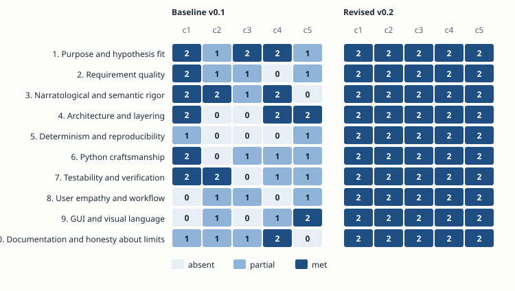
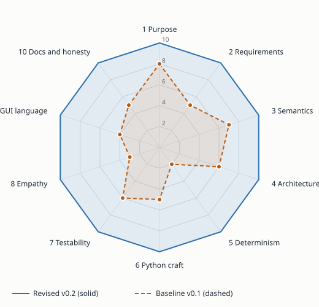

# SRS-033-R: Package Review and Scorecard

| Field | Value |
|---|---|
| Document ID | SRS-033-R |
| Version | 0.2 design score; implementation note 0.3 |
| Date | 2026-10-19 |
| Reviews | SRS-033 v0.2, SRS-033-A, SRS-033-V, IMPL-033 v0.2 |
| Reviewer stance | Literary critic and senior Python engineer, one reader holding both hats |

### How to read this scorecard now (2026-10-21)

The 51/100 and 100/100 figures, heat map, and radar chart compare two **versions of the written design**. They have not been rescored against the running application. The source has since gained a Tauri/React desktop shell, Python sidecar/kernel, and Mara/Len sample. The evidence and gaps are recorded in [SRS-033 Implementation Status](SRS-033-Implementation-Status.md). Cassettes, Pydantic, `import-linter`, complete GUI behavior, and human study verification below remain design targets; generated JSON Schema and TypeScript types now ship.

| Evidence from the current implementation | Result | What it does not establish |
|---|---|---|
| 88 Python behavior tests and one Rust retry-policy test | Passed | Full AC-01–AC-42, property and mutation gates, or literary validity. |
| TypeScript/Vite build and Rust `cargo check` | Passed | GUI end-to-end, accessibility, and performance goals. |
| Unsigned macOS `.app` build and bundled-sidecar smoke | Passed | Signed release, packaged GUI interaction, or Windows/Linux support. |
| Four offline condition runs | Distinct deterministic passages of roughly 800 words; 28 stage records passed in an earlier bundled-sidecar smoke | Model-backed generation, full grounding, blinded study, or literary validity. |

The running software has a separate, dated [ten-category codebase review](SRS-033-Codebase-Review-2026-10-21.md). Section 7's independent evidence-based rescoring and Milestone 9 sign-off remain open. Do not interpret a 10 in the original table as an implementation pass.

## 1. What this review does

The package was read twice: first as it stood after the first SRS and plan (baseline v0.1), then after the fixes drawn from the system assessment (revised v0.2). Each of ten categories has five criteria. A criterion scores **0** (absent), **1** (partial) or **2** (met), so a category runs 0 to 10.

| # | Category | Baseline (v0.1) | Revised (v0.2) |
|---|---|---|---|
| 1 | Purpose and hypothesis fit | 8 | 10 |
| 2 | Requirement quality | 5 | 10 |
| 3 | Narratological and semantic rigor | 7 | 10 |
| 4 | Architecture and layering | 6 | 10 |
| 5 | Determinism and reproducibility | 2 | 10 |
| 6 | Python craftsmanship | 5 | 10 |
| 7 | Testability and verification | 6 | 10 |
| 8 | User empathy and workflow | 3 | 10 |
| 9 | GUI and visual language | 4 | 10 |
| 10 | Documentation and honesty about limits | 5 | 10 |
| | **Total** | **51 / 100** | **100 / 100** |

*Heat map.* Each cell is one criterion. The left block is the baseline and the right block the revised package. The empty cells on the left cluster in categories 5, 8 and 9, which is where the biggest changes landed.

*Radar.* The baseline was strong on purpose and narratology and weak on determinism, empathy and the GUI. The revised shape is a full decagon.

## 2. Reading as a literary critic

1. **The package now says what a success would mean.** The first SRS promised an engine that produces an epiphany. A critic asks whose epiphany: the character's, the reader's, or the observer's. The revision keeps three answers apart (character, reader, observer) and ties each to a different proposed event type. That is the most important semantic repair in the specification.
2. **Story and telling are kept apart in the design.** Position carries time in the proposed visual language, so a reader of the canvas can see event order and telling order. The current app has separate story/discourse lenses and a basic time scrubber; the specified retrospection overlay remains open.
3. **Interpretation is not fact.** Observer-relative readings sit beside events and never replace them. The specified motif ledger (REQ-158) would let an evaluator ask what the chair or the bowl meant at D01 versus D05 without editing a single event; the current Motif lens derives a basic ledger, but does not implement the full visual catalog.
4. **Voice is a requirement in the design.** A full voice profile and drift checker are planned. The current packet and checker enforce selected phrase and length rules, not the full voice requirement.
5. **The theory table is honest about its status.** Genette, Phelan, Ryan, Doležel, Bremond and Herman are cited as established. Cohn, Iser, Jauss, Barthes, Kermode and Joyce appear as reviewer-proposed lenses and are marked that way.

## 3. Reading as a Python programmer

1. **Determinism is partly implemented.** Basis-point integers, canonical JSON, content-derived IDs, and offline template output support repeatable local runs. Cassette replay and model-output reproducibility remain planned.
2. **No code is evaluated.** The formula language is a closed AST with depth and node limits. This removes the usual temptation to `eval` an author's rule.
3. **Layering is specified more fully than it is enforced.** The current kernel lives in `src/cmne/`; there is no `kernel/fixtures.py` or `import-linter` gate in the app.
4. **Concurrency has basic safeguards.** A PID lock refuses a second writer and `app.hello` checks the protocol major version. Read-only second opens and concurrent committed-state reads during a background run are implemented; packaged GUI recovery remains unverified.
5. **Tests cover selected kernel behavior.** Mutation testing and the 80% kill target remain planned.

## 4. Criterion detail

#### 1. Purpose and hypothesis fit

| Criterion | v0.1 | v0.2 |
|---|---|---|
| States the research question and what would falsify it | 2 | 2 |
| Every feature traces to a stated purpose (SRS 2.8) | 1 | 2 |
| Scope and out-of-scope are explicit | 2 | 2 |
| Bounded experiment (Mara/Len, C0-C3) is the acceptance spine | 2 | 2 |
| Success measures separate system correctness from literary value | 1 | 2 |

#### 2. Requirement quality

| Criterion | v0.1 | v0.2 |
|---|---|---|
| Each requirement is atomic, testable, and has an ID | 2 | 2 |
| Priority and verification method are stated | 1 | 2 |
| Bidirectional traceability REQ to AC to task | 1 | 2 |
| No contradictions between SRS, plan, and GUI documents | 0 | 2 |
| Open questions are listed, owned, and resolved or defaulted | 1 | 2 |

#### 3. Narratological and semantic rigor

| Criterion | v0.1 | v0.2 |
|---|---|---|
| Story and discourse are separate timelines (Genette) | 2 | 2 |
| Observer-relative interpretation never overwrites events | 2 | 2 |
| Tension separates suspense, surprise, and curiosity (Phelan) | 1 | 2 |
| Epiphany is defined as a revision event with provenance | 2 | 2 |
| Theory table names sources, and flags what is proposed rather than established | 0 | 2 |

#### 4. Architecture and layering

| Criterion | v0.1 | v0.2 |
|---|---|---|
| Strict one-way dependencies, enforced by tool | 2 | 2 |
| Controller placement is decided (ADR-005) | 0 | 2 |
| Loader and parsing sit in the right layer | 0 | 2 |
| Ports isolate model vendors and the filesystem | 2 | 2 |
| Sidecar and shell hold no domain rules | 2 | 2 |

#### 5. Determinism and reproducibility

| Criterion | v0.1 | v0.2 |
|---|---|---|
| Canonical serialization and hashing are specified | 1 | 2 |
| Event IDs derive from content, not clocks or randomness | 0 | 2 |
| No floats in hashed state (basis points) | 0 | 2 |
| Model calls are recorded and replayable (cassettes) | 0 | 2 |
| Cross-platform hash vectors are a gate | 1 | 2 |

#### 6. Python craftsmanship

| Criterion | v0.1 | v0.2 |
|---|---|---|
| Pydantic contracts with a typed error catalog | 2 | 2 |
| Closed formula AST instead of eval or free text | 0 | 2 |
| Safe parsing, size limits, path containment | 1 | 2 |
| Single-writer lock and atomic append | 1 | 2 |
| Schema versioning with up-casting | 1 | 2 |

#### 7. Testability and verification

| Criterion | v0.1 | v0.2 |
|---|---|---|
| Coverage targets per package, with gates | 2 | 2 |
| Property tests for replay, isolation, and provenance | 2 | 2 |
| Mutation testing on invariants and revision logic | 0 | 2 |
| Every acceptance criterion maps to a named test | 1 | 2 |
| Packaged-app smoke test and performance budgets | 1 | 2 |

#### 8. User empathy and workflow

| Criterion | v0.1 | v0.2 |
|---|---|---|
| Personas state goals, fears, and what they need to feel | 0 | 2 |
| Scenarios cover first run, failure, and recovery | 1 | 2 |
| Error messages say what happened and what to do next | 1 | 2 |
| Vocabulary is plain; a glossary exists | 0 | 2 |
| The newcomer can succeed without reading the theory | 1 | 2 |

#### 9. GUI and visual language

| Criterion | v0.1 | v0.2 |
|---|---|---|
| Shape, border, and position carry meaning; color only reinforces | 0 | 2 |
| Create, modify, run, and visualize are one surface | 1 | 2 |
| Sealed vs draft semantics make 'modify' unambiguous | 0 | 2 |
| Graph scales, with an accessible outline alternative | 1 | 2 |
| Progress graph and strain overlay show the run live | 2 | 2 |

#### 10. Documentation and honesty about limits

| Criterion | v0.1 | v0.2 |
|---|---|---|
| Diagrams are validated, not just drafted | 1 | 2 |
| Assumptions and risks are recorded (risk register, ADRs) | 1 | 2 |
| Residual risks are named, including self-review bias | 1 | 2 |
| Docstring standard ties code to requirements | 2 | 2 |
| User guide follows the scenarios | 0 | 2 |

## 5. How each design gap closed in v0.2

| Gap in v0.1 specification | Addressed in the design by |
|---|---|
| Contradictory tension model | One machine, two views (REQ-036, ADR-006) |
| Controller placement unclear | ADR-005 |
| Floats in hashed state | Basis points (REQ-143, 149) |
| Nondeterministic IDs | Content-derived IDs (REQ-150) |
| Free-text conditions | Closed formula AST (REQ-147, 148) |
| No concurrency story | Lock, read/write modes, handshake (REQ-152, 165, 166) |
| Model calls not reproducible | Cassettes and budget (REQ-153, 154) |
| GUI was a list of views | SRS-033-V, GUI-001 to 040, seven lenses |
| "Modify" undefined for sealed events | Draft, seal, fork (ADR-010, GUI-011, 012) |
| No user voice | Personas P1 to P5, scenarios S-01 to S-13 |
| Thin verification | Verification-method column, mutation testing, AC-26 to AC-42 |

## 6. What a 10 does not mean

> **Read this before quoting the scores.**
>
> - The scores rate the **specification package**, not working software. The first implementation now has passing unit/build checks and an unsigned macOS bundle; these checks have not been used to rescore the rubric. Reaching 10 on paper means a criterion was addressed in the documents, not that the build meets it.
> - **The author scored the work.** The review was written by the same reviewer who made the fixes, so the rubric is biased toward the fixes being enough. T-35 requires a second reviewer to score the same rubric independently (§10.5 of the plan, risk R-08).
> - **Literary value is not scored.** Whether the prose is good is an evaluation-study question (REQ-100 to 114), and the answer may be that the engine does not help.
> - **Self-chosen rubric.** The ten categories were picked to fit this project. A different reviewer may weigh them differently.
> - **Open items remain**: OQ-A to OQ-H in the plan and OQ-17 to OQ-22 in the SRS.

## 7. Re-scoring procedure

At T-35, score each criterion again against the finished system with evidence (test name, CI link, commit). Record both the specification score and the implementation score. Any criterion that falls below 2 gets a task before release.
