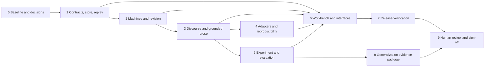

# SRS-033 project roadmap

| Field | Value |
|---|---|
| Status checked | 2026-10-21 against the local repository, 88-test suite, and implementation-status record |
| Scope | Complete the Coupled Modal Narrative Engine (CMNE) research workbench described by SRS-033 v0.2 and its visual-language supplement |
| Baseline | Working local Tauri/React app with a Python sidecar and deterministic, offline sample; full SRS acceptance has not been demonstrated |
| Planning unit | Dependency-ordered milestones with testable exit gates; no calendar dates or effort estimates are asserted |
| Status rule | Milestones 0–8 close on their software and automated evidence; Milestone 9 owns human study, interpretation, independent review, and sign-off. A milestone is complete only when its own stated exit gate passes. |

This roadmap turns the [requirements specification](SRS-033-Coupled-Modal-Narrative-Engine.md), [implementation plan](SRS-033-Implementation-Plan.md), [visual-language specification](SRS-033-GUI-Visual-Language.md), [scenarios](SRS-033-System-Assessment-and-Scenarios.md), and [implementation status](SRS-033-Implementation-Status.md) into an execution sequence. Those documents remain the source of detailed contracts. A requirement listed here is a **target**, not a claim that its present implementation passes.

## 1. Current milestone status

**Summary (2026-10-21 checkpoint):** 2 of 10 revised roadmap milestones meet their stated local software gates (5 and 8); 6 are **In progress** and 2 are **Planned**. The local Python suite has 88 passing tests. The acceptance inventory records 32 passed, 8 partial, and 232 planned IDs under the original full SRS wording. The cross-OS CI matrix has not run from a clean checkout, and the full packaged GUI/accessibility/performance gates are open. Human research and sign-off now have their own Milestone 9. “In progress” describes repository state, not a claim that someone is actively coding that milestone.

| Milestone | Overall status | Done now | In progress / partial | Planned to close the gate |
|---|---|---|---|---|
| 0. Baseline and decisions | **In progress** | ADR-001–ADR-013 record defaults; the executable inventory covers 167 REQ, 40 GUI, 42 AC, and 23 GAC IDs; CI includes Python tests/typing/lint, frontend/docs and line coverage on three OS targets, plus Rust Clippy/package jobs on macOS. | Local checks pass; the workflow has not run on GitHub from a clean checkout on all targets. | Run and fix the matrix, record target-specific evidence, and resolve any research-owner changes to the defaults. |
| 1. Contracts, store, replay | **In progress** | Typed contracts and generated schema/TypeScript, 49-code error catalog, bounded formulas, hash vectors, safe JSON import, atomic batches, locking/readers, corruption errors, snapshots, version-1-to-2 in-memory up-cast, and regression tests for failed project switch, invalid contract replacement, and post-commit error reporting. | Selected local tests pass; AC-27/32/38 remain partial, and INV-01–INV-18 do not yet have a complete invariant-by-invariant evidence set. | Prove all applicable invariants and ACs, run cross-OS vectors, and exercise packaged GUI recovery. |
| 2. Machines and revision | **In progress** | Six projections, weighted integer strain, crisis eligibility and seven options, modal consistency rules, preserved conceptual versions and interpretations, five trace forms, C0–C3 state comparison, a motif ledger, and nine separate sealed-history fixtures with checked outcomes. | AC-08–AC-13, AC-20/21/39 have named local tests. REQ-132 is partial: the reader-only/character-only fixtures check divergence but do not prove a complete epiphany model. Provenance/reader semantics and broader property evidence remain incomplete. | Add property tests; complete every observer provenance path and formal modal/conceptual rule; verify UI labels and full gate evidence. |
| 3. Discourse and grounded prose | **In progress** | Discourse-time fields, focal-access packet filtering, reader before/after snapshots, `ProseRealizer` protocol, sentence annotations, deterministic checks for selected access/causal/disclosure/resolution/voice patterns, rejected candidate records, and repair-first layer. | AC-15–AC-18/33 pass locally for their specified examples. Heuristic language checks can miss paraphrases; suspense/surprise/irony plan variants and a broad adversarial corpus are incomplete. | Complete semantics and corpus, verify AC-19 adapter fallback, and demonstrate grounding portion of AC-22. |
| 4. Adapters and reproducibility | **Planned** | Offline template path and saved run/packet/projection hashes provide prerequisites. | No model adapter, cassette, call budget, model manifest, or network-blocked replay is implemented. | Adapter ports and contract tests, vendor selection, recording/replay, budget and privacy controls, AC-30/31. |
| 5. Experiment and evaluation software | **Complete (local software gate)** | Layer A/B diagnostics; seven saved, realized controlled ablations with lineage and checker findings; fixed plans and linked amendments; 12 distinct offline variants; randomized text/HTML blind export with private key; atomic cited-span response import; descriptive agreement, intervals, rejection counts, and null/contrary report. | Human recruitment, final study-design approval, responses, and literary interpretation are assigned to Milestone 9. | Retest on release targets in Milestone 7; Milestone 9 conducts and signs off the study. |
| 6. CLI, sidecar, workbench | **In progress** | Expanded `--json` CLI, study/trace/decision RPC, seven lenses, drafts, compare/trace/chart, fixture/contract JSON editing with immediate bounds feedback, outline node/link tables, four-condition strain chart, study controls, background run progress, locked status snapshots, committed-state reads and cancellation between conditions. | Local Python/TypeScript tests pass. Concept/rule editing, full graph catalog/diff/overlays, keyboard/table parity, 300-node performance, packaged GUI E2E, and GAC-01–GAC-23 evidence remain open. | Implement and verify the remaining GUI catalog/accessibility/performance tasks and target-platform packaged journeys. |
| 7. Release verification | **In progress** | Build/launch scripts, unsigned macOS bundle, bundled-sidecar smoke, MkDocs source/generated docs, local line-coverage and release-preflight scripts; 100-event kernel timing sample. | No recorded full GUI E2E, cross-platform package, mutation, accessibility, or 300-node graph performance gate. | Target-OS CI, packaged GUI smoke, complete automated trace report and AC/GAC gates. Independent review and release sign-off belong to Milestone 9. |
| 8. Generalization evidence package | **Complete (local software gate)** | A deterministic decision packet joins the fixed plan, C0–C3 structural measures, seven saved ablations, response counts, effects, and null/contrary alternatives without inventing a decision. | Actual study data and the go/no-go judgment are assigned to Milestone 9. | Retest the packet against collected data in Milestone 9. |
| 9. Human review and sign-off | **Planned** | The study protocol, blinded export, report, and decision packet are ready for review. | No research-lead approval, recruited responses, independent assessment, or release sign-off has occurred. | Approve the final protocol and target platforms; conduct the study; interpret AC-22 and S-07–S-09; review accessibility/literary quality; make a dated generalization and release decision. |

### Evidence at this check

| Measure | Current value | Limit |
|---|---|---|
| Python tests | **88 passed** locally on 2026-10-21 with `PYTHONPATH=src python3 -m unittest discover -s tests -q`; one Rust retry-policy test also passed | Selected tests, not full AC/GAC acceptance |
| Python line coverage | **89.4%** executable lines (2,785/3,116) with `scripts/coverage_report.py`; core 97.6%, machines 97.3%, prose 93.5%, study 96.7%, project 89.4%, CLI 69.9%, sidecar 60.5% | [Full report](../reports/coverage-2026-10-21.json); standard-library line coverage, not branch/GUI/Rust coverage or a mutation score |
| Sample conditions | **4** seeded branches, C0–C3 | Branches exist; study validity and all distinguishability gates remain unproved |
| Derived machine views | **6** named projections | Several have only partial SRS semantics |
| Desktop lenses | **7** views; **2** editable lenses (Story and Discourse) | Fixture/Mind/Provenance/Motif/Pipeline are chiefly inspection views |
| Acceptance inventory | **272 IDs**: 167 REQ, 40 GUI, 42 AC, 23 GAC; 32 passed, 8 partial, 232 planned in the conservative [expanded report](../reports/acceptance-inventory.json) | An inventory entry is not a passing acceptance result |
| Packaging evidence | **1** unsigned macOS app rebuilt locally on 2026-10-21; [packaged sidecar smoke](../reports/packaged-sidecar-smoke-2026-10-21.json) passed handshake, atomic batch, draft recovery, study export, seven ablations, and decision packet | No full packaged GUI smoke or Windows/Linux package result recorded |
| CI | GitHub Pages workflow plus three-OS checks/coverage and macOS Rust/package jobs | New GitHub Actions jobs have not run yet |
| Local release preflight | **11/11 passed** for Python tests, Mypy, Ruff, acceptance inventory, generated artifacts, frontend, docs, kernel timing, and Rust Clippy | [Preflight report](../reports/release-preflight-2026-10-21.json); no packaged GUI, multi-OS, accessibility, graph performance, or mutation result |
| Local kernel timing | 100-event replay max 0.0003 s; packet max 0.0015 s; development sidecar handshake max 0.0517 s | [Benchmark report](../reports/benchmark-kernel.json); current macOS host, 5/5/3 samples, not the reference-machine or 300-node GUI gate |

Treat these as **evidence counts**, not a percent-complete score. Python, frontend, Rust (with rustup first on `PATH`), MkDocs, macOS package build, and packaged-sidecar smoke passed locally. GitHub Actions and full GUI evidence remain outstanding. The [ten-category software review](SRS-033-Codebase-Review-2026-10-21.md) ranks quality with these limits explicit.

## 2. Destination and present baseline

The complete product lets an author define a two-actor scene, maintain sealed causal history, model distinct actor and reader knowledge, apply belief/modal/conceptual revisions, plan what the reader learns, realize grounded prose, compare C0–C3 and ablations, conduct a blinded human study, and reproduce a published result. The desktop workbench and CLI must expose that path without moving narrative rules into the UI or Rust shell.

| Capability | Current evidence | Remaining release work |
|---|---|---|
| Local app and packaging | Tauri 2/React shell, Python sidecar, macOS unsigned bundle, protocol handshake, background condition runs and cancel | Full application smoke, robust supervision, target-platform CI |
| Canon and replay | Fixture/contract validation, hashed NDJSON, one-writer lock, branch fork, six named projections, versioned schemas/up-cast, snapshots, and atomic batches | Complete invariant evidence and cross-platform hash-vector runs |
| Narrative mechanics | Bounded formula AST, weighted strain/crisis, versioned revision records, five trace queries, motif ledger, C0–C3 state comparison | Independent golden fixtures, deeper provenance and formal semantics, realized ablations |
| Prose | Focal-access packet, offline realization, sentence annotations and selected hard checks | Adversarial grounding corpus, robust paraphrase handling, optional model adapters |
| Research | Fixed plans, 12 matched offline variants, blinded export, response import and descriptive report | Real human responses, matched realized ablations, study analysis and interpretation |
| Workbench | Seven lenses, SVG graph, outline, inspector, scrubber, basic compare/chart/trace | Full visual language, fixture/rule editing, diff/overlays, live pipeline, accessibility and performance gates |
| Documentation and quality | MkDocs manual/design/API, generated schema and error catalog, full acceptance inventory, and selected unit/build checks | Verified theory traceability and complete property/mutation/E2E evidence |

The current [implementation status](SRS-033-Implementation-Status.md) records 82 selected Python tests and local build checks. Thirty-two individual ACs have named passing evidence; the full AC-01–AC-42 and GAC-01–GAC-23 set remains open. A passing current run does not establish the SRS's grounding or literary claims.

## 3. Sequencing and release rules

Milestones 4 and 5 can proceed after the packet/checker contract stabilizes. Workbench foundations can improve earlier, but its final run, study, and trace flows depend on the corresponding kernel services. Every milestone must preserve a runnable offline template path and existing project data. Breaking format changes require an explicit migration/up-cast test before merging.

**Priority convention.** Deliver every SRS **M** requirement and every applicable AC/GAC gate for the complete SRS release. Include **S** requirements where a named acceptance criterion or scenario depends on them (for example blinded export, motif ledger, accessibility, and replay cassettes). Treat **C** capabilities and optional SQLite storage as scoped additions after the required gates. The original SRS generalization decision is preserved in Milestone 9; the revised Milestone 8 prepares its evidence packet. The complete SRS release still requires Milestone 9.

## 4. Milestones and exit gates

### Milestone 0 — Baseline, decisions, and executable traceability

**Outcome.** One agreed release target and one visible list of unpassed requirements. Establish a repeatable way to prove progress before adding major semantics.

**Work.** Reconcile the current compact JSON/NDJSON implementation with the proposed Pydantic/module layout without rewriting sealed projects casually. Record ADRs for schema authority, persistence default, migration, run execution model, supported OS, adapter credentials, voice exemplars, and evaluation protocol. Create a machine-readable REQ/GUI-to-test and AC/GAC-to-test map; mark each as passed, partial, missing, or blocked by a decision. Add CI for Python, Rust, frontend, docs, and packaged smoke on the selected targets.

**Exit evidence.** Baseline CI runs from a clean checkout; the status record names each current pass and gap; unresolved product/research choices have explicit defaults or a decision owner. No design-review score is counted as implementation acceptance. Maps cover AC-01–AC-42 and GAC-01–GAC-23, even when tests are still pending.

**References.** IMPL-033 T-00–T-01 and T-35; REQ-129, REQ-139, REQ-159, REQ-163; S-01–S-13.

### Milestone 1 — Deterministic contracts, transactions, and replay

**Outcome.** The project folder is a trustworthy, versioned source of canon across processes and operating systems.

**Work.** Define typed fixture, contract, event, formula, result, and error schemas as the shared boundary. Complete the bounded formula evaluator and canonical integer/hash rules. Implement a command transaction that validates all emitted events and commits them atomically; retain no update/delete path for sealed events. Add safe import/path/size checks, line-specific corruption errors, one-writer/many-reader behavior, stale-lock handling, schema up-casts in memory, trusted snapshot verification, and replay fallback. Keep derived state independent across branches. Generate TypeScript/RPC contracts from the same schema or explicitly test equivalent contracts if a different schema tool is chosen.

**Exit evidence.** Cross-OS golden hash vectors match; an invalid second event leaves a batch uncommitted; a killed append cannot expose partial canon; a v1 project reads under the new reducer without changing stored bytes; invalid files and symlinks are rejected. Verify AC-01–AC-07, AC-14, AC-23–AC-29, AC-32, AC-35–AC-36, and AC-38 where applicable. Do not mark an AC passed from a narrower unit test alone.

**References.** SRS M1; REQ-001–027, REQ-123, REQ-127–129, REQ-147–152, REQ-155–156; IMPL-033 T-02–T-10.

### Milestone 2 — Six machines, crisis logic, and provenance

**Outcome.** C0, C1, C2, and C3 differ by explicit state transitions, and every consequential claim can be traced to accessible evidence.

**Work.** Complete one Actor reducer instantiated twice, Environment, Tension with two views, Reader, and Prose Style. Compute strain from contract weights; gate crisis eligibility on accessible evidence, implicated commitments, threshold, and repair budget. Implement the seven revision options and distinct belief, modal, and conceptual operators. Preserve superseded model versions and both old/new interpretations; permit rival and suspended interpretations without promoting them to world facts. Add claim provenance, five trace queries, and a motif ledger with discourse appearances. Expand the C0–C3 comparer to report state-level distinction and changed interpretations; add the nine specified golden fixtures.

**Exit evidence.** AC-08–AC-14, AC-20–AC-21, and AC-39 pass on golden histories; C3's retrospective links to S01/S02 and C1's belief-only change are mechanically visible; an inaccessible observation cannot cause crisis; every observer claim has a provenance path. The interface labels the reader projection as simulated and the epiphany result as a candidate, never a certification.

**References.** SRS M1–M2; REQ-028–069, REQ-101–105, REQ-131–132, REQ-158; IMPL-033 T-11–T-15.

### Milestone 3 — Discourse, packet, voice, and hard grounding

**Outcome.** A sealed story can be told in different orders without changing canon, and generated prose is checked against the focalizer's knowledge and the contract.

**Work.** Complete discourse timing, reveal/cue/withhold semantics, focalizer state, and suspense/surprise/irony variants. Build a deterministic, read-only packet containing only licensed claims, reader before/after views, unresolved questions, voice constraints, and word bounds. Define the `ProseRealizer` port and keep the template realizer. Annotate candidate sentences with act, claim type, grounding source, and access; distinguish assertions from metaphor, hypothesis, and free indirect thought. Flag ungrounded entities, causal claims, private cognition, premature disclosures, forced resolution, and voice violations; retain rejected candidates as evaluation records. Classify findings by responsible layer and expose a repair-first status.

**Exit evidence.** Packet hashes match on repeat builds; a Len-private-motive sentence in Mara's close third fails while an allowed metaphor does not; an explicitly resolved open question fails; voice rules produce deterministic findings; story/discourse streams are unchanged by realization. Verify AC-06, AC-15–AC-19, AC-33, and the grounding portion of AC-22. Human review still judges literary quality.

**References.** SRS M3–M4; REQ-070–095, REQ-146, REQ-157; IMPL-033 T-16–T-17.

### Milestone 4 — Model adapters, budgets, and reproducible runs

**Outcome.** A model can propose or realize text without gaining authority over canon, and a recorded run can be replayed without network access.

**Work.** Define vendor-independent proposal and prose adapter ports. Validate generated commands through the same command bus as authored commands. Add a recording/replay cassette, model/prompt/seed/decoding manifest, per-run budget guard, timeout/failure fallback, secret redaction, and opt-in transfer of fixture/evaluator data. Preserve the deterministic template path as a fully supported mode. Exercise adapter contract tests with an offline fake before selecting a vendor; implement a vendor adapter only after the model, cost ceiling, and credential storage decision is recorded.

**Exit evidence.** A replay with sockets blocked is byte-identical to its recording; the sixth call under a five-call budget is prevented; an unavailable adapter leaves canon intact and the template path completes; credentials never enter logs, events, packets, or exports. Verify AC-19, AC-20, AC-30–AC-31 and the S-10–S-12 adapter paths.

**References.** SRS M4; REQ-024, REQ-027, REQ-096–099, REQ-121–122, REQ-124, REQ-134, REQ-153–154; IMPL-033 T-18.

### Milestone 5 — Bounded experiment software and evaluation dry run

**Outcome.** The Mara/Len comparison is prepared for human evaluation without disclosing condition labels or hiding rejected/null results.

**Work.** Complete Layer A blocking checks, Layer B descriptive measures, and Layer C ablations. Record an analysis plan before export: hypotheses, measures, sample-size rationale, agreement metric, exclusion rules, and session limit. Produce matched realizations (at least three per branch where required), separate the blinded key, randomize presentation, and keep rejected candidates in the audit trail. Provide a short accessible evaluator protocol with span citation and “no discernible difference.” Import structured responses with field-level errors; report primary/secondary measures, agreement, effect sizes with intervals, per-condition generation/rejection counts, and contrary or null results. Keep advisory model ratings outside human ground truth.

**Exit evidence.** Export without a plan returns E-PLAN-001; removing the key leaves no condition cue in passages; response import rejects malformed rows without silently dropping them; seven ablations save distinct, checked passage candidates without changing canon; the report can represent a null or contrary result. The 82-test local suite exercises this dry run and AC-25/34/40 examples. The human-grounded portion of AC-22 and S-07–S-09, final protocol approval, recruitment, and claims about literary effect are Milestone 9 gates. **Local software gate: passed; release-target retest remains in Milestone 7.**

**References.** SRS M5; REQ-100–114, REQ-118, REQ-135, REQ-160–162; IMPL-033 T-19.

### Milestone 6 — Complete CLI, sidecar, and seven-lens workbench

**Outcome.** An author can perform the complete workflow in the desktop app or CLI, while the Python services remain authoritative.

**Work.** Expose all REQ-115 CLI operations with `--json`, usable exit codes, and corrective errors. Make long runs asynchronous with progress notifications, read access to committed state during writes/runs, and cancellation at safe points. Add fixture, concept, rule, and contract editing; full import/export; the visual-language node/edge/state catalog; draft autosave and recovery; transaction-safe sealing; rich comparison and overlays; trace path highlighting; scene packet and sentence findings views; run settings; live pipeline/strain views. Ensure graph and outline/table offer equivalent operations, complete keyboard flows, text alternatives, reduced motion, high contrast, and status beyond color. Keep manual layout separate from domain data. Fixture and contract JSON editing is available; concept/rule and full graph editing are pending.

**Exit evidence.** A user can complete S-01–S-06 and S-13 in a packaged app, and study/adapter tasks in S-07–S-12 through their intended interfaces. Run cancellation stops within five seconds without partial canon. GAC-01–GAC-23 pass, including 300-node/30-fps, 200-ms interaction, keyboard-only authoring, recovery, and `axe-core` checks. A GUI demonstration alone is insufficient for accessibility or performance gates.

**References.** SRS M7; REQ-115–122, REQ-164–167, GUI-001–GUI-040; IMPL-033 T-20–T-32; SRS-033-V.

### Milestone 7 — Packaging, documentation, and release verification

**Outcome.** A clean checkout builds, launches, verifies, and documents the complete product on the agreed platforms.

**Work.** Finish target-specific sidecar packaging and smoke tests. Run the Python/Rust/frontend/docs CI matrix and packaged GUI smoke. Complete MkDocs API/developer/testing/ADR/error-catalog/theory pages and keep user instructions aligned with shipped behavior. Add property and golden tests, cross-platform vectors, mutation testing, static layer checks, accessibility tests, end-to-end flows, benchmarks, and a requirement trace report. Record automated preflight results and limitations. Signing/notarization choice, independent review, and release approval are Milestone 9 decisions.

**Exit evidence.** All automatable AC-01–AC-42 and GAC-01–GAC-23 checks pass with named evidence; any human-only judgments are explicitly assigned to Milestone 9. The IMPL-033 coverage targets, ≥80% mutation kill rate, AC-37 performance limits, and packaged smoke pass. `mkdocs build --strict` passes; generated output, build scripts, and release notes match the actual distribution. The local preflight is a subset and does not close this gate.

**References.** IMPL-033 T-33–T-35 and §7; SRS §§5, 9; REQ-125–133, REQ-136–139, REQ-159, REQ-163–167.

### Milestone 8 — Generalization evidence package

**Outcome.** Prepare a reproducible decision package that can be regenerated after response import. The decision itself belongs to Milestone 9.

**Work.** Join the frozen plan, C0–C3 structural diagnostics, seven ablation outcomes, descriptive response measures, intervals, contrary results, and null alternatives into a hashed packet. Keep raw evaluator responses out of the decision summary. Explicitly identify missing responses and leave the decision pending.

**Exit evidence.** Repeated packet builds produce the same hash; a zero-response packet reports a null alternative and `pending_human_review`; all seven ablation records and four condition metrics are present. The dated go/no-go decision and useful-components judgment move to Milestone 9. **Local software gate: passed; release-target retest remains in Milestone 7.**

**References.** SRS M6 and OQ-10; S-09 and S-12.

### Milestone 9 — Human study, independent review, and sign-off

**Outcome.** People decide whether the bounded tool and its literary hypothesis are supported, and whether the release is acceptable.

**Work.** A research lead approves or amends the study plan, recruitment and consent approach, target release platforms, and any licensed voice exemplars. Recruit readers, conduct the blinded protocol, review cited spans and literary quality, and examine contrary/null results. Independently review accessibility and the complete acceptance dossier. Decide whether to generalize the engine, record useful components if the hypothesis fails, and sign off or reject release.

**Exit evidence.** A dated study record and decision cite collected responses, exclusions, agreement, effects, ablations, limitations, and reviewer identities or roles. The release sign-off records supported platforms, remaining risks, approved scope changes, and a go/no-go outcome. Software cannot auto-pass this milestone.

**References.** Original SRS M5–M6; AC-22; S-07–S-09; OQ-10, OQ-14, OQ-18, OQ-20.

## 5. Cross-cutting verification matrix

| Evidence stream | Minimum gate and where it matters |
|---|---|
| Requirements | Every REQ and GUI requirement has a test/inspection marker and actual status; every AC/GAC has named evidence before release |
| Determinism | Golden fixtures and hashes on macOS, Linux, and Windows; property tests for key order, branch isolation, snapshots, and concept versions |
| Domain correctness | One explicit test per hard invariant; all nine golden fixtures; no rejected command changes projections or history |
| Integration | Sidecar framing/handshake/read-write tests; Rust supervisor with real sidecar; CLI exit/JSON tests; packaged application smoke |
| Accessibility | Keyboard-only create/connect/seal and outline parity, reduced motion/forced colors, and automated checks on every lens |
| Performance | Reference-machine measurements for 100-event replay ≤1 s, packet build ≤2 s, sidecar ready ≤3 s, and 300-node graph ≥30 fps with actions ≤200 ms |
| Test strength | IMPL-033 package coverage thresholds and ≥80% mutation kill rate in invariant/machine/revision code |
| Documentation | Strict MkDocs build, link/diagram checks, generated API/error catalog, theory traceability, user manual verified against the release |
| Research integrity | Plan hash before blind export, separate condition key, retained rejected candidates, auditable imports, realized ablations, and a report that can show null results; human interpretation in Milestone 9 |

## 6. Decisions and risks to resolve early

| Decision or risk | Effect if left open | Resolution point |
|---|---|---|
| Schema source and migration path | UI/Python drift or unreadable old projects | Milestone 0; prove at Milestone 1 |
| Default NDJSON versus optional SQLite | Duplicate store work and inconsistent tests | Milestone 0; NDJSON remains the required path |
| Exact strain weights and crisis threshold | C3 eligibility may be arbitrary or non-reproducible | Before Milestone 2 golden fixtures |
| Vendor, budget, and credential location | Adapter behavior and cost cannot be verified | Before Milestone 4 vendor implementation |
| Voice exemplars and usage rights | Unclear style target or shipping rights | Before Milestone 3 voice-profile tests |
| Human sample, recruitment, consent, and final agreement metric | Study cannot be conducted credibly | Milestone 9 review of the frozen pilot plan |
| Release OS and signing | Distribution scope remains unapproved | Milestone 9 sign-off; Milestone 7 exercises configured CI targets |
| Checker false positives/negatives | An apparently passing run could be ungrounded | Milestone 3 golden/adversarial corpus; keep human review |
| Graph performance and accessibility | Core workflows fail on large or assistive-use cases | Prototype early; formal gate in Milestone 6 |

## 7. First execution slice

The first execution slice is implemented locally: the inventory and ADRs exist; a two-event command is atomic; crash, stale-lock, corruption, reader, hash-vector, and real version-1-to-2 up-cast tests pass. Milestone 5's study software and Milestone 8's decision packet pass their revised local gates. The next software work is cross-OS CI, complete invariant and GUI gates, model cassettes, and release verification. Milestone 9 holds the human study and sign-off.
