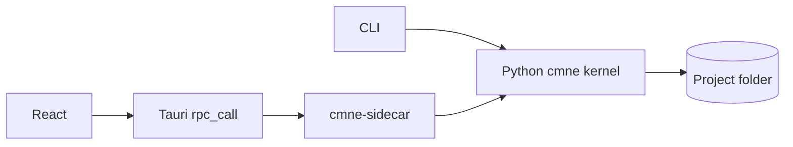

# API reference

The Python kernel is the source of narrative rules. The CLI calls it directly. The desktop UI calls it through Tauri's `rpc_call`, which relays to a line-framed JSON-RPC sidecar. The sidecar and GUI use the same project storage.

| Interface | Use |
|---|---|
| [Python kernel](python.md) | Scripting and tests in the same Python process |
| [CLI](cli.md) | Create, run, and inspect a graph from a terminal |
| [JSON-RPC](json-rpc.md) | Full project, draft, graph, run, and export operations |
| [Data contracts](contracts.md) | Event fields, formula syntax, validation, errors |
| [Tauri bridge](tauri.md) | Frontend to sidecar command boundary |

Protocol version is `1.0`; event schema and reducer version are `2`, while project metadata format remains version `1`. Methods returning errors do not mutate sealed history unless explicitly described. See the [storage design](../design/storage.md) for the on-disk model.
