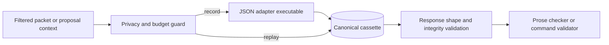

# Model adapter contract

The desktop and CLI default to the deterministic template. An optional JSON executable can propose story commands or realize prose. The executable is supplied by the researcher; CMNE does not bundle a vendor service or credentials. Every adapter call passes through a call/token/cost budget and a local request/response cassette.

## Prepare a run

1. Create a JSON manifest with exactly `model_name`, `model_version`, `prompt_version`, integer `seed`, and `decoding`. The optional decoding fields are integer `temperature_bp`, `top_p_bp`, and `max_output_tokens`.
2. Make an executable that reads one JSON request from standard input and writes one JSON response to standard output. Store credentials in its environment or a configuration file excluded from version control. Do not pass credentials in the manifest, command arguments, or output.
3. Use `--allow-data-transfer` only after reviewing the fixture and evaluator data for that run. Record mode refuses an adapter call without this flag. Replay mode needs no executable or network access.

```json
{"model_name":"research-adapter","model_version":"1","prompt_version":"scene-v1","seed":33,"decoding":{"temperature_bp":0,"max_output_tokens":512}}
```

## Request and response

The input has `role` (`prose` or `proposal`), `manifest`, and `payload`. A prose payload contains the filtered scene `packet` and `variant_index`. A proposal payload contains current projections, the contract, unresolved goals and contradictions, allowed command types, a limited entity/predicate catalog, branch ID, and expected sequence.

The output must contain only `output` and `usage`. `usage` has nonnegative integer `input_tokens`, `output_tokens`, and `cost_micros`. Prose `output` is a string. Proposal `output` is an object with a `candidates` array of at most 16 entries; each entry has `payload`, `rationale`, and `expected_effects`. Rationales stay in diagnostic proposal records and are never world facts. A proposal changes canon only after `accept-proposal` sends its payload through the ordinary story command validator.

```json
{"output":"The room was quiet.","usage":{"input_tokens":20,"output_tokens":5,"cost_micros":0}}
```

## Record and replay

```sh
cmne --json run PROJECT --branch BRANCH --adapter-mode record \
  --adapter-command /path/to/adapter --model-manifest manifest.json \
  --max-calls 5 --max-tokens 10000 --allow-data-transfer

cmne --json run PROJECT --branch BRANCH --adapter-mode replay \
  --model-manifest manifest.json --max-calls 5 --max-tokens 10000

cmne --json propose PROJECT --branch BRANCH --adapter-mode record \
  --adapter-command /path/to/adapter --model-manifest manifest.json \
  --allow-data-transfer
cmne --json accept-proposal PROJECT PROPOSAL_ID --branch BRANCH
```

The cassette key is the SHA-256 hash of the canonical request. `cassettes/<hash>.json` stores the request, response, and response hash. Replay validates both hashes and never invokes the executable. A missing or corrupt entry raises `E-CASSETTE-001`; recording a different response for an existing request is refused. The sixth call under a five-call budget raises `E-BUDGET-001` before invoking the adapter and reports spend so far. Adapter failures fall back to the template for prose runs and are recorded as `adapter_failure` without copying vendor exception text. Budget and cassette errors stop the run.



The current implementation has contract tests with an offline fake and a subprocess adapter bridge. A specific external model/vendor, cost ceiling, and credential configuration have not been selected for release. Model-generated prose remains a candidate subject to the deterministic checker and human review.
