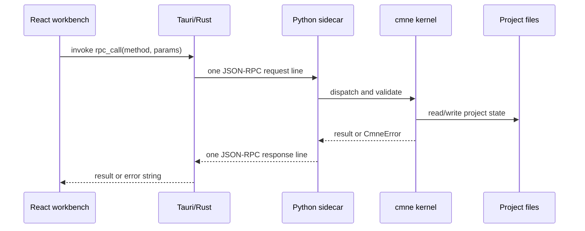

# Runtime architecture

## Components

The React UI owns editing interaction and graph presentation. The Rust command `rpc_call` restricts method names and serializes access to one child process. It starts the Python sidecar from the development virtual environment or bundled executable, performs `app.hello`, and restarts once after a broken pipe. The sidecar speaks line-delimited JSON-RPC 2.0 on standard input/output; logs go to standard error. The Python kernel owns narrative validation, storage, replay, packet construction, realization, and checking.

The UI offers seven lenses. **Story** and **Discourse** allow drafts; **Fixture**, **Mind**, **Provenance**, **Motif**, and **Pipeline** visualize current or derived data. The graph envelope includes nodes and edges with IDs, titles, fields, state, and text alternatives. An outline, inspector, scrubber, strain chart, trace pane, and branch comparison provide other routes through the same data.

## Runtime boundaries

| Boundary | Contract |
|---|---|
| React → Rust | Tauri `invoke("rpc_call", {method, params})` or `default_sample_path` |
| Rust → Python | One JSON-RPC request/response per newline, protocol major version 1 |
| Sidecar → kernel | In-process Python calls over JSON-compatible values |
| Kernel → disk | Local project directory, hashed NDJSON streams and atomic JSON writes |

The sidecar is stateful: `app.hello` precedes other calls and one project can be open in a process. The project lock allows one writer. Read the [JSON-RPC reference](../api/json-rpc.md) and [Tauri bridge](../api/tauri.md) for method details.
