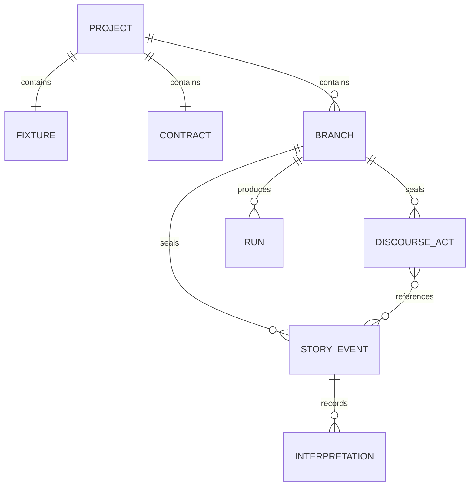

# Domain model and narrative theory

## Story, discourse, and perspectives

The **fixture** names exactly two actors, entities, initial facts, and optional style. The **contract** states required/forbidden story conditions, facts that should be clear, questions left open, prose bounds, and a strain threshold. **Story events** are sealed in sequence; **discourse acts** select and order references to those events. Replay derives six projections: `actor_a`, `actor_b`, `environment`, `tension`, `reader`, and `prose_style`.

The sample **Mara and Len** is a controlled comparison. C0 reveals a fact; C1 revises a belief; C2 adds a possible situation; C3 changes the concepts used to classify prior events. All share the same first seven story events and diverge later. The question is whether a later change affects how earlier details are understood, even though the sealed past stays intact.

| Revision | Implemented representation | Projection effect |
|---|---|---|
| Interpretation | Claim tied to an observer and earlier story sequence(s) | Adds an interpretation and belief to that actor |
| Belief | Observer, claim, status, confidence, accessible evidence | Replaces that actor's claim status |
| Modal | Observer and added scenarios | Increments modal model version and appends scenarios |
| Conceptual | Observer, concepts, migration map | Creates a new conceptual model version with superseded model |

This representation supports useful inspection, but it is not yet a complete formal epistemic/modal revision engine. The current [formula AST](../api/contracts.md#formula-ast) supports tri-state preconditions and bounded syntax; provenance and grounding checks are partial.

## Temporal relations

Story sequence is the order of sealed events. A causal edge must point from an earlier sealed event to a later one. A discourse act can reference any sealed story event and is itself ordered in the discourse stream. A later event's interpretation can target earlier story sequence numbers. The scrubber replays a prefix of story and optionally a prefix of discourse; this lets an author compare the world and the reader's disclosed information at a chosen point.

## Design invariants

- Exactly two fixture actors, with unique actor/entity IDs.
- Event stream entries carry stable IDs and integrity hashes; earlier sealed entries are not edited in place.
- Observation has an observer and an access path; belief revision cites evidence the observer could access.
- Discourse `reveal` is grounded in referenced story facts, except when hypothetical/unreliable is explicitly marked.
- Causal parents are earlier events; a draft causal graph cannot contain cycles.
- Runs and exports are derived artifacts, separate from sealed canon.
