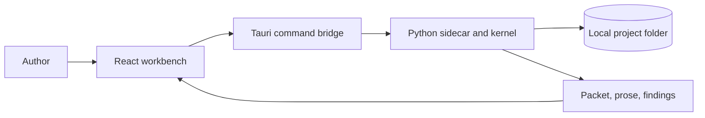

# Design overview

CMNE is a local narrative workbench for a bounded two-actor scene. It separates **what happened** (story) from **how the reader encounters it** (discourse), then replays sealed events into actor, world, reader, tension, and style views. A scene packet feeds an offline deterministic realizer. The desktop app is Tauri 2, React, and a Python sidecar.

The design pages document **implemented behavior**. The original [_design specifications](https://github.com/mattbriggs/Coupled-Modal-Narrative-Engine/tree/main/_design) describe the broader research system. See [Current limits](roadmap.md) before treating a research scenario as available in this build.

| Topic | Page |
|---|---|
| Narrative entities, revisions, and the C0–C3 comparison | [Domain model](domain-model.md) |
| Components and protocol boundary | [Runtime architecture](architecture.md) |
| Deterministic run and checking | [Pipeline](pipeline.md) |
| Project layout, integrity, and branches | [Storage](storage.md) |
| Shipped scope and planned work | [Roadmap](roadmap.md) |

For user tasks, start with the [manual](../manual/index.md). For callable interfaces, see the [API](../api/index.md).
