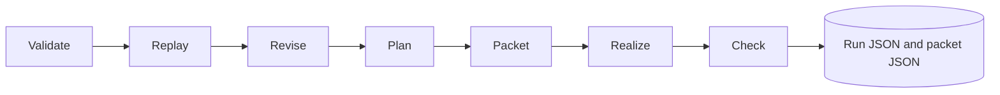

# Pipeline and checks

## Run flow

These seven names are recorded in each run's `stages`. In this release, `Project.run` performs packet construction, deterministic realization, and checks synchronously; the stage entries are a report of that process, not seven independent worker services. If findings exist, the run marks an applicable stage failed and later stages skipped. The pipeline lens shows latest stage status for C0–C3.

## Packet content

`build_packet` replays the branch and combines ordered discourse acts with referenced story payloads, grounded story facts, prose style, simulated reader state, forbidden assertions, unresolved questions, and word bounds. A canonical hash identifies the packet. The packet is saved at `packets/<packet-hash>.json` when running.

## Realization

`template_realize` joins authored discourse `text` with blank lines. If an act has no text, it uses referenced story descriptions/titles. The unchanged seeded Mara and Len story can use authored expanded paragraphs; custom projects and edited cues use their actual authored text. No network or model API is used.

## Checks and limits

| Check | Current behavior |
|---|---|
| Word bounds | Counts word-like tokens and compares with contract min/max |
| Forbidden assertions | Case-insensitive literal substring search in realized prose |
| Required story conditions | Confirms each required condition occurs in grounded story facts |
| Missing content | Flags empty story or discourse |
| Disclosure grounding | Validated when sealing discourse acts |

`facts_that_must_be_clear`, `questions_that_must_remain_open`, and `strain_threshold_bp` are stored contract fields but are not fully evaluated by the current run checker. There is no general semantic grounding proof, private-cognition leak detector, or model adapter. The manual explains how to [read a finding](../manual/read-output.md).
