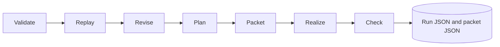

# Pipeline and checks

## Run flow

These seven names are recorded in each run's `stages`. `Project.run` performs packet construction, deterministic realization, and checks in one operation; stage entries report the outcome, not seven independent worker services. The sidecar can run conditions in a background worker, report completed conditions, and cancel before the next condition. If findings exist, the run marks the responsible stage failed and later stages skipped.

## Packet content

`build_packet` replays the branch and combines ordered acts with discourse time, focal access, reader state before/after each act, licensed claims, style, forbidden assertions, unresolved questions, voice rules, and word bounds. Story references outside focal access have their descriptions/facts removed from the realizer view. A canonical hash identifies the packet, saved at `packets/<packet-hash>.json` when running.

## Realization

`template_realize` joins authored discourse `text` with blank lines. If an act has no text, it uses referenced story descriptions/titles. The unchanged seeded Mara and Len story can use authored expanded paragraphs; custom projects and edited cues use their actual authored text. No network or model API is used.

## Checks and limits

| Check | Current behavior |
|---|---|
| Word bounds | Counts word-like tokens and compares with contract min/max |
| Forbidden assertions | Case-insensitive literal substring search in realized prose |
| Focal access and prose | Sentence annotations flag selected unsupported claims, private cognition, named entities, causal assertions, early literal reveals, and explicit open-question resolution |
| Voice | Forbidden phrases and sentence-length bounds are deterministic checks |
| Required story conditions | Confirms each required condition occurs in grounded story facts |
| Missing content | Flags empty story or discourse |
| Disclosure grounding | Validated when sealing discourse acts |

The checker uses deterministic language rules and optional structured sentence annotations. It is not a general semantic proof: paraphrases can be missed, and figurative language can be ambiguous. The sample's care/avoidance question has an explicit resolution pattern; arbitrary open questions need their own rule or review. There is no model adapter. The manual explains how to [read a finding](../manual/read-output.md).
