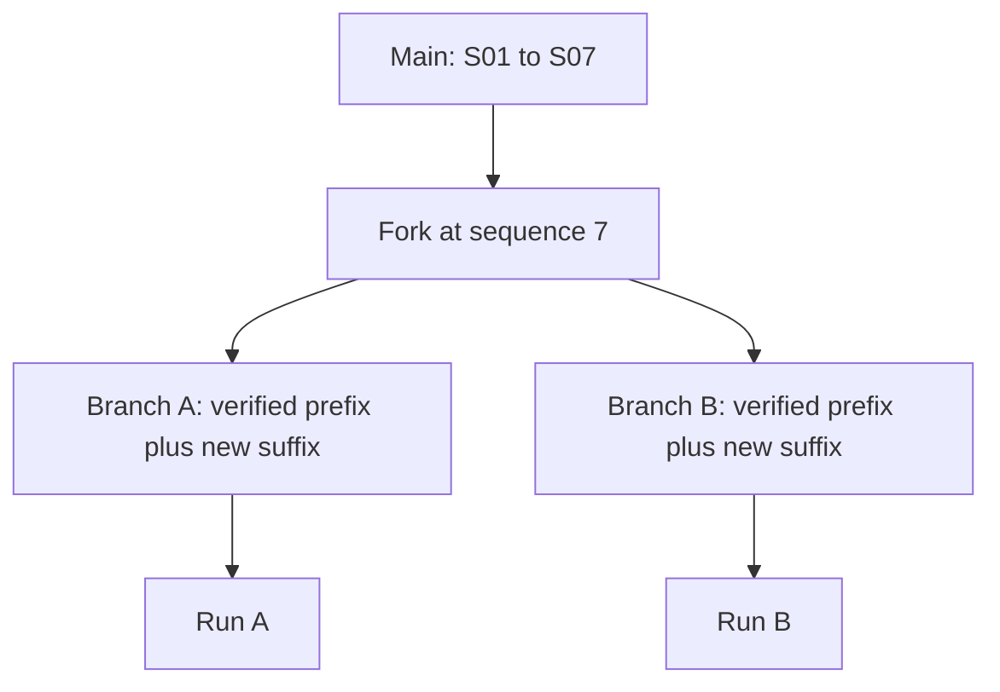

# Storage, branches, and integrity

## Project layout

```text
project.cmne.json
.cmne.lock
fixtures/active.json
contracts/active.json
branches/<branch-id>/story.ndjson
branches/<branch-id>/discourse.ndjson
branches/<branch-id>/evaluation.ndjson
snapshots/<branch-id>.json
drafts/<draft-id>.json
packets/<packet-hash>.json
runs/<run-id>.json
exports/<run-id>.md
```

The metadata file records the name, active branch, parent, fork sequence, and condition labels where present. Fixture and contract are current JSON documents with content hashes. Story and discourse streams contain one event per line. Drafts are mutable JSON; packets, runs, and exports are generated from sealed data.

## Event integrity

An event contains `stream`, `branch_id`, one-based `sequence`, `schema_version`, `payload`, `event_id`, and `integrity_hash`. IDs and hashes come from canonical JSON with sorted keys and SHA-256. On read, the kernel verifies sequence, schema, ID, hash, and duplicate IDs. A same-stream command validates its full event batch before one atomic file replacement; existing sealed lines retain their original bytes. Never edit a sealed stream directly.

The lock records PID, host, and start time. One writer owns it, while a read-only project instance can inspect committed streams. A stale lock is reported and must be cleared explicitly after confirming that its writer stopped. Full replay checks a snapshot against fixture, contract, reducer, event heads, projection data, and content hash; an invalid snapshot is rebuilt by a writer. Snapshot files are caches, not canon. The shipped event schema and reducer are version 2; version-1 story/discourse events gain `source_kind: authored` in memory while their sealed bytes and IDs remain unchanged. Project metadata remains format version 1.

Fixture and contract edits revalidate sealed events and preconditions before replacing their JSON files. A proposed contract that makes an existing crisis invalid is refused and leaves the old contract bytes intact. A failed switch to another project keeps the current project's lock and state.

## Fork semantics



Forking copies a verified story prefix and the initial contiguous discourse acts whose references remain in that prefix into a new branch. It stops copying discourse at the first act that refers beyond the prefix. The old story suffix becomes editable draft nodes on the new branch. When sealed, those nodes receive new event IDs. `branch.compare` reports common payload prefix, first divergence, counts unique to each branch, and projection hashes. It does not generate a prose diff.

## Reproducibility boundary

Replay reduces fixture, contract, and selected event prefixes into six projections and content hashes. Integer basis points avoid floating-point state in strain and confidence fields. The run saves the packet hash, projection hashes, realizer ID, stages, prose, findings, adapter spend, and a reproducibility record. Canonical model requests and responses live under `cassettes/`; replay checks request and response hashes without a network call. This supports local repeatability; published replication and full evaluation provenance remain future work.
