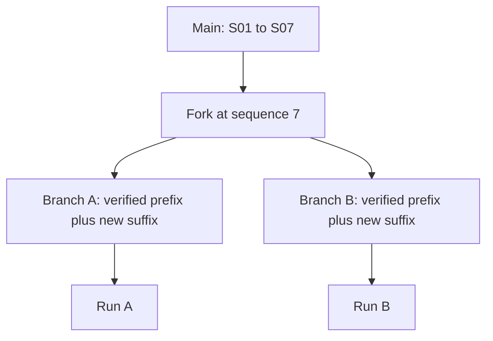

# Storage, branches, and integrity

## Project layout

```text
project.cmne.json
.cmne.lock
fixtures/active.json
contracts/active.json
branches/<branch-id>/story.ndjson
branches/<branch-id>/discourse.ndjson
branches/<branch-id>/evaluation.ndjson
drafts/<draft-id>.json
packets/<packet-hash>.json
runs/<run-id>.json
exports/<run-id>.md
```

The metadata file records the name, active branch, parent, fork sequence, and condition labels where present. Fixture and contract are current JSON documents with content hashes. Story and discourse streams contain one event per line. Drafts are mutable JSON; packets, runs, and exports are generated from sealed data.

## Event integrity

An event contains `stream`, `branch_id`, one-based `sequence`, `schema_version`, `payload`, `event_id`, and `integrity_hash`. IDs and hashes come from canonical JSON with sorted keys and SHA-256. On read, the kernel verifies sequence, schema, ID, hash, and duplicate IDs. Stream writes replace a complete file atomically. A project lock prevents a second writer; normal close removes the lock. Never edit a sealed stream directly.

## Fork semantics



Forking copies a verified story prefix and the initial contiguous discourse acts whose references remain in that prefix into a new branch. It stops copying discourse at the first act that refers beyond the prefix. The old story suffix becomes editable draft nodes on the new branch. When sealed, those nodes receive new event IDs. `branch.compare` reports common payload prefix, first divergence, counts unique to each branch, and projection hashes. It does not generate a prose diff.

## Reproducibility boundary

Replay reduces fixture, contract, and selected event prefixes into six projections and content hashes. Integer basis points avoid floating-point state in strain and confidence fields. The run saves the packet hash, projection hashes, realizer ID, stages, prose, and findings. This supports local repeatability; published replication, adapter cassettes, and full evaluation provenance remain future work.
