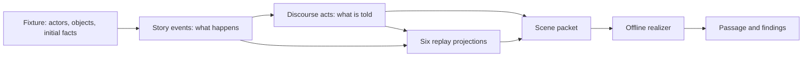

# Coupled Modal Narrative Engine

CMNE Workbench is a local desktop instrument for drafting a bounded fictional scene, tracking what characters and readers can know, and producing an offline prose passage from a discourse plan. It separates **story** (what happens) from **discourse** (the order and form in which a reader encounters it). Its Mara and Len sample compares four kinds of change in Mara's understanding.

!!! info "Implementation scope"
    This site documents the 2026-10-21 local implementation checkpoint. The workbench has a Tauri/React interface and a Python sidecar. The seeded sample produces four deterministic passages of about 800 words and three matched offline composition variants per condition for a blinded study dry run. There is no language-model adapter or completed human study. Pages mark remaining gate work explicitly.

## Choose a route

| If you want to… | Start here |
|---|---|
| Install and run the app | [Install and launch](getting-started/install.md) |
| See the idea in ten minutes | [First run: Mara and Len](manual/first-run.md) |
| Make your own scene | [Build a scene](manual/build-scene.md) and [constructs and rules](manual/constructs.md) |
| Understand the four conditions | [Revise and compare](manual/revise-compare.md) |
| Get the generated passage | [Generate and export](manual/generate-export.md) |
| Interpret a run's status and limits | [Read the result](manual/read-output.md) |
| Extend the Python kernel or sidecar | [API overview](api/index.md) |
| Study architecture and theory | [Design overview](design/index.md) |

## One scene, two orders

**Example.** In story time, Len repairs a chair before he leaves. In telling time, the reader meets the rocking chair after he leaves and learns about the repair later. A later event can change Mara's interpretation of that earlier repair without changing the original event.

## Documentation set

- The **user manual** is task-based. It follows the numbered scenarios S-01 through S-13 and uses labeled information blocks so a reader can find a procedure, rule, or explanation quickly.
- The **design** section explains the implemented state, domain model, processes, storage, and gaps from the target SRS.
- The **API** section covers the Python package, CLI, JSON-RPC sidecar, contracts, errors, and Tauri bridge.

The longer target specifications remain in the repository's `_design/` folder. This site describes the running application and identifies design goals that have not yet shipped.
