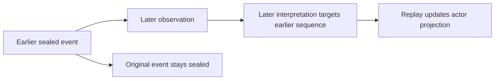

# Constructs and rules

## Concept — the narrative layers

| Layer | Meaning | Sample example |
|---|---|---|
| Fixture | Stable cast, objects, starting facts, style | Mara, Len, chair, bowl |
| Contract | Conditions and limits for a run | Keep a question open; prose word bounds |
| Story | Events in causal/chronological sequence | Chair rocks; Mara sees a note |
| Discourse | Order and manner of telling | A later paragraph remembers the chair |
| Projection | Derived state after replay | Mara's belief, reader disclosure, strain |
| Packet | Bounded input to the realizer | Ordered acts, grounded facts, limits |
| Run | Saved prose and findings | A C3 passage and its Check status |

## Structure — story event

A story event has a title and a kind (`action`, `observation`, `utterance`, `recollection`, `decision`, `revision`, or `crisis`). Optional fields include description, actor/entity IDs, earlier causal parents, world facts, observers, interpretations, revisions, and `strain_bp`.

For an **observation**, identify an observer and `access_path`: `perception`, `testimony`, or `memory`. For a belief revision, point to an earlier event the observer actually observed. A causal parent must already be sealed on that branch.

## Structure — discourse act

A discourse act has a title and a mode: `scene`, `summary`, `ellipsis`, `pause`, `memory`, or `repetition`. `story_refs` link it to sealed story events. `text` is its authored narration; `focalizer` selects a known actor. `reveal` must be grounded in the referenced events' world facts unless the act is marked hypothetical or unreliable. `withhold` cannot name a claim already revealed in a previous act.

## Process — how interpretations change the past

An interpretation records an observer, claim, positive model version, and optional earlier target sequences. It changes the derived mind projection. It does not alter the referenced event. A belief revision records accepted, rejected, or suspended status and confidence in basis points. A modal revision adds possible scenarios; a conceptual revision creates a new model version and migration map. These implemented transitions are basic representations of the richer theory in [Domain model](../design/domain-model.md).

## Principle — authoring boundaries

Edit **Story** and **Discourse** through drafts, then preview and seal. Once sealed, fork to change a story suffix. The other five lenses are read-only views of fixture or derived state. Fixture and contract JSON can be managed through the sidecar API; the current GUI has no direct editors for them.

## Fact — formula language

Preconditions use JSON AST operators `atom`, `not`, `and`, `or`, `implies`, `necessarily`, `possibly`, `believes`, `suspends`, and `in_scenario`. Evaluation can return true, false, or unknown. The validator limits depth to 16 and nodes to 256. See [Data contracts](../api/contracts.md#formula-ast).
