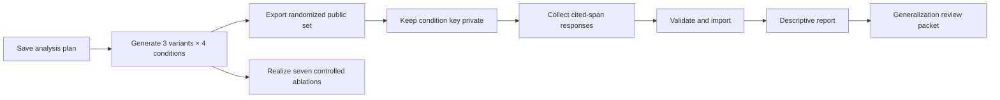

# Prepare and evaluate a blinded comparison — S-07 to S-09

## Concept — what the study tests

The four conditions share S01–S07. C0 adds a fact, C1 corrects a belief, C2 admits another possibility, and C3 revises Mara's conceptual model while leaving the central question open. The reader projection and structural measures are **simulated and descriptive**. Human responses are the evidence for claims about what readers noticed.

The current offline realizer makes three **matched composition variants** per condition. These are deterministic edits of the same authored prose, not independent model generations. A researcher should inspect all twelve candidates and record any rejected candidates before recruiting readers.



## Procedure — freeze the analysis plan

1. Open the Mara and Len sample in the workbench and expand **Evaluation study** under Run analysis.
2. Edit the JSON plan. State hypotheses, the four primary measures, any secondary measures, target sample size and rationale, agreement metric, exclusion rules, and session limit. The example is a **template**, not a preregistered study decision.
3. Choose **Save or amend plan**. The project stores its hash and creation time. A later change creates a linked amendment; the earlier plan remains on disk.

The CLI equivalent is `cmne analysis-plan PROJECT plan.json`. The plan can use `percent_agreement` or `cohen_kappa`.

## Procedure — export the blinded set

1. Choose **Generate 12 matched passages**. The workbench saves variants 0–2 for C0–C3 and checks each run.
2. Choose a randomization seed and select **Export blinded set**.
3. Share only the returned `public` folder. It contains `manifest.json`, `protocol.html`, and each passage as plain text and accessible HTML.
4. Keep the returned key path private. It is stored under `<project>/study/keys/`, outside the public export folder.

From a terminal:

```sh
cmne study-generate /path/to/project
cmne export-evaluation /path/to/project --seed 33
```

Export returns `E-PLAN-001` when no plan exists and `E-STUDY-001` when any condition lacks three passing, textually distinct candidates. The public files contain opaque passage IDs and no condition labels.

## Procedure — collect and import responses

Give evaluators the public `protocol.html`. It asks for an earlier detail and cited span, preparedness rating, resolution classification, and a paired ranking or **no discernible difference**. Use pseudonymous evaluator IDs. Respect the plan's session limit.

Save responses in a JSON object with a `responses` array. Each row needs:

| Field | Value |
|---|---|
| `evaluator_id` | Pseudonymous ID, 3–48 safe characters |
| `passage_id`, `text_version` | Values from the public manifest |
| `paired_ranking` | `first`, `second`, `tie`, or `not_shown` |
| `free_response` | Evaluator's own words |
| `cited_spans` | Array of `{start, end, earlier_detail}` using character offsets in the plain text |
| `confidence_bp` | Integer from 0 to 10000 |
| `no_discernible_difference` | Boolean |
| `preparedness_rating` | Integer 1–5 |
| `resolution_class` | `meaningful`, `confusing`, or `neither` |

Enter the study ID and response JSON path in the workbench, then choose **Import responses**. Or run `cmne responses-import PROJECT STUDY_ID responses.json`. The entire batch is checked before it is saved; a malformed row reports a field path and leaves the stored response set unchanged. The private key adds the condition after import.

## Procedure — read the report

Choose **Generate report** or run `cmne report PROJECT STUDY_ID`. The JSON report is saved under `<project>/study/reports/`. It includes primary measures, C3–C0 contrasts and 95% intervals, inter-rater agreement when repeated ratings exist, candidate and rejection counts, contrary results, and null-result alternatives.

An empty or small response set can produce `null` estimates or unstable intervals. Percent agreement uses all rater pairs for a passage. Cohen's kappa is reported only when paired passages have exactly two ratings; extra raters produce an explicit not-computable reason. Interpret these as limits of the available data. The report does not certify an epiphany or literary quality.

## Procedure — inspect ablations and prepare a decision

1. Select the C3 branch and choose **Realize seven ablations for this branch**. The saved records are under `<project>/study/ablations/<branch>/`. Each has the changed-stream hash, packet hash, passage text and hash, checker findings, and a link to the baseline text hash. Some deliberately altered passages fail checks; keep those rejections in the audit trail.
2. After exporting a study, choose **Build generalization review packet**, or run `cmne decision-packet PROJECT STUDY_ID`. The packet is saved under `<project>/study/decision-packets/` and joins C0–C3 structural measures, ablations, response counts, effects, and null/contrary outcomes.
3. Treat `pending_human_review` as a handoff status. The packet does not decide whether the literary hypothesis succeeded or whether the project should generalize. That judgment and release sign-off are Milestone 9.

The CLI ablation command is `cmne study-realize-ablations PROJECT --branch C3_BRANCH_ID`. It works on copies of the sealed streams and does not alter canon. The sample ablations are controlled authored edits; they are comparison material for review, not independent model generations.

## Reference — structural checks

`cmne study-metrics PROJECT --branch ID` returns Layer A blocking findings and Layer B descriptive measures, including strain, reinterpretation depth, evidence availability, and motif recurrence. `cmne study-ablations PROJECT --branch ID` lists seven in-memory changes with stable hashes. `cmne study-realize-ablations` saves their passages and findings. Both operations leave canon unchanged.
