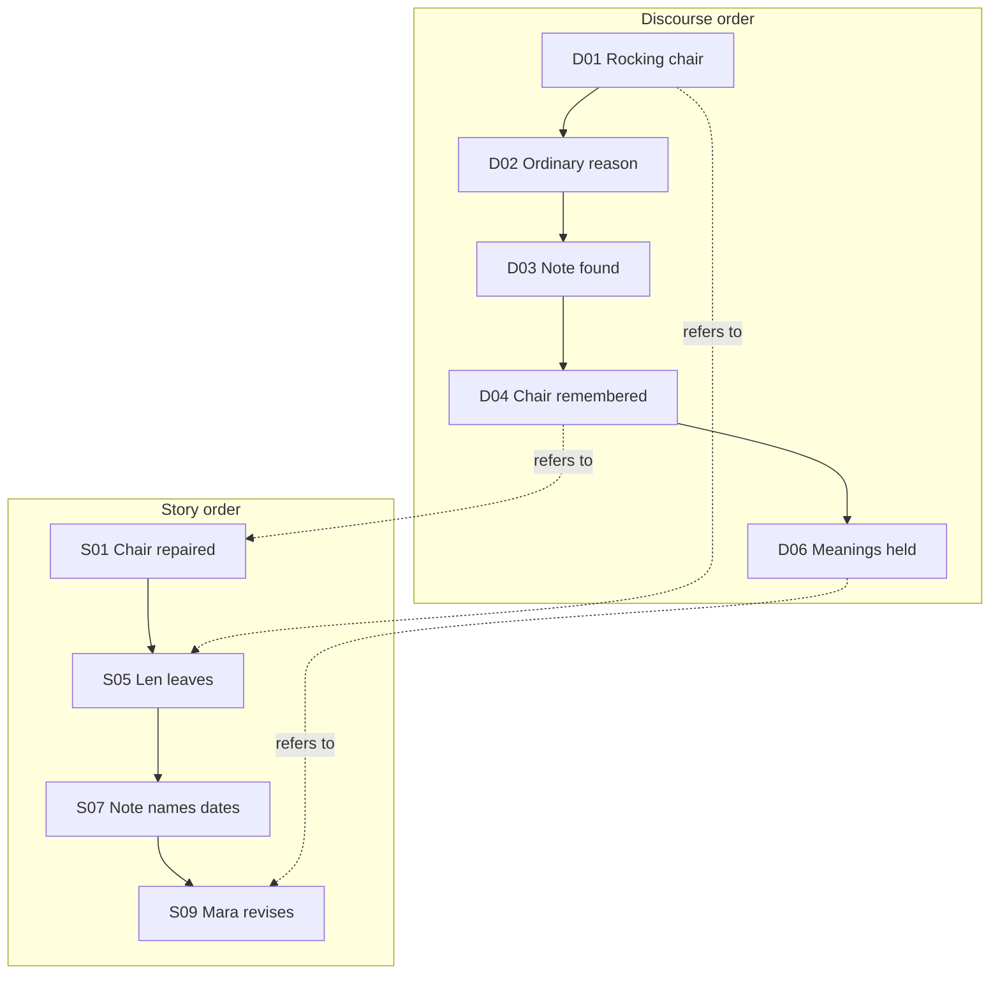

# S-01 · See Mara and Len run

## Concept: the bounded experiment

Mara tries to understand Len's leaving. A repaired chair, a blue bowl, and a note become evidence that can be read in more than one way. The sample contains story events S01–S10 and discourse acts D01–D07. Four branches share S01–S07 and diverge at the interpretation of what Mara has learned.

| Condition | Change represented in the sample | Question to ask while reading |
|---|---|---|
| C0 | A new external fact | What does the address settle, and what does it leave open? |
| C1 | A belief is rejected | Which inference does Mara stop making? |
| C2 | Another possibility becomes admissible | Can care and departure coexist? |
| C3 | A concept divides and remains unresolved | Do the chair and bowl change meaning without changing as facts? |

These are experimental **design conditions**, not evidence that one passage is better literature. The present offline sample uses authored prose; it does not call a model.

## Procedure: run the sample

1. [Launch the app](../getting-started/install.md). The first launch opens **Mara and Len · The chair and the bowl**. If another project opens, choose the project name at the top and select **Open bundled Mara and Len sample**.
2. In the **Story** lens, select the chair repair, departure, note, and crisis events. The inspector shows each event's canonical fields.
3. Click **Run C0–C3**. The run is synchronous; wait for the result. The **Pipeline** lens then shows seven recorded stages for each condition.
4. Choose a C3 branch in the left sidebar. In **Latest Run**, open **Read generated passage**. Read the final paragraphs about the chair and bowl.
5. Switch to C1 and read its passage. Use **Compare branches** for the shared prefix and first diverging sequence.

**Result.** Each seeded condition yields a deterministic passage of roughly 800 words and a saved run. A previous short run record remains until you run again after installing an updated build.

## Structure: seven lenses

| Lens | Main question | Current use |
|---|---|---|
| Fixture | Who and what are present? | Inspect actors and objects |
| Story | What happened? | Draft, seal, fork, inspect causal and retrospective edges |
| Discourse | In what order is it told? | Draft telling acts and connect them to story events |
| Mind | What does an actor believe or consider possible? | Inspect basic belief, scenario, model, and interpretation nodes |
| Provenance | Which event supports a claim? | Inspect a basic evidence/claim graph |
| Motif | Where do marked objects recur? | Inspect basic appearances of the chair and bowl |
| Pipeline | What did a run record? | Inspect completed stage status per condition |

## Process: story versus telling

The chart shows why the reader can meet the effect before learning the cause. [Domain model and theory](../design/domain-model.md) explains the distinction in more detail.
