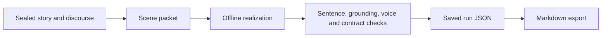

# Generate and export a passage — S-04

## Concept — generation in this release

A **run** reads the selected branch's sealed story and discourse, builds a scene packet, assembles prose with the offline deterministic realizer, and checks the result. It does not call a language model. A run saves its result separately from the sealed events; running again does not edit canon.

## Process — from plan to report



## Procedure — generate the sample

1. Open **Mara and Len** and select a C0–C3 branch.
2. Select **Run scene** for that branch, or **Run C0–C3** for all four sample conditions. The workbench shows progress while committed state remains readable; **Cancel run** stops at the next condition boundary.
3. Read the passage and run status in the passage/pipeline views. For all four, select each branch to inspect its own passage.
4. If the status is **failed**, read the finding and correct the named story, discourse, or contract issue. Fork first if the correction changes a sealed event.
5. Run again. The newest run is the one used by export for the selected branch.

## Procedure — export the story

1. Select the branch whose passage you want.
2. Run that branch at least once.
3. Choose **Export report** in the workbench.
4. Open the returned Markdown file at `<project>/exports/<run-id>.md` in any text or Markdown editor. The report contains the project title, run ID, status, passage, and findings.

The export is a Markdown report. For a plain story, copy the text under **Passage**. The run's complete machine-readable record remains at `<project>/runs/<run-id>.json`.

## Procedure — generate from the command line

```sh
source .venv/bin/activate
cmne run "/path/to/project" --branch main
```

The CLI prints run JSON, including `prose`, `status`, and `findings`. It does not create the Markdown report; use the desktop **Export report** action or the sidecar's [`export.report`](../api/json-rpc.md#run-and-export).

## Principle — writing a custom scene

For a new project, the realizer joins nonempty discourse `text` in discourse order, separated by blank lines. If an act has no text, it falls back to the descriptions or titles of its referenced story events. Write the desired narration in the discourse acts and use `story_refs` to keep each act tied to sealed events. The 700–1,100-word authored expansion belongs only to the unchanged Mara and Len seed; an edited cue or a new project uses its own text.

## Fact — what the checker tests

The implemented checker records sentence annotations and deterministic findings for word bounds, forbidden assertions, some unsupported claims and entities, causal claims, another actor's private cognition in close focalization, premature literal disclosures, explicit resolution of the sample's open question, and voice limits. Its language rules are conservative and can miss paraphrases or misclassify a sentence. Read the passage yourself for voice, continuity, and grounding. See [Read the result](read-output.md).
