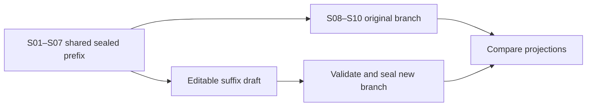

# S-03, S-05, S-06 · Revise and compare

## Concept: three levels of revision

The Mara/Len conditions isolate different changes. **Belief revision** changes the status of one claim; **modal revision** adds a possible scenario; **conceptual revision** changes the model's vocabulary or interpretation map. The current kernel implements basic transitions for all three, but the full formal operators and revision planner in the target design are not built.

| Condition | In the sample | What remains unchanged |
|---|---|---|
| C1 belief | Mara rejects “The repairs are care.” | Earlier chair and bowl events |
| C2 modal | Mara admits “care and departure coexist” as a scenario. | Earlier facts and their event IDs |
| C3 conceptual | Mara's model moves to v2; `care` maps to `care` and `avoidance`, with unresolved terms. | Earlier story events; new interpretation records point back to S01 and S02 |

## Procedure: fork a sealed event

1. In **Story**, select the sealed event where the alternative should begin.
2. Click **Fork from here** and name the branch. The new branch keeps the sealed prefix before that event and opens draft copies of the selected event and its suffix.
3. Edit the draft copies in the inspector, add or remove draft nodes, and check their causal connections.
4. Click **Seal draft**. The source branch remains intact; the new branch gets its own suffix.
5. Run the new branch and compare it with the source branch.

**Result.** The branch comparer reports shared prefix length, first diverging sequence, suffix counts, and projection hashes. It does not yet show the designed graph diff overlay.

## Process: safe alternative history

**S-05 example.** To ask whether the chair's rocking matters, select the event where it appears, fork, remove its draft copy, and repair later references or preconditions before sealing. The old branch remains available for comparison. The current editor does not provide a one-click visual diff.

## Procedure: compare C1 and C3

1. Run **C0–C3** from the seeded sample.
2. Select C1 in the left branch list. Click **Compare branches** and choose C3.
3. Read the shared prefix and first difference in the comparison panel.
4. Switch between branches in **Mind** and **Story**. On C3, inspect the model v2 node and the retrospective links to S01/S02. In C1, inspect the rejected belief.
5. Read each passage and note what changed for the character, then what changed for the reader. [Read the result](read-output.md) explains the limits of that comparison.

## Principle: an interpretation is not a new fact

Mara can reinterpret the chair repair under model v2 while S01 still says the same thing happened. A different interpretation may change the significance of an event without editing the event's canon. Keep that distinction when writing the prose and when comparing conditions.

## Fact: sample prose on edited branches

The long authored expansion is used only when the Mara/Len fixture and story still match a seeded condition and its discourse cues are unchanged. If canon changes, the offline realizer uses the branch's authored discourse text. This prevents the seed's prepared prose from describing a different event as if it were still true.
